> **Intent:** Find the real cost and latency differences between hot, cool, cold and archive tiers, and what rehydrating an archived blob actually involves.

> **Status:** complete. Built and tested in the portal. Lifecycle walk and bill read. Rebuilt in Bicep and verified. Torn down 11 Nov 2026.

## What this lab is

Azure Blob Storage keeps files ("blobs") in four **access tiers**. The colder
the tier, the cheaper it is to *store* a file and the dearer it is to *read*
it back. Archive is so cold the file is offline: it cannot be read at all until
Azure brings it back, which takes hours.

Picking the wrong tier is one of the easiest ways to waste money in Azure,
either by paying hot prices for data nobody reads, or by archiving data that
then has to be pulled back in a hurry.

## Questions

1. **What does each tier really cost:** to store a file, and to read it back?
2. **What happens when you try to open an archived file,** and what does it
   take, in time and money, to get it back?
3. **What does moving a file to a colder tier too early cost?** Cool, cold and
   archive each have a minimum stay.
4. **Once the account's master keys are switched off, who can still read the
   files?** Owner manages the account, but reading data needs a separate data
   role. (Added mid-lab after spotting that the portal quietly uses the key.)

### Predictions (written before building)

| # | My prediction | What actually happened |
|---|---|---|
| 1 | Cool. | Not measurable at this size. Storing a few kilobytes in any tier rounded to nothing; every cent on the bill came from reading, writing and rehydrating, not from keeping (Cost). |
| 2 | It is first moved out of archive, through cold and cool to hot, and only then can be read. | Half right. It cannot be read until it is brought back online (step 4), but there is no stepping through tiers: it goes straight to whichever online tier is chosen. |
| 3 | You pay for one day. | Wrong way round. You pay for the days you *did not* stay: a **Cold LRS Early Delete** line appeared for leaving Cold after 3 of its 90 days. For a few kilobytes it came to $0.0000000072 (Cost). |
| 4 | No. Owner cannot open the files once keys are off. | Correct. Owner manages the account but has no data rights; reading needed a separate data role (step 10). |

## Key ideas, from zero

| Term | Plain meaning |
|---|---|
| **Storage account** | The top-level container for storage in Azure. Its name becomes part of a public web address, so it must be unique worldwide. |
| **Container** | A folder inside the account that holds blobs. |
| **Blob** | One file. |
| **Access tier** | Hot, Cool, Cold or Archive. Set per blob; the account has a default for new blobs. |
| **Hot** | Data read often. Highest storage price, lowest read price. |
| **Cool / Cold** | Data read rarely. Cheaper to store, dearer to read, with a minimum stay (cool 30 days, cold 90). |
| **Archive** | Data almost never read. Cheapest to store, **offline**, minimum stay 180 days. |
| **Rehydration** | Bringing an archived blob back online by moving it to a warmer tier. Standard priority can take up to 15 hours; High priority is faster and costs more. |
| **Early deletion charge** | Move or delete a blob before its tier's minimum stay and you pay for the remaining days anyway. |
| **Lifecycle management** | Rules that move or delete blobs automatically by age, e.g. "cool after 30 days, archive after 180". |
| **Redundancy (LRS)** | How many copies Azure keeps. Locally redundant storage keeps three copies in one datacentre: the cheapest option, and one that supports the archive tier. |

## Architecture

Figure 2.2 shows every resource in the lab and how they connect.

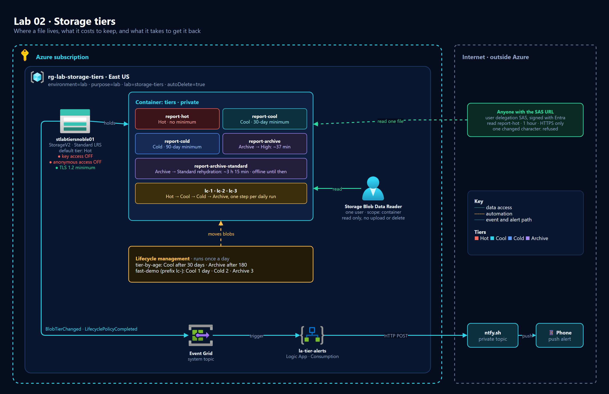

*Figure 2.2: Lab 02 architecture: storage account, container, lifecycle rules, data access and the alert pipeline. Source: [`diagrams/architecture.drawio`](https://github.com/noble-antwi/az-104-labs/blob/master/02-storage-tiers/diagrams/architecture.drawio), editable in
[draw.io](https://app.diagrams.net). Rendered with
[`scripts/diagrams/render_drawio.py`](https://github.com/noble-antwi/az-104-labs/blob/master/scripts/diagrams/render_drawio.py).*

## What gets built

| Resource | SKU / setting | Why it's here |
|---|---|---|
| `rg-lab-storage-tiers` | resource group, East US | holds the lab |
| `stlabtiersnoble01` | StorageV2, Standard, **LRS**, default tier Hot | LRS is the cheapest redundancy that supports archive |
| Container `tiers` | private | no anonymous access |
| Four report files | one per tier, identical content | only the tier differs |
| `report-archive-standard.txt` | Archive | second archived file, to time Standard against High rehydration |
| `lc-1.txt` to `lc-3.txt` | Hot at upload | watched by the fast lifecycle rule |
| Lifecycle rules | `tier-by-age` 30/180 days, `fast-demo` 1/2/3 days | automated tiering, one realistic and one fast enough to watch |
| Logic App `la-tier-alerts` | Consumption | turns tier-change events into phone alerts |
| Event Grid system topic | created by the Logic App trigger | routes storage events |
| Role assignment | Storage Blob Data Reader on `tiers` | data access once the master keys were switched off |

## Build it in the portal

### 1. Create the storage account

`stlabtiersnoble01` in a new group `rg-lab-storage-tiers`, East US. The
portal now asks for a **primary service** (Blob Storage) and a **primary
workload**; **General purpose** was chosen because the workload presets quietly
change defaults on later tabs. Choosing it also reset the resource group to
`NetworkWatcherRG`, which had to be put back: re-check earlier fields after
changing a preset (Figure 2.3).

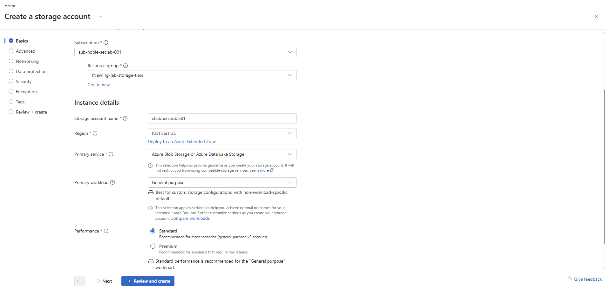

*Figure 2.3: Create storage account, Basics tab.*

Standard performance, **LRS** redundancy (three copies in one datacentre: the
cheapest, and it supports archive). The portal recommends RA-GRS for general
purpose, which copies to a second region; a lab does not need it.

**The default access tier offers Hot, Cool and Cold, but not Archive.** The
account default applies to every new blob, and an archived blob is offline, so
it cannot be the default. Archive is set per blob (Figure 2.4).

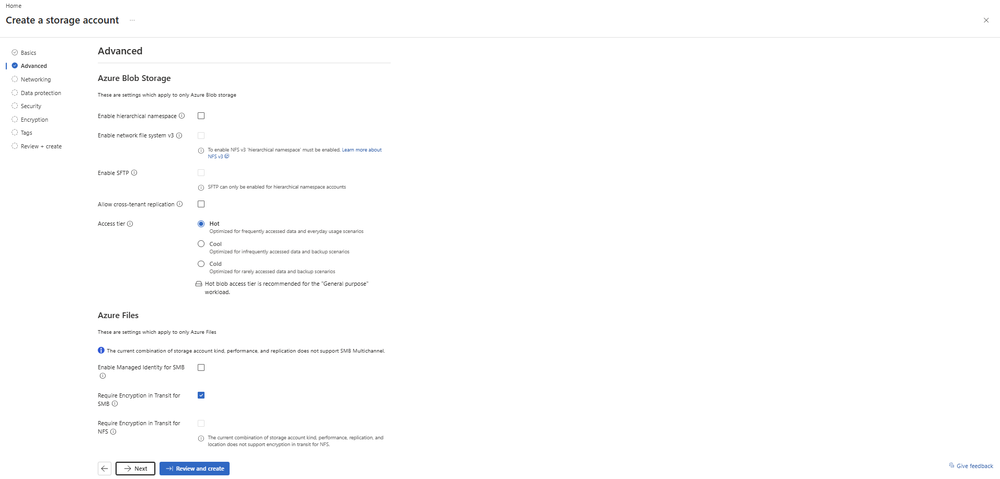

*Figure 2.4: Advanced tab: the default access tier offers Hot, Cool and Cold, but not Archive.*

The other tabs, and why each was left as it was:

| Tab | Setting | Why |
|---|---|---|
| Advanced | Hierarchical namespace **off** | Real folders (Data Lake Gen2) are for analytics; cannot be turned off once on |
| Networking | Public network access, all networks | Reachable is not readable: every request still needs a key or a sign-in. Private access is lab 15 |
| Data protection | Soft delete 7 days on; versioning, change feed, immutability off | A recycle bin, without extra copies that would cloud the tier results. Soft-deleted data is still billed |
| Security | Anonymous access **off** (now the default), secure transfer, TLS 1.2 | No unauthenticated reads |
| Security | Storage account key access **on** | Kept on for now; part 4 turns it off |
| Encryption | Microsoft-managed keys | Data is always encrypted at rest; this only decides who holds the key |

Figures 2.5 to 2.9 show each of those tabs as submitted.

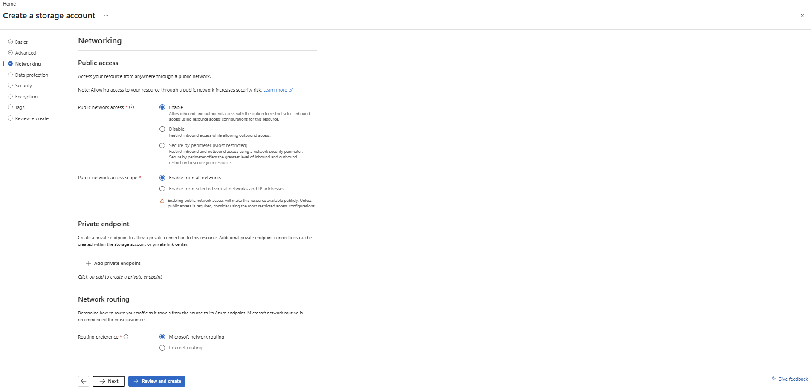

*Figure 2.5: Networking tab.*

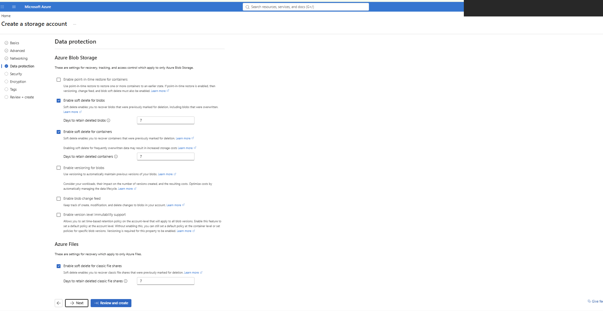

*Figure 2.6: Data protection tab.*

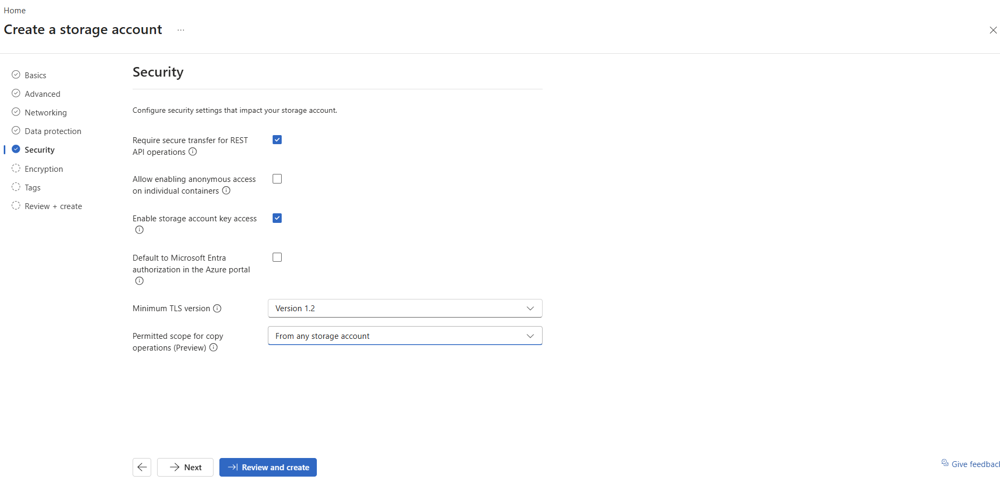

*Figure 2.7: Security tab.*

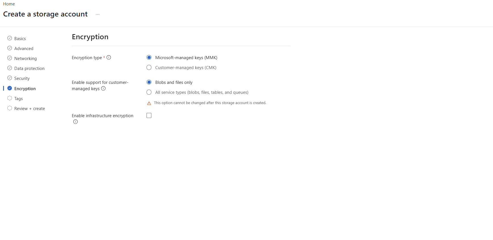

*Figure 2.8: Encryption tab.*

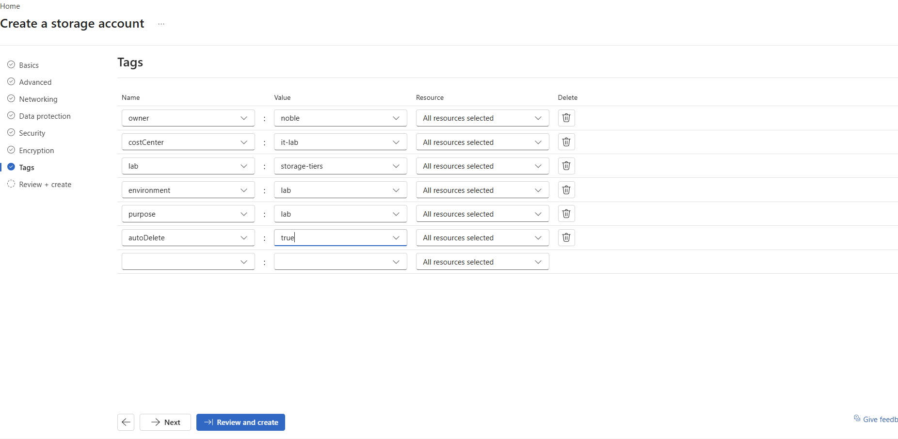

*Figure 2.9: Tags tab: the lab tags.*

The review page shows the six tags applied to the storage account **and** to
resource types this deployment did not create (virtual network, private
endpoint): the portal's tag picker defaults to "all resources selected" for
anything the template could include (Figures 2.10 and 2.11).

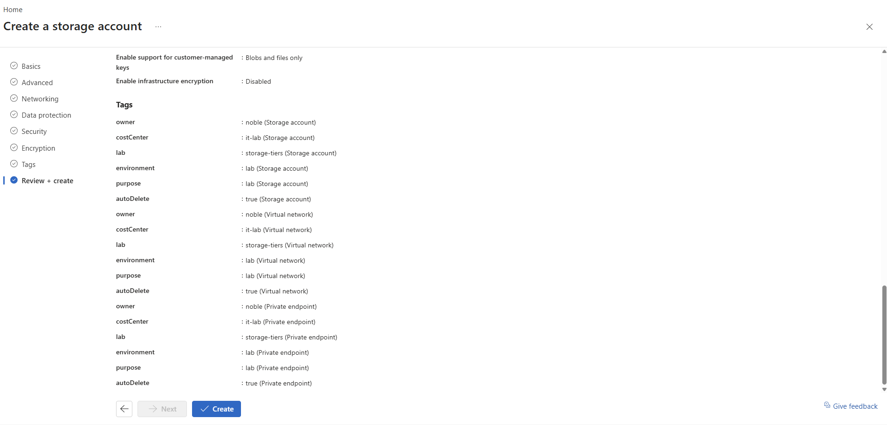

*Figure 2.10: Review: tags applied per resource type.*

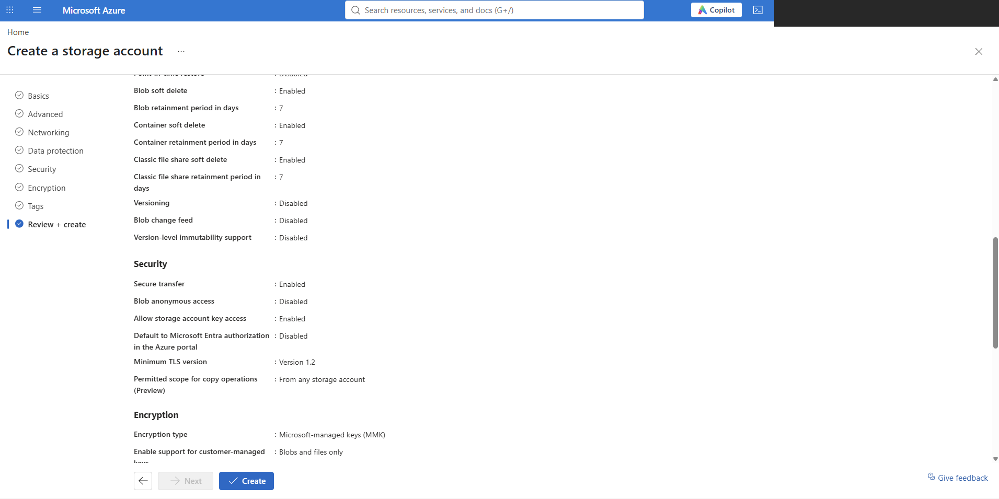

*Figure 2.11: Review + create summary.*

### 2. Create a container

A container is the top-level grouping for blobs: a security boundary (access
can be granted per container), a boundary for lifecycle and immutability rules,
and the equivalent of an S3 bucket. Containers do not nest.

`tiers` was created **Private**, and the access level was greyed out because
anonymous access is off for the whole account (Figure 2.12).

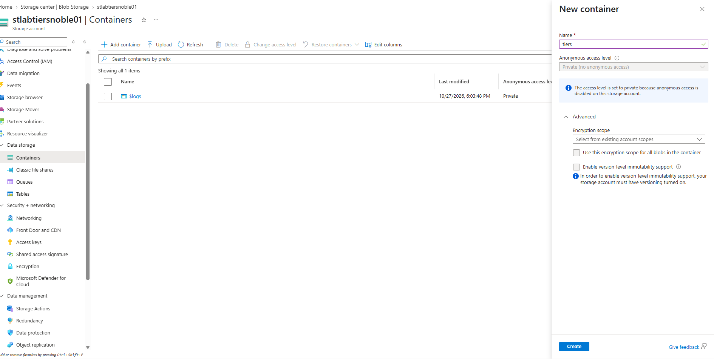

*Figure 2.12: New container: anonymous access greyed out, so the container is private.*

A second container, **`$logs`**, appeared without being created. It is a
system container Azure reserves for storage analytics logs (Figure 2.13).

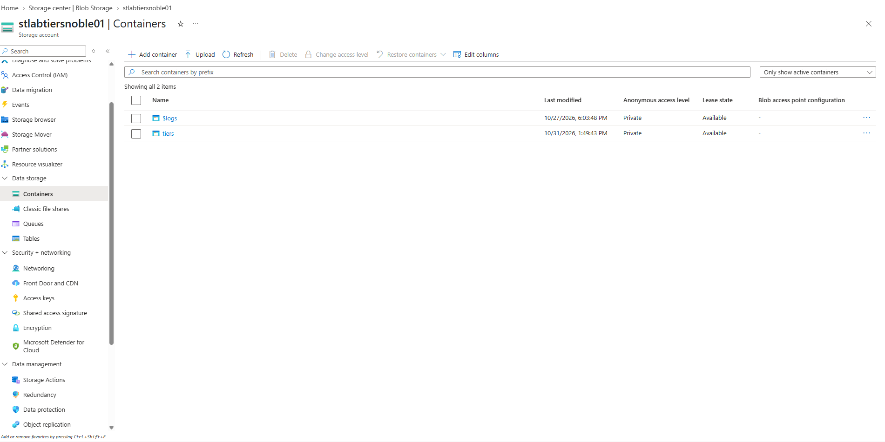

*Figure 2.13: Containers: the system container $logs next to tiers.*

### 3. Upload one file per tier

The four files in [`sample-files/`](https://github.com/noble-antwi/az-104-labs/tree/master/02-storage-tiers/sample-files) are identical apart from one
word, so the only real difference between them is the tier. Each was uploaded
on its own, with the tier set under **Advanced**.

The tier list offers **Hot (Inferred)** as well as **Hot**. *Inferred* means
the blob has no tier of its own and follows the account default; if that
default later changed to Cool, the blob would silently change with it. Plain
**Hot** pins the tier to the blob. **Archive** is offered here, per blob, even
though the account default cannot be Archive. **Smart** (automatic tiering by
access pattern) was listed but greyed out (Figures 2.14 and 2.15).

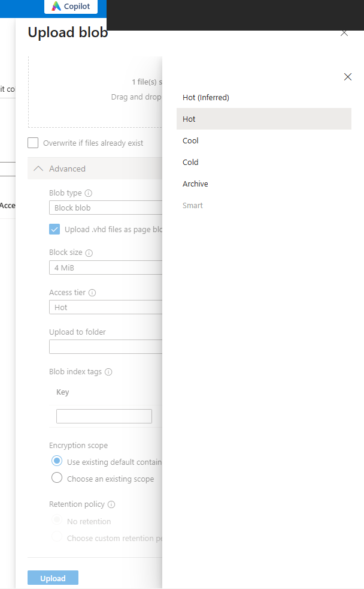

*Figure 2.14: Upload: the access tier choices for a blob.*

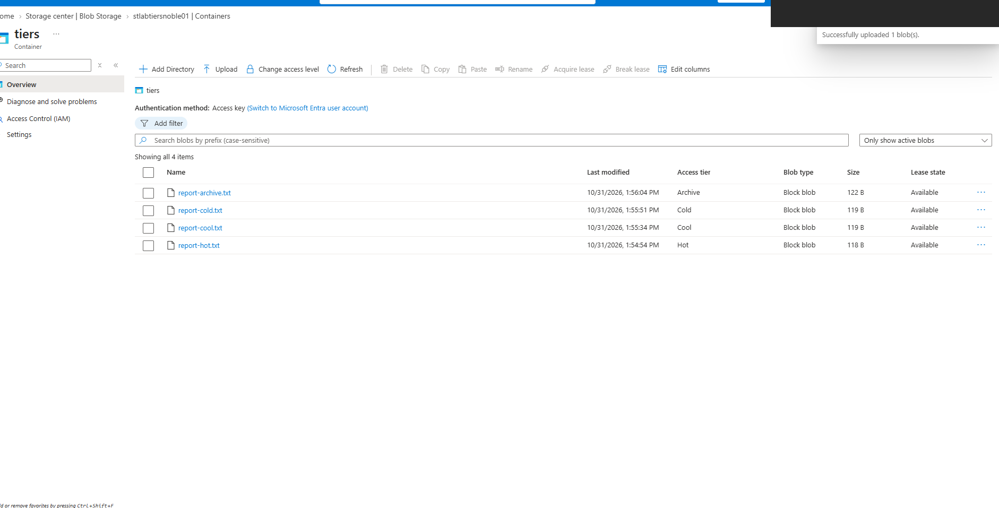

*Figure 2.15: The container with one file in each tier.*

The container page reads **Authentication method: Access key**: the portal was
using the account's master key behind the scenes, not the signed-in user.

### 4. Try to open each file

Hot, Cool and Cold all opened in the portal editor straight away, with the same
content. From the reader's side, the online tiers behave identically; only the
bill differs (Figures 2.16 to 2.18).

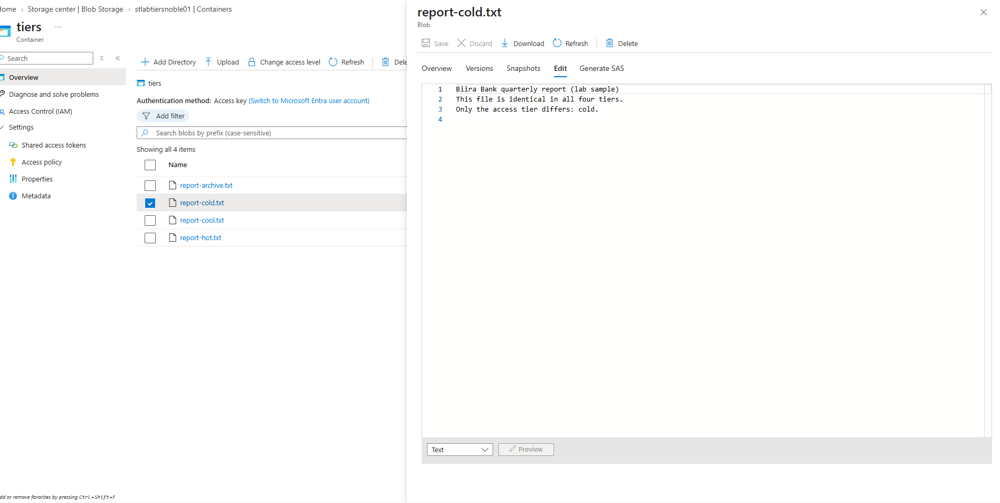

*Figure 2.16: Report-cold.txt opens straight away.*

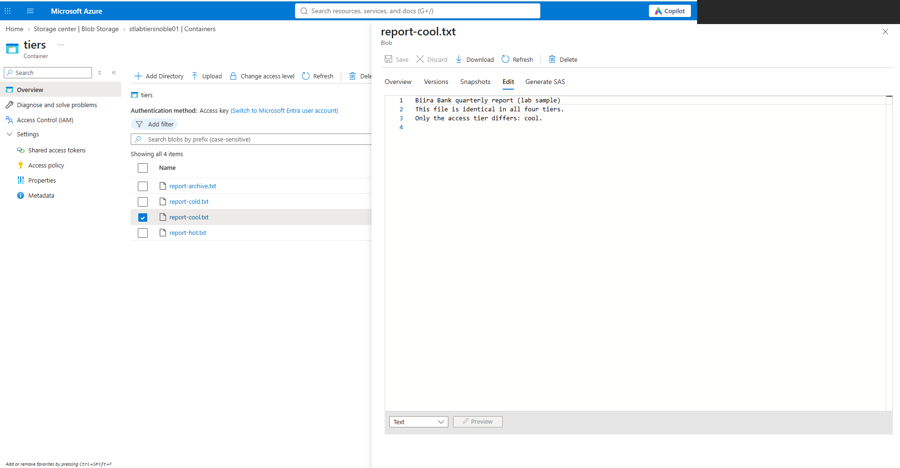

*Figure 2.17: Report-cool.txt opens straight away.*

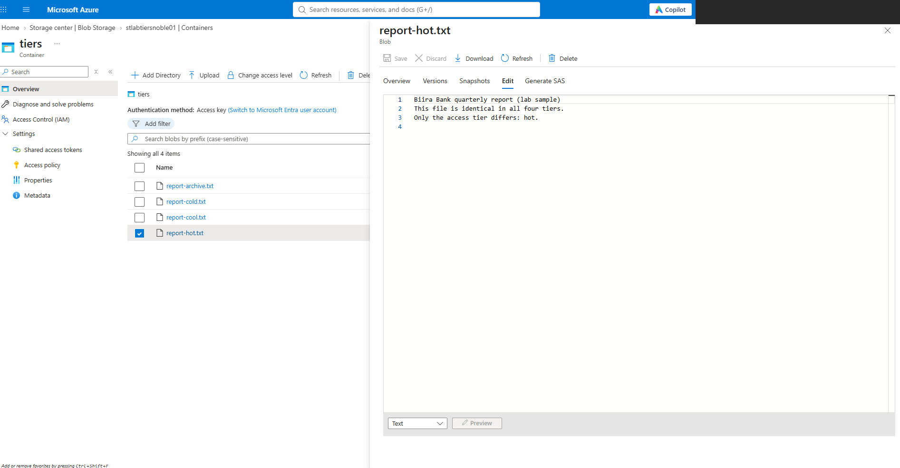

*Figure 2.18: Report-hot.txt opens straight away.*

The archived file did not open, and would not download (Figures 2.19 and 2.20):

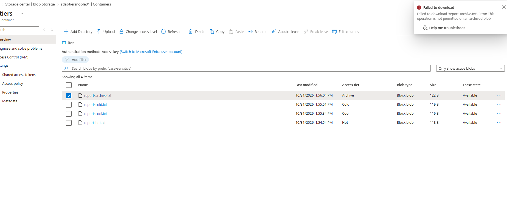

*Figure 2.19: Downloading the archived file fails.*

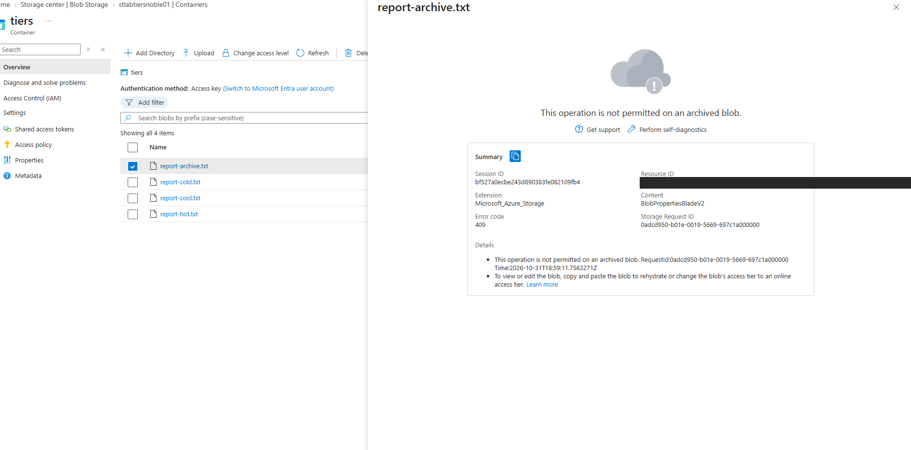

*Figure 2.20: The portal refuses: not permitted on an archived blob.*

> This operation is not permitted on an archived blob. To view or edit the blob,
> copy and paste the blob to rehydrate or change the blob's access tier to an
> online access tier.

The data is still there and still billed; it is offline. The message also names
the **two** ways back: change the blob's tier, or copy it to a new blob in an
online tier. Neither steps through Cold and Cool on the way: the target can be
any online tier directly.

### 5. Rehydrate: High versus Standard priority

A second file, `report-archive-standard.txt`, was archived so both speeds could
run side by side. Each was moved back to **Hot** with **Change tier**, one at
each **rehydrate priority**. The portal warns: *"Rehydrating a blob from
Archive to Hot or Cool may take several hours to complete."* (Figures 2.21 and 2.22)

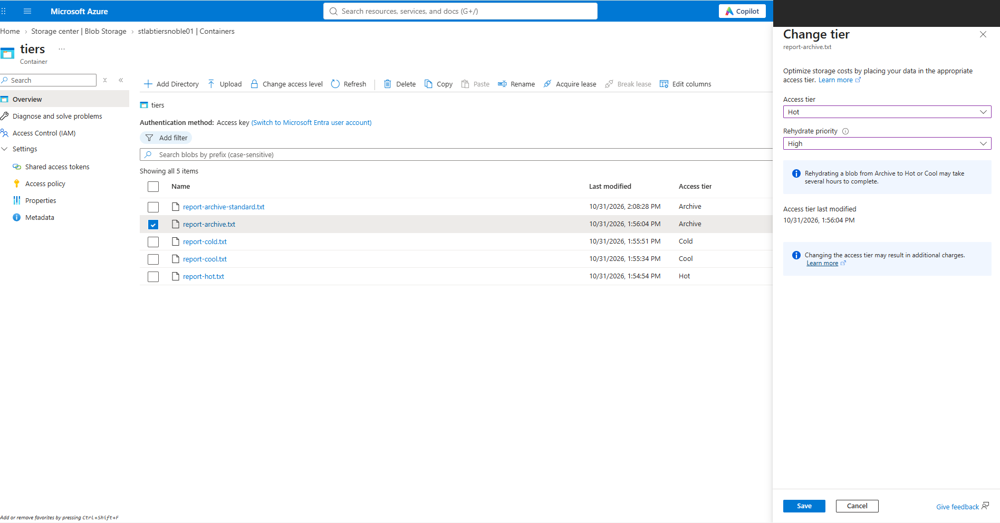

*Figure 2.21: Rehydrate to Hot, High priority.*

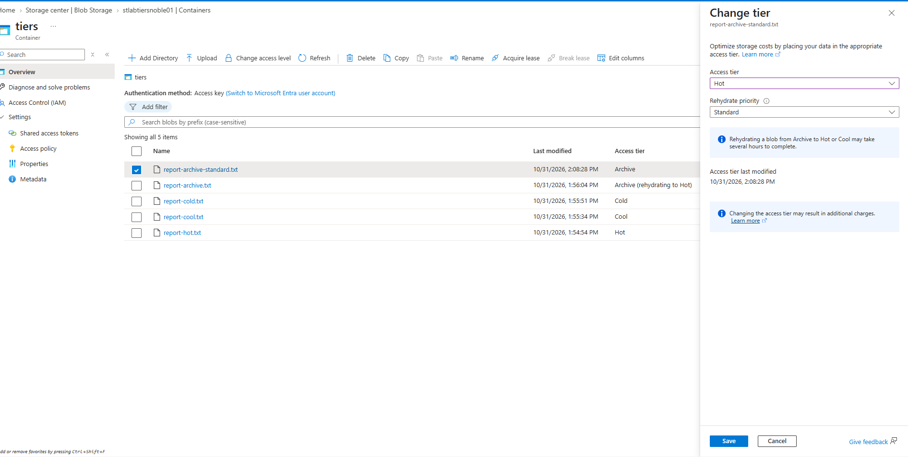

*Figure 2.22: Rehydrate to Hot, Standard priority.*

Both started at 19:10 UTC (20 seconds apart) and immediately read
**Archive (rehydrating to Hot)**: still archive, still unreadable, until the
copy back online finishes (Figure 2.23).

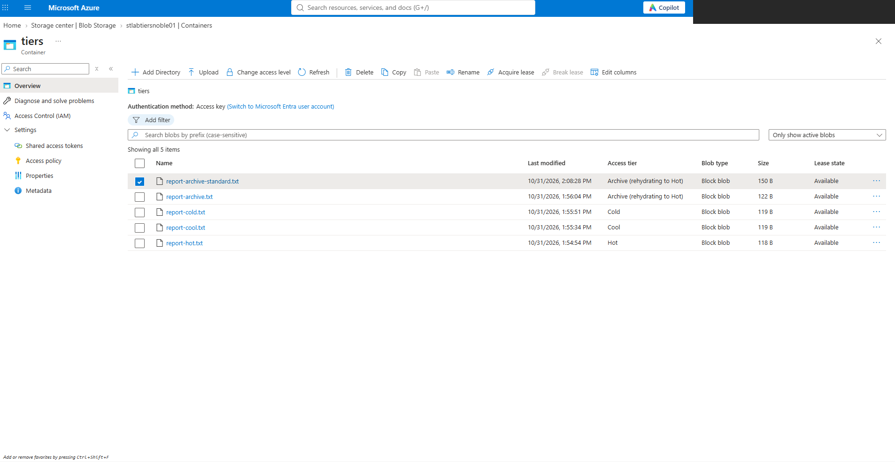

*Figure 2.23: Both archived files showing a pending rehydration.*

Prediction: High within an hour, Standard several hours. Both correct: High ≈ 37 minutes, Standard ≈ 3 h 15 min, far inside its 15-hour ceiling.

| File | Priority | Started (UTC) | Online (UTC) | Took |
|---|---|---|---|---|
| `report-archive.txt` | High | 19:10:03 | ≈ 19:47 | **≈ 37 minutes** |
| `report-archive-standard.txt` | Standard | 19:10:23 | ≈ 22:21 to 22:25 | **≈ 3 h 15 min** |

Status was read every two minutes with `az storage blob show`, so the High
finish time is accurate to about two minutes; Standard was checked every five.

### 6. A lifecycle rule

Moving files by hand does not scale. **Lifecycle management** applies rules
once a day: `tier-by-age` moves blobs to Cool **30 days** after their last
modification and to Archive at **180 days**, both counted from the same last
change (180 is not 30 + 180). Changing tier does not count as a modification;
editing a file resets the clock (Figure 2.24).

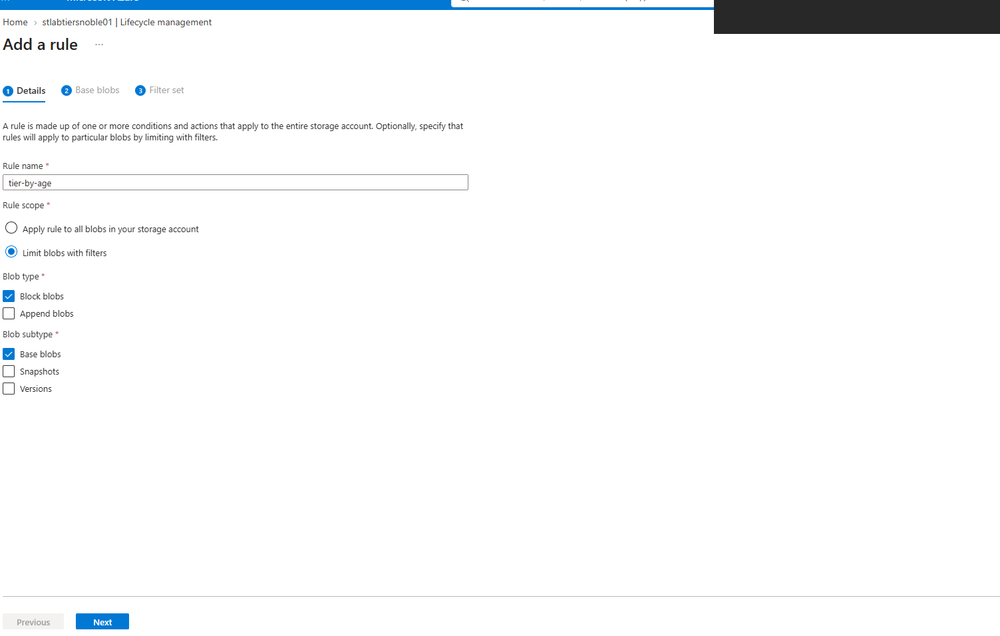

*Figure 2.24: Lifecycle rule tier-by-age: details.*

*Base blobs* means the current file, as opposed to snapshots or old versions;
real policies often add separate rules to expire old versions, which pile up
unseen. *Skip blobs rehydrated in the last 7 days* stops a rule from
re-archiving a file someone has just brought back (Figures 2.25 and 2.26).

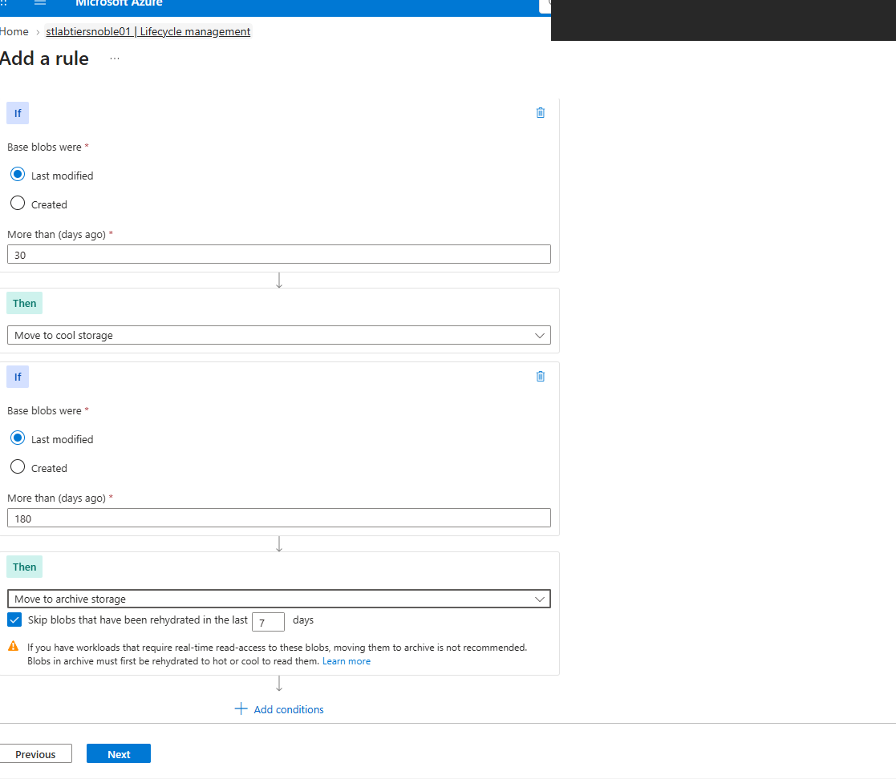

*Figure 2.25: Tier-by-age: Cool after 30 days, Archive after 180.*

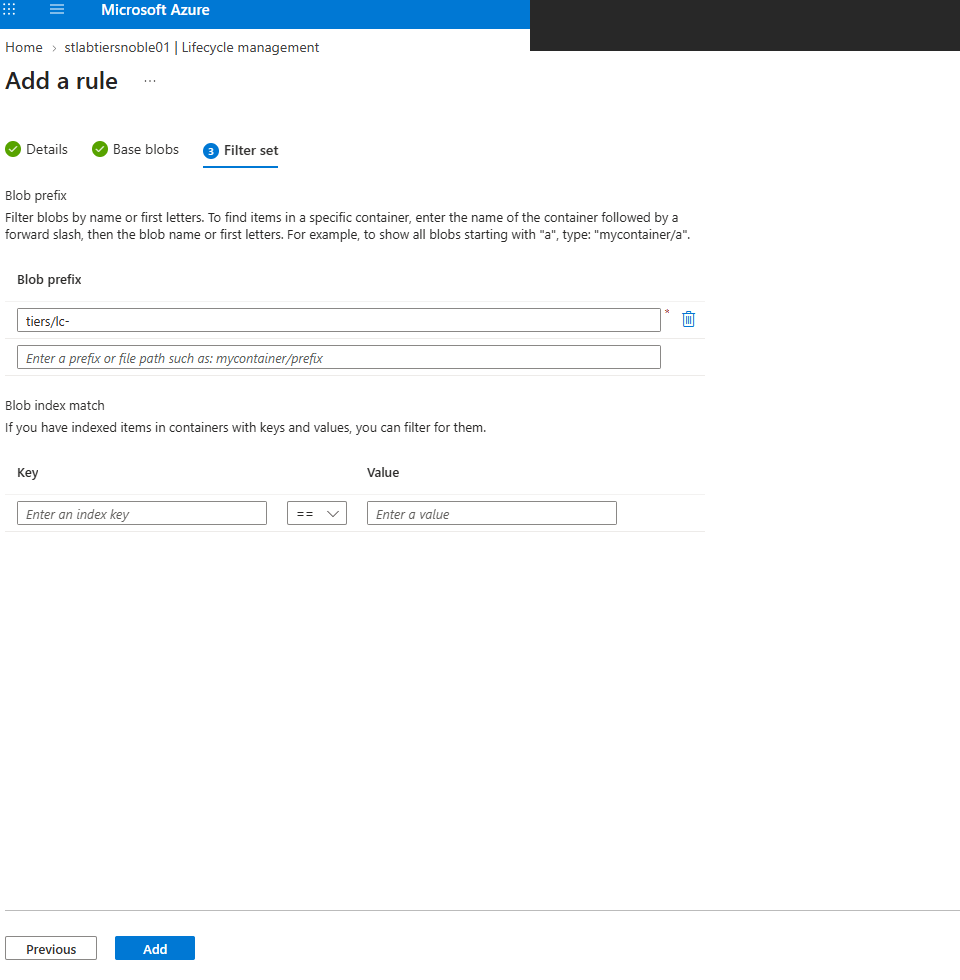

*Figure 2.26: Tier-by-age: prefix filter.*

The prefix `tiers/lc-` limits the rule to files whose names start with `lc-`,
so the four test files are untouched. A new rule *"can take up to 24 hours to
go into effect"*, and at 30 days it would never fire within a one-day lab: the
rule can be seen, not watched (Figure 2.27).

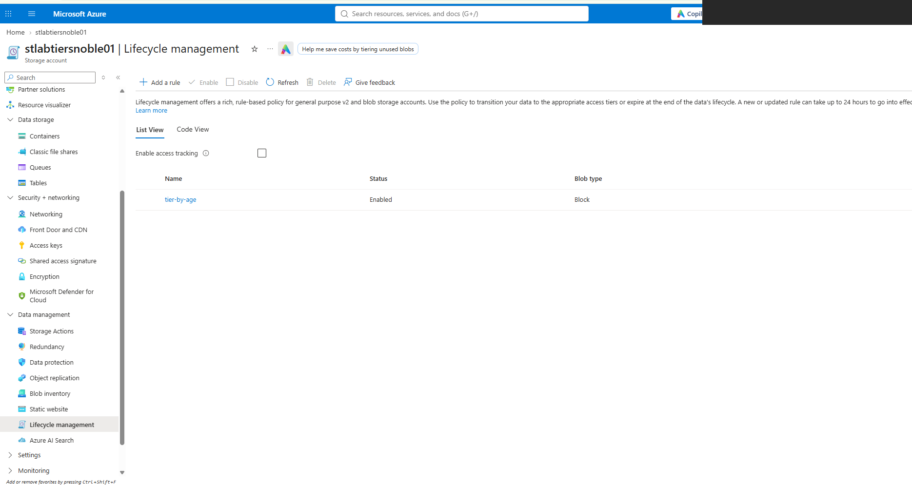

*Figure 2.27: Tier-by-age enabled.*

**Code View** shows the same rule as JSON (`tierToCool`,
`daysAfterModificationGreaterThan: 30`, `daysAfterLastTierChangeGreaterThan: 7`,
`prefixMatch`): every click became a line of text that could live in Git (Figure 2.28).

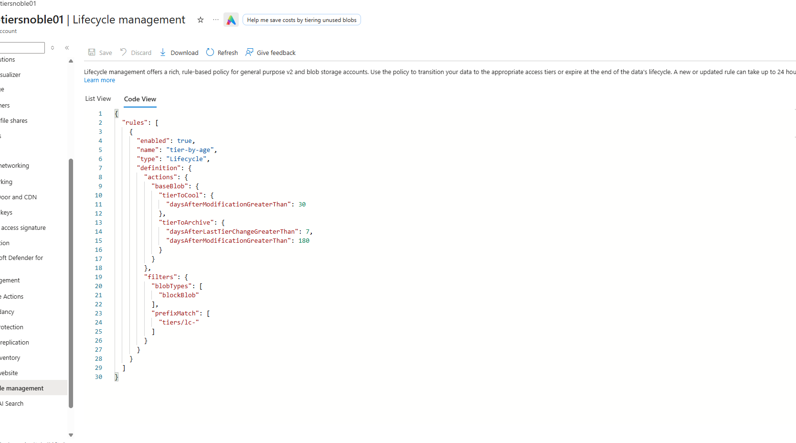

*Figure 2.28: Tier-by-age in Code View (JSON).*

### 7. A fast rule to watch over a few days

To see a rule actually act, a second rule, `fast-demo`, uses the shortest
practical gaps: Cool after **1** day, Cold after **2**, Archive after **3**,
on three new files `lc-1.txt` to `lc-3.txt` uploaded Hot. Days are the
smallest unit lifecycle rules accept, and rules run once a day, so this plays
out over about four days (Figures 2.29 and 2.30).

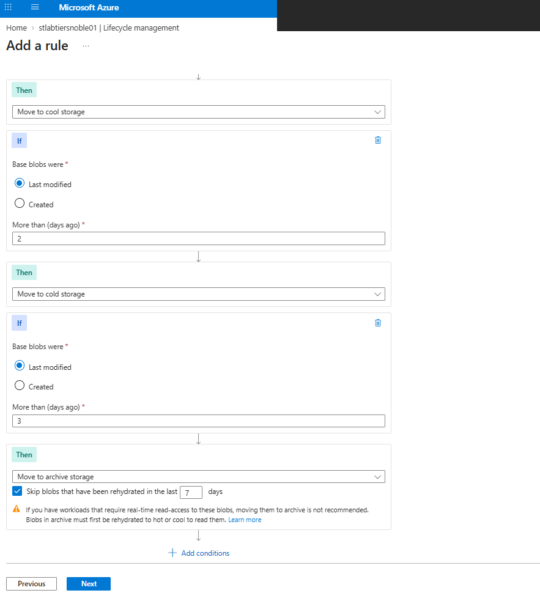

*Figure 2.29: Fast-demo: Cool after 1 day, Cold after 2, Archive after 3.*

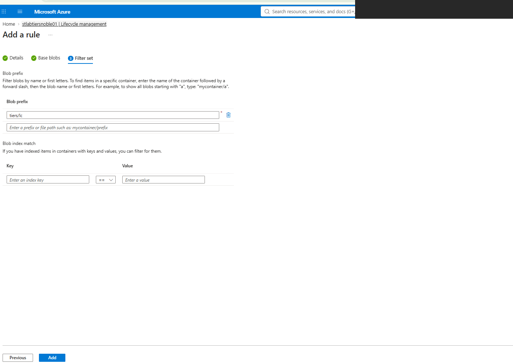

*Figure 2.30: Fast-demo: prefix filter.*

Both rules match the `lc-` files. Where rules overlap, the cheapest action
wins, so `fast-demo` decides.

| Daily run (UTC) | `lc-1.txt` to `lc-3.txt` | Run summary |
|---|---|---|
| 31 Oct, 22:55 | stayed Hot | nothing to move: the files were under a day old |
| 1 Nov, 22:26 | **Hot to Cool**, all three | `tierToCool` 3 of 3 succeeded |
| 2 Nov, 22:26 | **Cool to Cold**, all three | `tierToCold` 3 of 3 succeeded |
| 3 Nov, 22:26 | **nothing moved**, stayed Cold | every count 0: see below |
| 4 Nov, 22:26 | nothing moved | ran 2 minutes after the rule change, still on the old rule |
| 5 Nov, 22:57 | **Cold to Archive**, all three | `tierToArchive` 3 of 3 succeeded |

The first move arrived on the phone as it happened: three tier-change alerts
at the same minute, then the run's summary about **30 minutes later**. The
alerts show the lifecycle engine changing tiers through the same
`SetBlobTier` operation a person uses in the portal; only the timing is
automated (Figures 2.31 and 2.32).

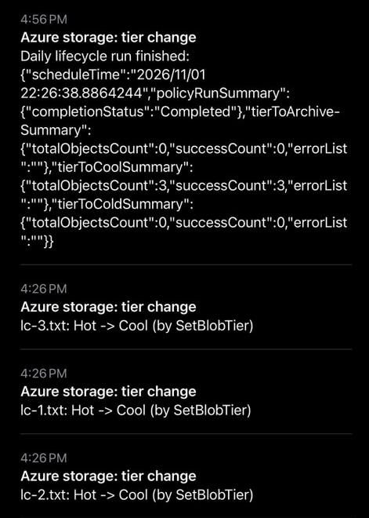

*Figure 2.31: Phone alerts, 1 Nov run: Hot to Cool.*

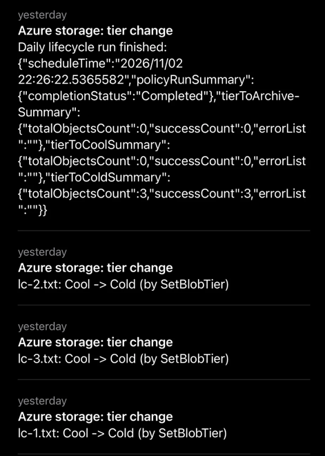

*Figure 2.32: Phone alerts, 2 Nov run: Cool to Cold.*

**Why Archive did not happen on day 3.** The rule's JSON shows the portal had
added a second condition to the Archive action:

```json
"tierToArchive": {
  "daysAfterModificationGreaterThan": 3,
  "daysAfterLastTierChangeGreaterThan": 7
}
```

That is the portal's *skip blobs rehydrated in the last 7 days* option, on by
default. It exists so a file someone just pulled back out of Archive is not
archived again the next night. But it counts **any** tier change, and the files
moved to Cold on 2 Nov, so Archive waits until 7 days after that. The rule did
exactly what it said; the form just said more than it showed (Figure 2.33).

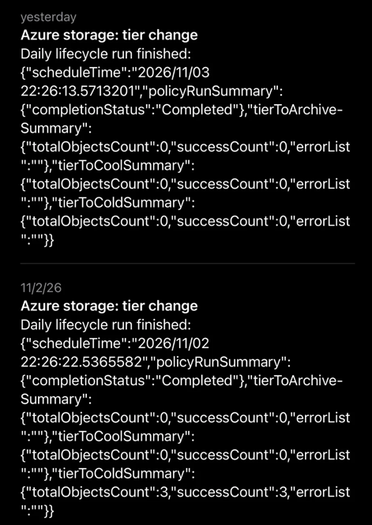

*Figure 2.33: Phone alert, 3 Nov run: nothing moved.*

**Change made, 4 Nov 22:24 UTC:** the 7-day condition was removed from
`fast-demo` only, in Code View, so the test files can reach Archive. The
realistic `tier-by-age` rule keeps it. A rule change can take up to 24 hours to
apply.

The next run archived all three. The whole walk took five daily runs instead
of three, and the run time is not fixed: 22:26 four nights in a row, then 22:57 (Figure 2.34).

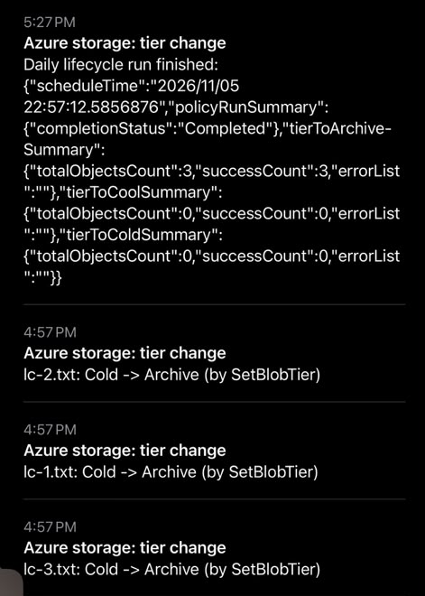

*Figure 2.34: Phone alerts, 5 Nov run: Cold to Archive.*

### 8. Alerts on every tier change

Instead of checking the portal, every tier change now pushes a notification to
a phone:

```
storage account ──event──► Event Grid ──► Logic App ──HTTP POST──► ntfy.sh/<private topic> ──push──► phone
```

- **Event Grid** is Azure's event router. A storage account publishes events
  such as `Microsoft.Storage.BlobTierChanged` (one blob changed tier) and
  `Microsoft.Storage.LifecyclePolicyCompleted` (the daily rule run finished).
- **Logic App** (Consumption plan, pay per run) subscribes with the trigger
  *When a resource event occurs*: Azure's own resource events, as opposed to
  *When an event occurs*, which is for events your own apps publish.
- **ntfy** is a free publish/subscribe relay. The phone app subscribes to a
  topic; anything POSTed to `https://ntfy.sh/<topic>` is pushed to it. Anyone
  who knows a topic name can read it, so the topic is random and kept out of
  this repository.

Email was the first idea, but a Logic App cannot send mail through a personal
Gmail account, so a push service was used instead (Figures 2.35 to 2.37).

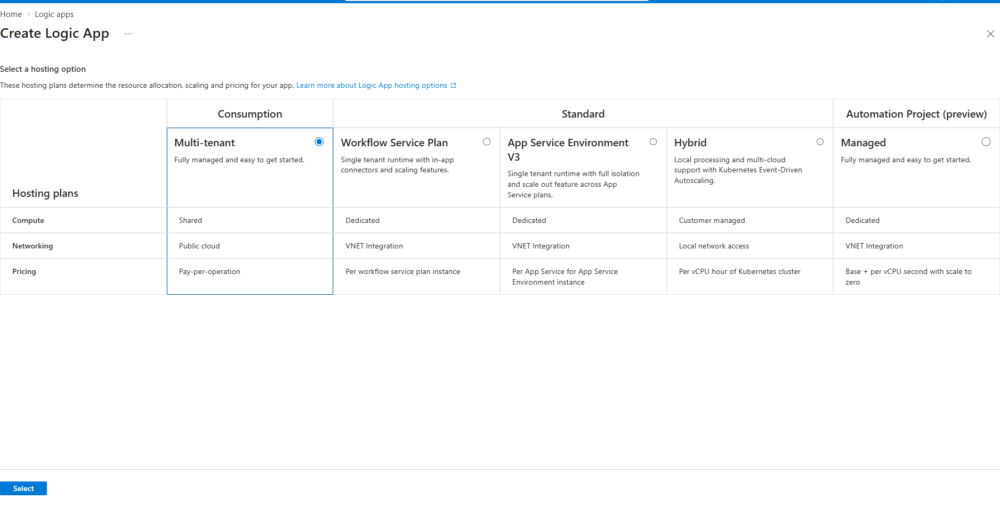

*Figure 2.35: Logic App hosting plans: Consumption chosen.*

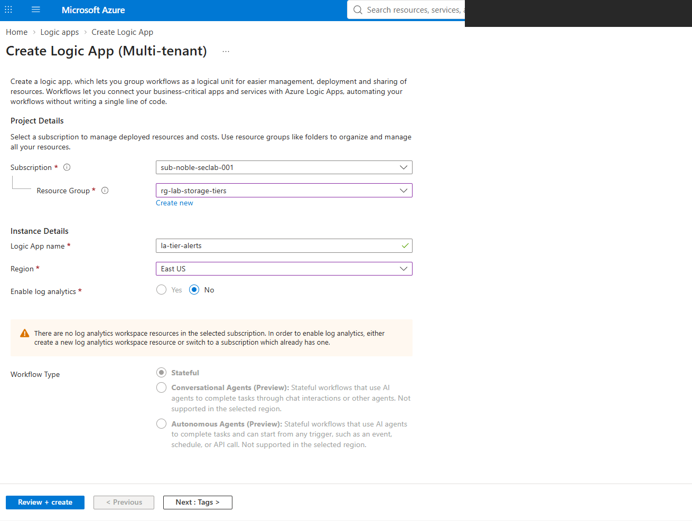

*Figure 2.36: Logic App la-tier-alerts, Basics.*

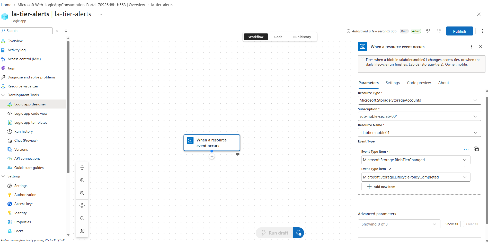

*Figure 2.37: Event Grid trigger with both event types.*

The trigger's connection uses **OAuth**, so it acts as the signed-in Owner. A
production version would use a managed identity with only the rights it needs,
the same least-privilege point as lab 01's Tag Contributor finding.

The action is the built-in **HTTP** step. Its body must be inserted as an
**expression** (an *fx* chip); pasted as plain text it would send the formula's
own words (Figure 2.38).

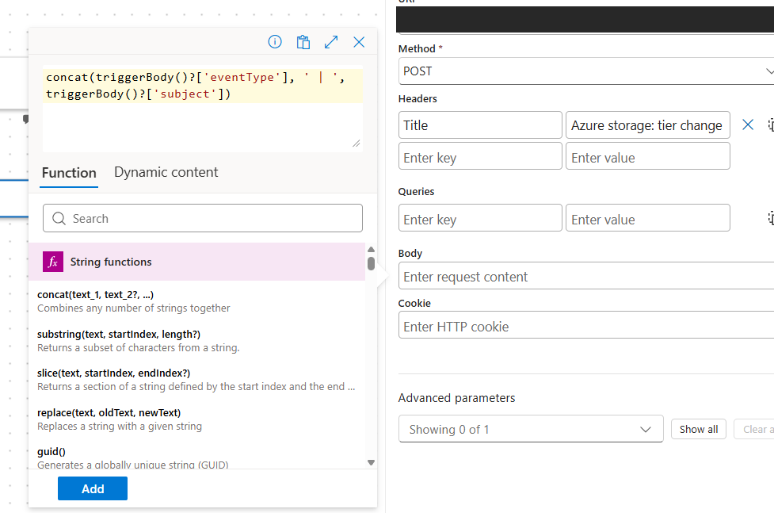

*Figure 2.38: HTTP action posting to ntfy, with the body expression.*

**Gotcha: the trigger failed silently.** After publishing, no event
subscription existed and the trigger's history read *Failed*. The cause was
the subscription itself: the **`Microsoft.EventGrid` resource provider was
not registered** on `sub-noble-seclab-001`. Every Azure service is a resource
provider that has to be switched on per subscription; common ones are
registered automatically, Event Grid was not. Registering it and publishing
again created the subscription (Figure 2.39).

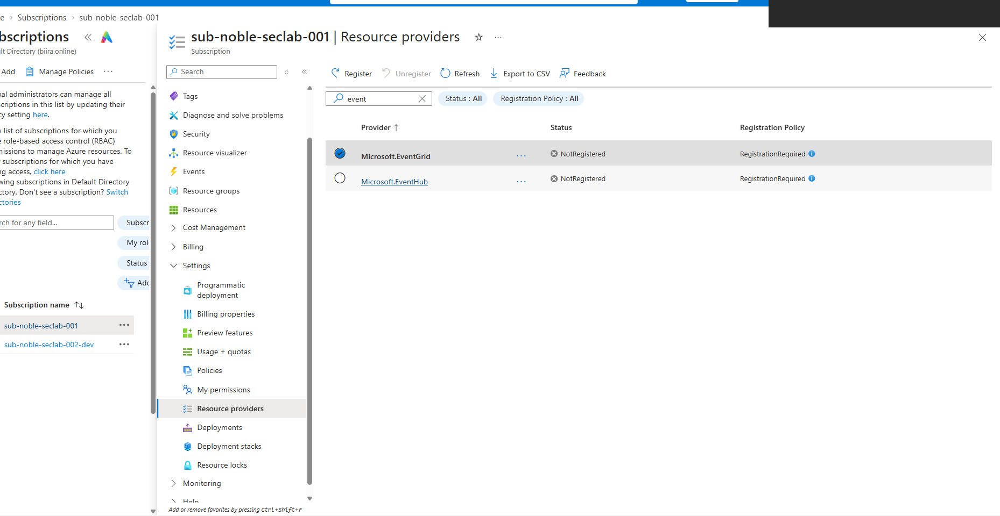

*Figure 2.39: Registering the Microsoft.EventGrid resource provider.*

```
az provider show -n Microsoft.EventGrid --query registrationState   →  Registered
trigger status                                                       →  Succeeded (was Failed)
event subscription                                                   →  WebHook, BlobTierChanged + LifecyclePolicyCompleted
```

**Test.** `report-hot.txt` was moved Hot → Cool by hand. The Logic App ran one
second later and ntfy received the message. The test push arrived first (Figure 2.40):

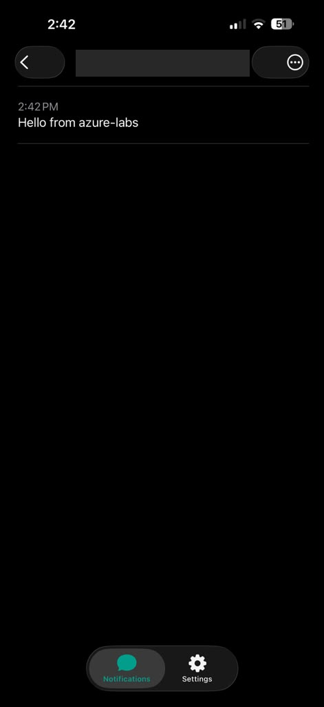

*Figure 2.40: Test push from ntfy.*

The first real alert carried the raw event type and path (Figure 2.41):

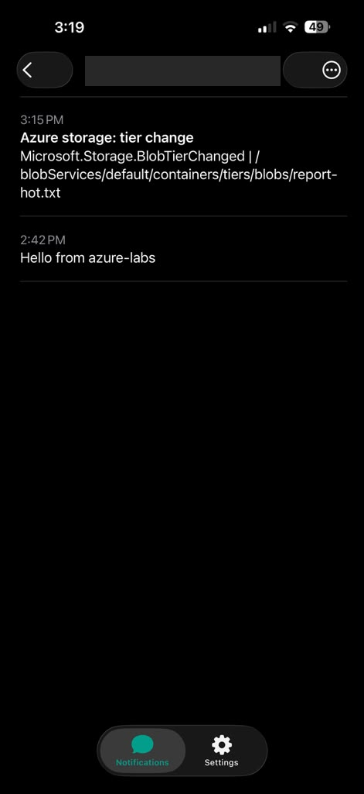

*Figure 2.41: First tier-change alert on the phone.*

The event's own payload carries `previousTier`, `accessTier` and the `api`
that made the change, so the body became a conditional expression:

```
if(equals(triggerBody()?['eventType'],'Microsoft.Storage.BlobTierChanged'),
   concat(last(split(triggerBody()?['subject'],'/')), ': ',
          triggerBody()?['data']?['previousTier'], ' -> ',
          triggerBody()?['data']?['accessTier'], ' (by ', triggerBody()?['data']?['api'], ')'),
   concat('Daily lifecycle run finished: ', string(triggerBody()?['data'])))
```

Moving the file back to Hot produced *report-hot.txt: Cool -> Hot (by
SetBlobTier)* (Figure 2.42):

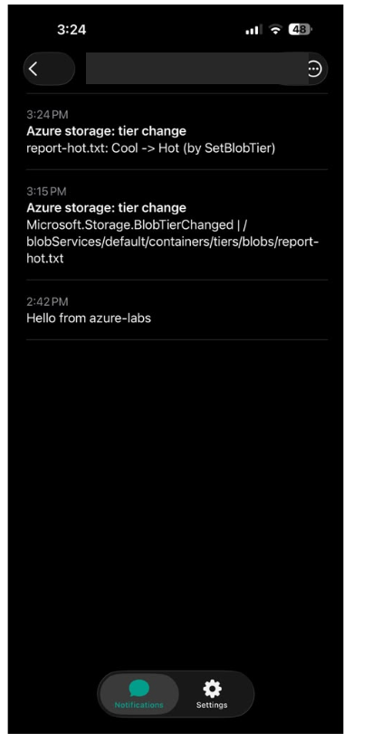

*Figure 2.42: The alert after formatting.*

That move back also took a blob out of Cool minutes after it went in, well
inside Cool's 30-day minimum: an early-deletion charge to look for on the bill
(question 3) (Figure 2.43).

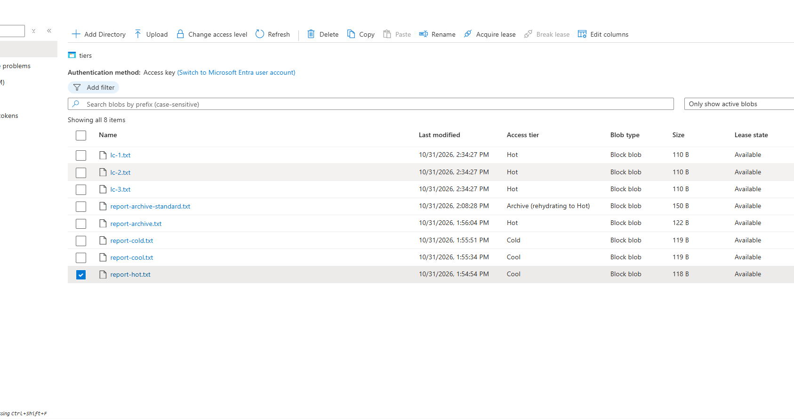

*Figure 2.43: Lc files uploaded; report-archive.txt back online.*

### 9. Switch off the master keys

Until now the portal read files with the account's **access key**, a master
password for the whole account. **Configuration > Allow storage account key
access: Disabled.** The portal warns that every Shared Key request, including
SAS tokens signed with the key, will now be refused (Figure 2.44).

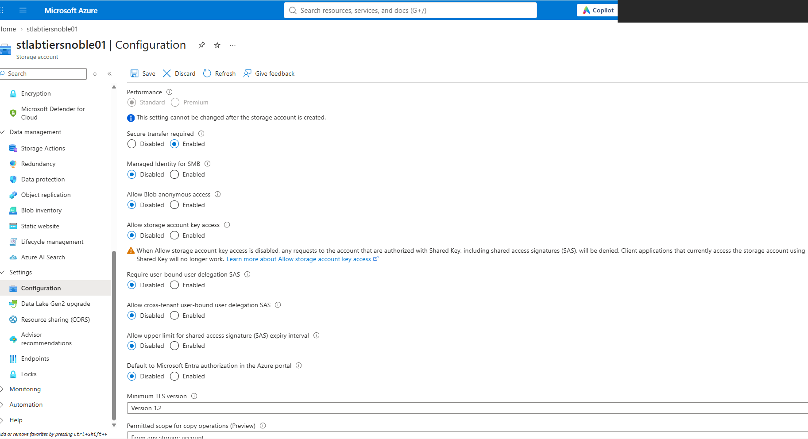

*Figure 2.44: Storage account key access disabled.*

The container stopped listing anything, for the subscription **Owner** (Figure 2.45):

> You do not have permissions to list the data using your user account with
> Microsoft Entra ID.

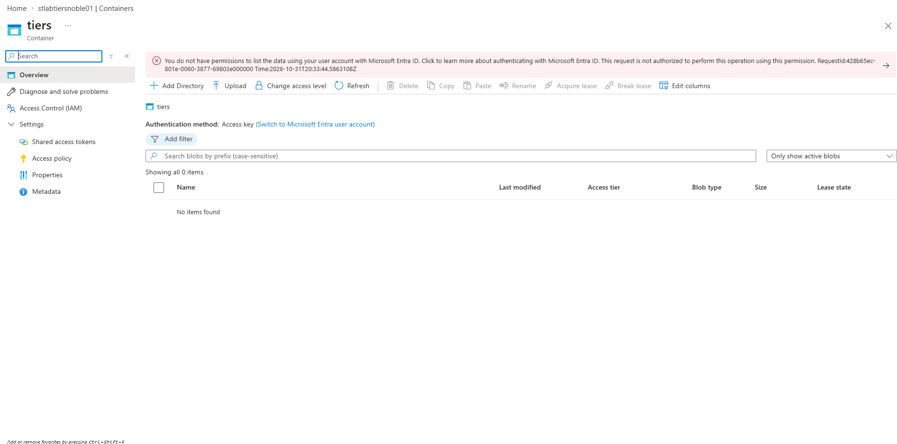

*Figure 2.45: With keys off, the subscription Owner cannot list the files.*

Azure keeps two kinds of rights apart:

| Kind | Roles | Controls |
|---|---|---|
| Management (control plane) | Owner, Contributor, Reader | the storage account: settings, networking, deletion |
| Data (data plane) | Storage Blob Data Reader / Contributor / Owner | the files inside |

Owner is all control plane. The key had been hiding the missing data role.

### 10. Grant only what is needed

**Storage Blob Data Reader**, assigned on the **`tiers` container** (not the
account), to the one user, with an audit-style description: purpose, scope,
why Reader and not Contributor, approver, review date, change reference. No ABAC
condition; the container scope was narrow enough (Figure 2.46).

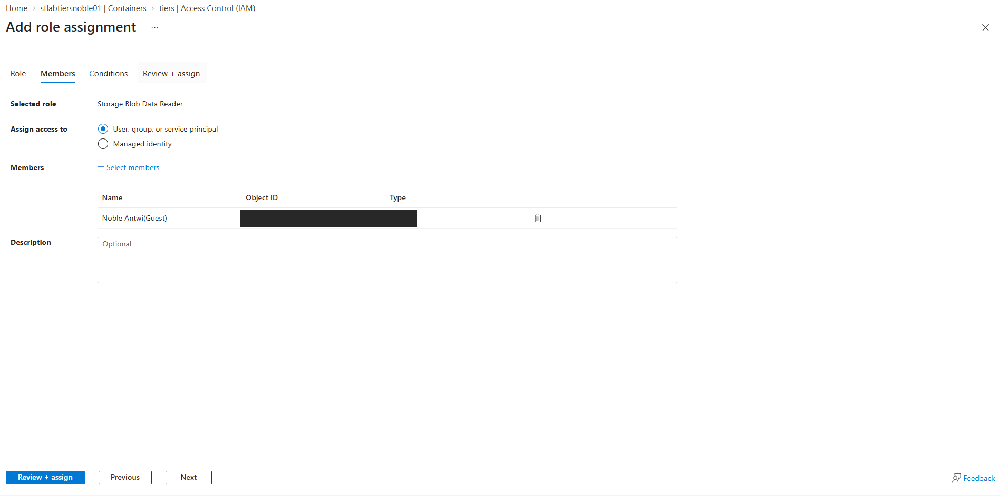

*Figure 2.46: Assigning Storage Blob Data Reader.*

The user's access on the container now shows the difference between inherited
and direct rights (Figure 2.47):

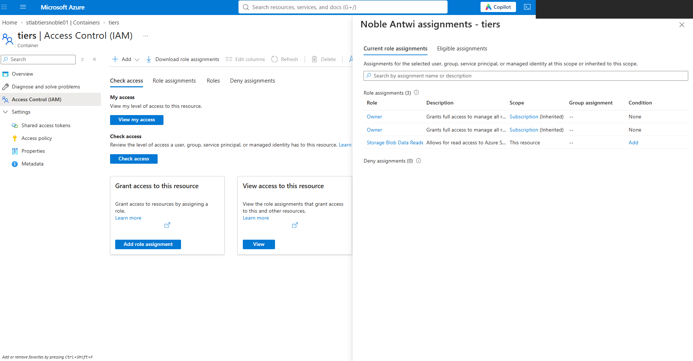

*Figure 2.47: Owner inherited, Reader direct.*

The first read, seconds after assigning, still failed: role assignments take a
few minutes to reach the storage service. A few minutes later, with the
container switched to **Microsoft Entra user account** authentication, all
eight files listed and opened (Figure 2.48).

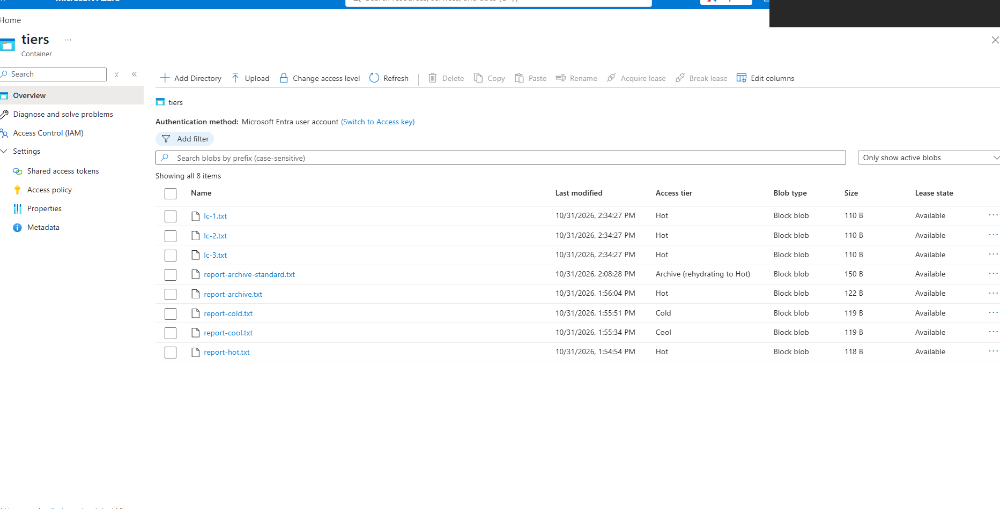

*Figure 2.48: Entra authentication lists the files.*

Upload was refused, as it should be: *"This request is not authorized to
perform this operation using this permission."* Reader reads; it cannot
upload, delete, overwrite or even change a blob's tier (Figure 2.49).

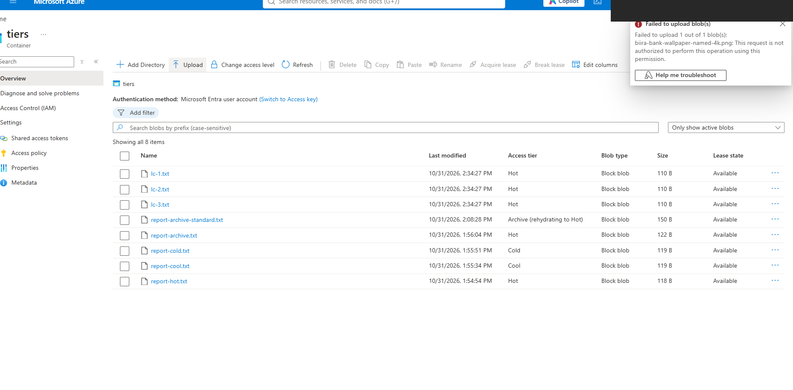

*Figure 2.49: Reader cannot upload.*

The command-line status checks used for step 5 had been reading with the key
too; they were switched to the same identity (`--auth-mode login`) and worked
under the Reader role, so even the lab's own tooling ended up on least
privilege.

### 11. Share one file safely: a user delegation SAS

A **shared access signature (SAS)** is a URL with a permission slip built in:
which file, which actions, from when, until when. Whoever holds the URL can use
it, with no Azure account at all.

| SAS type | Signed with | Works with key access off? |
|---|---|---|
| Account SAS, service SAS | the account key | no |
| **User delegation SAS** | a key Azure issues to a signed-in Entra identity | **yes** |

**Generate SAS** on `report-hot.txt`: signing method **User delegation key**
(Account key was greyed out, with the warning that Shared Key requests would be
denied), permission **Read**, valid for **one hour**, **HTTPS only**, no IP
restriction, user-bound off (Figure 2.50).

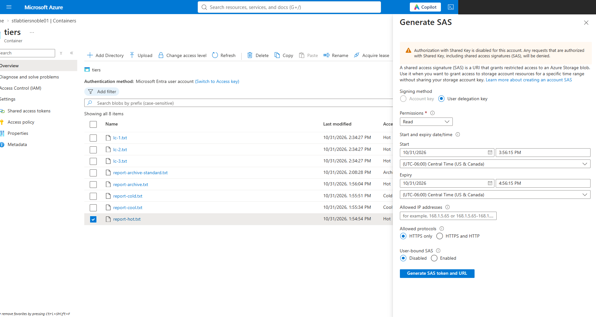

*Figure 2.50: User delegation SAS.*

A SAS can never grant more than its signer holds. The signer here has
Storage Blob Data Reader, so a link signed by this user cannot write whatever
boxes are ticked.

Pasted into a private browser window with no sign-in, the URL returned the
file (Figure 2.51):

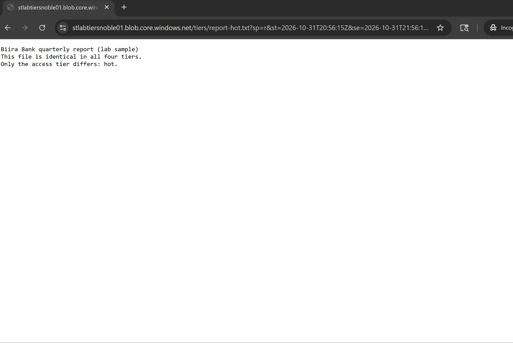

*Figure 2.51: The SAS opens with no sign-in.*

The URL's query string carries the slip in plain view: `sp=r` (read),
`st` and `se` (start and expiry, UTC), `skoid` (the signer's object ID), and
`sig`, a signature computed over all of it. Changing **one character** of `sig`
was refused (Figure 2.52):

```
AuthenticationFailed: Signature did not match.
```


*Figure 2.52: A tampered SAS is refused.*

So a holder cannot widen `sp=r` to write or push `se` later; the only lever is
the expiry, and the link dies on its own. The flip side: until it expires,
anyone who gets the URL can use it, so a SAS URL is handled like a password.
The account's **Configuration** page can cap every SAS's lifetime
(*upper limit for SAS expiry*), a sensible default in a real tenant.

## Break it

Every break ran inside the build:

| Attempt | Result | Why |
|---|---|---|
| Open or download the archived file | refused: *not permitted on an archived blob* | Archive is offline storage |
| Set the account's default tier to Archive | not offered | a default must be readable |
| Phone alerts straight after publishing | trigger *Failed*, no event subscription | `Microsoft.EventGrid` provider not registered |
| HTTP body pasted as text | the formula itself would have been sent | expressions must be inserted as *fx* |
| Read files with key access disabled, as Owner | refused | Owner is control plane only |
| Read seconds after assigning Reader | refused | role assignments take minutes to arrive |
| Upload as Storage Blob Data Reader | refused: *not authorized* | Reader cannot write |
| SAS URL with one character of `sig` changed | refused: *Signature did not match* | the signature covers every field |

## Rebuild it as code

[`bicep/main.bicep`](https://github.com/noble-antwi/az-104-labs/blob/master/02-storage-tiers/bicep/main.bicep) rebuilds the data side of the lab in
about 120 lines. Each block maps to a portal step:

| Bicep block | Portal step | What it sets |
|---|---|---|
| `sa` (storageAccounts) | 1 and 9 | LRS, Hot, TLS 1.2, HTTPS only, anonymous access off, **shared key off** |
| `blobSvc` (blobServices) | none | the hidden layer between account and container; always named `default` |
| `tiers` (containers) | 2 | private container |
| `lifecycle` (managementPolicies) | 6 and 7 | both rules, copied from Code View, including the hidden `daysAfterLastTierChangeGreaterThan: 7` |
| `readerOnContainer` (roleAssignments) | 10 | Storage Blob Data Reader, scoped to the container only |

The Logic App alert pipeline (step 8) is left out: it holds the private
ntfy topic, and the rebuild is about the storage decisions.

**Reading the export first.** `az group export` on the portal-built group
produced a template listing every property, defaults included. The two
settings that mattered were easy to find in it, `"allowSharedKeyAccess": false`
and `"minimumTlsVersion": "TLS1_2"`, but most of the file was settings never
touched. A hand-written file only needs the choices you made.

**Deploying.** Storage account names are global (the name becomes
`<name>.blob.core.windows.net`), so the code uses `stlabtiersnoble02`; `01`
would fail with *StorageAccountAlreadyTaken*. The reader's object ID is a
parameter passed at deploy time, so no identifier sits in the repo.

```powershell
az group create --name rg-lab-storage-tiers-iac --location eastus `
  --tags environment=lab purpose=lab lab=storage-tiers owner=noble costCenter=it-lab autoDelete=true

$me = az ad signed-in-user show --query id -o tsv
az deployment group create --resource-group rg-lab-storage-tiers-iac `
  --template-file 02-storage-tiers/bicep/main.bicep --parameters readerPrincipalId=$me
```

**Result, 11 Nov 2026:** the deployment succeeded in 26 seconds, and read-back
checks matched the portal build setting for setting:

```text
storage account   sku Standard_LRS, tier Hot, tls TLS1_2, https true,
                  sharedKey false, anonymous false
lifecycle         tier-by-age  prefix tiers/lc-  cool 30   archive 180
                  fast-demo    prefix tiers/lc   cool 1  cold 2  archive 3
role on 'tiers'   Storage Blob Data Reader, principal type User
```

What took about an hour of clicking across two sessions deployed in under
half a minute, and redeploying it changes nothing: Bicep describes the end
state, not the steps.

## What I found

**1. The colder the tier, the cheaper to keep and the dearer to read.** From the
reader's side Hot, Cool and Cold behave identically: the files opened straight
away in all three. The difference is only on the bill, which will be read
on reads and writes. Storing kilobytes costs nothing measurable in any tier;
the bill for the whole lab was about **1.2 cents**, and the largest storage line
was the one High-priority rehydration (see [Cost](#cost)).

**2. Archive is offline, not slow.** An archived blob cannot be opened or
downloaded at all. Getting it back means changing its tier, or copying it, to
any online tier directly; there is no stepping through Cold and Cool. High
priority took about **37 minutes** for a tiny file and Standard about **3 hours 15 minutes**: roughly five times longer, for the same 150-byte file.

**3. Minimum stays are charged, not enforced.** Azure let a file leave Cool
minutes after entering it, and lifecycle moved files out of Cold after 3 days.
Nothing was blocked; instead the bill carries a **Cold LRS Early Delete** line
for the unserved part of Cold's 90 days. No Cool or Archive early-delete line
appeared; at a few hundred bytes those charges are most likely below what the bill records.

**4. Owner is not data access.** With key access disabled, the subscription
Owner could not list a single file. A data-plane role, Storage Blob Data
Reader, scoped to one container, restored read access and nothing more:
upload was still refused. Sharing still worked without the key: a one-hour,
read-only **user delegation SAS**, signed with Entra, opened the file in a
browser with no sign-in, and a single altered character in its signature was
refused.

**Also learned:**

- The portal read the files with the account key until it was switched off:
  *Authentication method: Access key* was on screen the whole time.
- Workload presets on the create form reset earlier fields; the resource group
  silently changed to `NetworkWatcherRG`.
- Lifecycle rules count days from the last modification, run once a day, and
  "can take up to 24 hours" to start. A 30-day rule cannot be watched inside a
  one-day lab, hence the 1/2/3-day rule.
- A lifecycle rule's real conditions live in its JSON. The portal's
  *skip if rehydrated* box added `daysAfterLastTierChangeGreaterThan: 7` to
  Archive, which also delays Archive after an ordinary Cool or Cold move.
- A new subscription may need resource providers registered before a service
  works, and the failure can be silent.
- Storage events carry `previousTier`, `accessTier` and the `api` that made the
  change: enough for a useful one-line alert.

**The one sentence to remember:** *Tiers trade the cost of keeping against the
cost and speed of reading; Archive is offline until rehydrated, minimum stays
are billed rather than enforced, and managing a storage account never implies
reading its data.*

## Cost

The whole lab, 30 Oct to 11 Nov, cost **about $0.012**. Cost analysis, filtered
to `rg-lab-storage-tiers` and grouped by meter, shows the shape of it
(Figure 2.53): nothing before the build on 31 Oct, one step that day for the
High-priority rehydration (dark blue), then a slow daily climb from the Logic
App (light blue) as the lifecycle runs fired alerts.


*Figure 2.53: Accumulated cost for rg-lab-storage-tiers, grouped by meter, 1 Oct to 11 Nov.*

The table view shows every line as *<$0.01* (Figure 2.54), so the exact
figures below were read from the Cost Management query API with the same
filter.


*Figure 2.54: Cost analysis for rg-lab-storage-tiers, grouped by meter: every line rounds to less than a cent.*

| Meter | Service | Cost (USD) | What caused it |
|---|---|---:|---|
| Consumption Standard Connector Actions | Logic Apps | 0.0055 | 44 connector actions: the HTTP posts to ntfy |
| Archive Priority Read Operations | Storage | 0.0050 | the one High-priority rehydration (step 5) |
| Consumption Built-in Actions | Logic Apps | 0.00055 | 22 built-in actions in the runs |
| All Other Operations | Storage | 0.00020 | lifecycle tier changes, listing |
| Cold, Archive, Cool LRS Write Operations | Storage | 0.00017 | uploads and tier moves |
| Consumption Data Retention | Logic Apps | 0.00006 | run history |
| Cold and Cool Read Operations, Data Retrieval | Storage | 0.00003 | opening files in step 4 |
| **Cold LRS Early Delete** | Storage | **0.0000000072** | leaving Cold after 3 of 90 days (question 3) |
| Hot reads and writes, Event Grid, bandwidth | | 0.00 | free allowance |

What the numbers say:

- **Keeping is not where the money went.** No data-stored line appears for any
  tier; kilobytes for twelve days round to zero.
- **One urgent read cost almost as much as all other storage activity
  combined.** High-priority rehydration of one 150-byte file: half a cent.
  Standard priority for the other file did not appear as a separate charge.
- **The alerting cost more than the storage.** The Logic App was about half
  the bill. Monitoring is not free, even when the thing monitored is nearly free.
- **Early deletion is real and prorated.** It appeared exactly where predicted
  (Cold, 3 days into 90), scaled by size.

## Teardown

Deleting the resource group removes the storage account, the Logic App and its
Event Grid subscription. Deleting archived blobs early bills the rest of their
180 days; for a few kilobytes that is a fraction of a cent, and it is part of
what this lab measures.

```bash
az group delete --name rg-lab-storage-tiers --yes --no-wait
az group delete --name rg-lab-storage-tiers-iac --yes --no-wait
```

**Done 11 Nov 2026.** Both groups deleted; a check for any group starting
`rg-lab-storage` returned nothing. (In PowerShell, a JMESPath query with
brackets and parentheses gets mangled on its way through `az.cmd`;
`az group list -o table` is the simpler check there.)

The ntfy topic needs no cleanup: with the Logic App gone it simply goes quiet.
