> **Intent:** Settle what a VM is made of (size family, disks, NIC, IP) and prove the billing difference between shutting down inside the OS and deallocating from Azure.

> **Status:** done. Portal build and all three questions tested (14 Nov 2026), rebuilt in Bicep and verified, torn down 19 Nov 2026 after labs 04 and 05 reused the VM.

## What this lab is

A virtual machine looks like one thing in the portal, but Azure builds it from
several separate resources: the compute (a **size**), an **OS disk**, a
**network interface** in a subnet, usually a **public IP** and a **network
security group**. Each is billed and deleted on its own terms, which is where
most VM surprises on a bill come from.

The lab builds one small Linux VM with **no inbound ports open**, manages it
through Run Command, tests the two ways of "turning it off", and then opens
SSH to one address only.

## Questions

1. **What is a VM actually made of?** Which separate resources appear in the
   resource group, and which of them still cost money when the VM is off?
2. **Is shutting down from inside the OS the same as stopping it in Azure?**
   Which one stops the compute charge?
3. **What survives a deallocate?** The OS disk, the temporary disk, the public
   IP address, the private IP address.

### Predictions (written before testing)

| # | My prediction | What actually happened |
|---|---|---|
| 1 | The OS disk and the public IP keep costing money when the VM is deallocated. | **Right.** Azure's own Stop prompt says so: compute charges stop, storage and networking continue (Figure 3.9). The other five resources (NIC, NSG, VNet, schedule, the VM's compute) cost nothing while deallocated. |
| 2 | Shutting down from inside Linux stops the compute charge. | **Wrong.** The portal showed **Stopped**, not *Stopped (deallocated)* (Figure 3.8). The server is still reserved, so compute keeps billing. |
| 3a | The file on the OS disk is lost. | **Wrong.** It survived (Figure 3.12). |
| 3b | The file on the temporary disk is lost. | **Right.** *No such file or directory* (Figure 3.12). |
| 3c | The public IP stays the same: it is static and we created it. | **Right.** |
| 3d | The private IP changes: the VM can come back on another host. | **Wrong.** It stayed `10.30.0.4` (Figure 3.11). The address belongs to the NIC, and the NIC is not deleted by a deallocate. |

Score on question 3: 2 of 4.

## Key ideas, from zero

| Term | Plain meaning |
|---|---|
| **Size** | The VM's CPU and memory, e.g. `Standard_D2s_v3` (2 vCPU, 8 GiB). In the name, **a** = AMD, **l** = low memory, **d** = has a local temp disk, **s** = can use premium storage. |
| **OS disk** | A managed disk holding the operating system. Stored apart from the server, so it survives stop and deallocate; billed for its full size while it exists. |
| **Temporary disk** | Fast local storage on the physical server, mounted at `/mnt` on Linux. Not a resource of its own and not billed separately. **Wiped** when the VM is deallocated. |
| **NIC** | Network interface: connects the VM to a subnet and **owns** its private IP. |
| **Public IP** | A separate resource. Standard SKU, static: billed per hour whether the VM runs or not. |
| **NSG** | Network security group: the guard at the door. Inbound and outbound allow/deny rules, lowest priority number checked first. |
| **Stopped** | Shut down from inside the OS. Azure was not told, so the server is still held for you and compute still bills. |
| **Stopped (deallocated)** | Stopped by Azure (portal Stop, `az vm deallocate`, auto-shutdown). The server is handed back; compute billing ends. |
| **Run Command** | Runs a script inside the VM through the Azure agent, as root, with no inbound port needed. |
| **Auto-shutdown** | A daily deallocate at a set time, whether or not someone is working. The safety net against a forgotten lab VM. |

Analogy: a hotel room. Turning off the lights inside is the OS shutdown, and
the room is still billed. Checking out at the front desk is Azure's Stop.

## Architecture

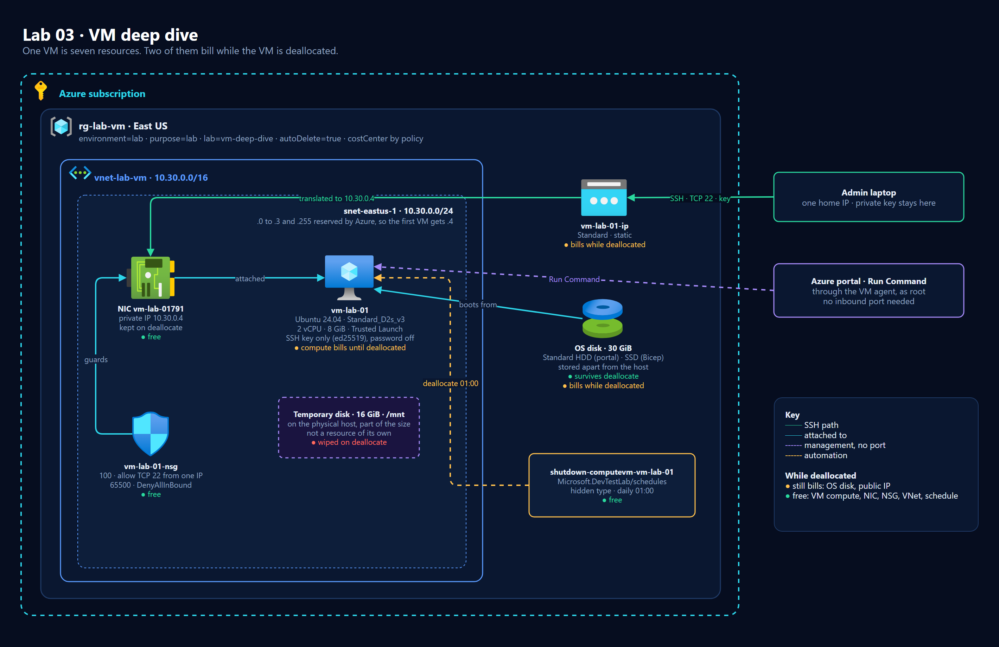

*Figure 3.2: Lab 03 architecture. Source: [`diagrams/architecture.drawio`](https://github.com/noble-antwi/az-104-labs/blob/master/03-vm-deep-dive/diagrams/architecture.drawio).*

## What gets built

| Resource | SKU / setting | Why it's here |
|---|---|---|
| `rg-lab-vm` | resource group, East US | holds the lab |
| `vm-lab-01` | Ubuntu Server 24.04 LTS, `Standard_D2s_v3` | see step 2: the planned size did not stick |
| OS disk | Standard HDD, 30 GiB | survives deallocate; still billed |
| Temporary disk | 16 GiB, comes with the D2s_v3 size | the thing question 3 tests |
| `vnet-lab-vm`, `snet-eastus-1` | 10.30.0.0/16, 10.30.0.0/24 | its own small network |
| NIC, public IP, NSG | created with the VM | to see each as its own resource |
| Sign-in | SSH key (ed25519) generated locally; password login off | the portal's key download failed twice |
| Inbound ports | none at build; later **22 from one IP only** | step 9 |
| Auto-shutdown | daily at 01:00 | the safety net |

## Build it in the portal

### 1. Create the resource group

`rg-lab-vm` in East US with the lab tags; the lab 01 policy adds `costCenter`
on its own (Figure 3.3).

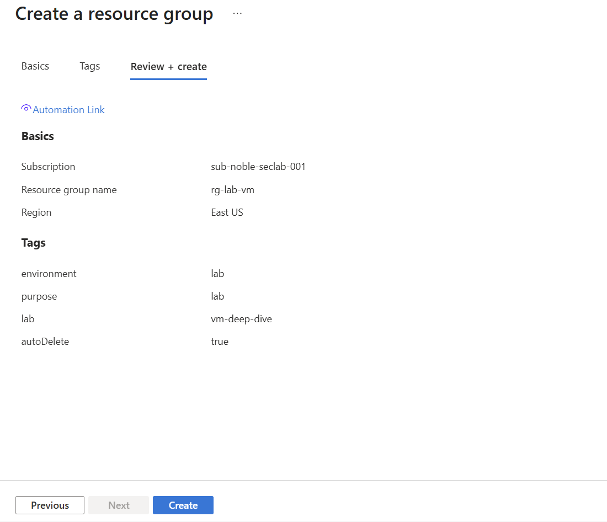

*Figure 3.3: Review + create for rg-lab-vm.*

### 2. Choose a size, and meet quota

The create form defaulted to **Standard_D2s_v3 at $70.08 a month**, about ten
times what a lab VM needs. The plan was a B-series burstable size, and that is
where the lab hit its first real wall:

- `Standard_B1s` is no longer offered in East US for this subscription.
- `Standard_B2ats_v2` ($6.86 a month) was listed but greyed out:
  *Insufficient quota - family limit*. The subscription's quota for the
  **Basv2 family was 0 vCPUs**, while most D, E and F families had 10.
- The automatic quota increase to 4 vCPUs was **refused**, so a support
  request (Basic plan, severity C) went to Microsoft. It was **approved to 4
  vCPUs** a day later.

Quota is a ceiling on how many vCPUs of a family can run at once, per region.
It costs nothing to hold, and keeping it low is a guardrail: nothing can start
ten VMs by mistake.

| Size | Temp disk | Per hour | Per month if never stopped |
|---|---|---:|---:|
| Standard_B2ats_v2 | none | $0.0094 | $6.86 |
| Standard_D2als_v6 | none | $0.0804 | $58.69 |
| Standard_D2alds_v6 (planned) | yes | $0.0952 | $69.50 |
| **Standard_D2s_v3** (what was built) | **16 GiB** | **$0.096** | $70.08 |

Question 3 needs a size **with** a temp disk, so the plan was D2alds_v6. The
first attempt was abandoned when the portal's SSH key download failed; on the
second, the size change **did not stick** and the VM deployed with the portal
default, D2s_v3. It has a temp disk and costs the same per hour, so it was
kept. Lesson: read the size on the Review page, not the Basics tab. The OS disk
also came out Standard HDD rather than Standard SSD; the portal now warns that
Standard HDD OS disks retire on 8 September 2028.

At a few hours of running time, deallocated in between, the difference
between sizes is cents; the monthly figure only matters for a VM left on.

### 3. One VM, seven resources

With **Manage view → Show hidden types** on (the schedule is hidden by
default), the group holds seven resources for "one VM" (Figure 3.4): the VM,
its OS disk, NIC, public IP, NSG, virtual network and the auto-shutdown
schedule.

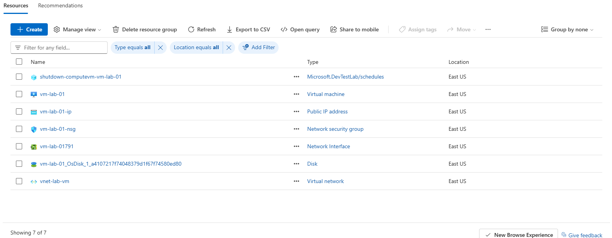

*Figure 3.4: The seven resources in rg-lab-vm, with hidden types shown.*

### 4. See the disks from inside

**Run command → RunShellScript**, `lsblk` (Figure 3.5):

| Device | Size | What it is |
|---|---|---|
| `sda` | 30G | the OS disk, mounted at `/` |
| `sdb` | 16G | the temporary disk, mounted at `/mnt` |
| `sr0` | 628K | a tiny virtual CD Azure uses to pass first-boot settings (the SSH key) |

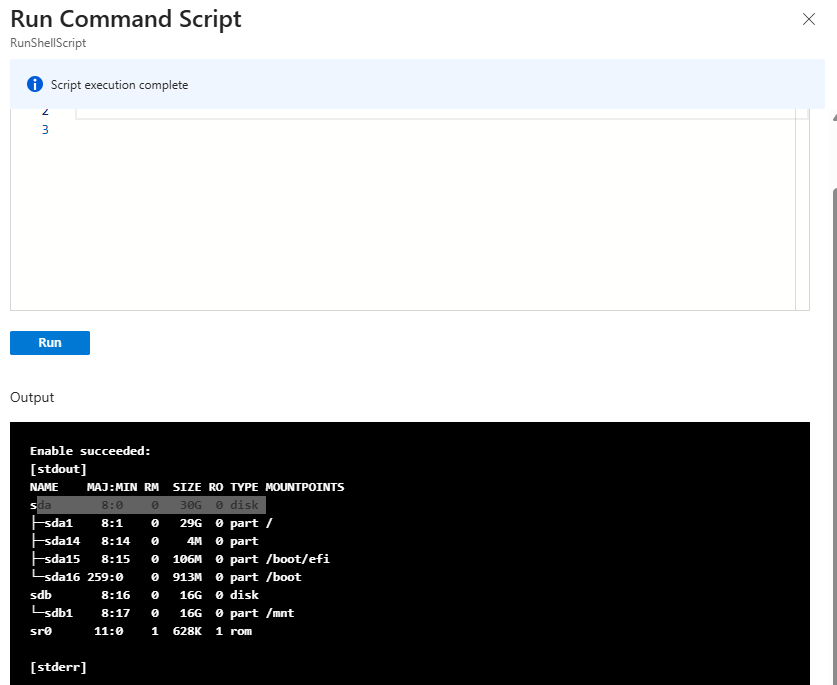

*Figure 3.5: lsblk shows two disks: the 30 GiB OS disk and the 16 GiB temporary disk at /mnt.*

### 5. Leave a marker on each disk

```bash
echo "on the temp disk" > /mnt/proof.txt
echo "on the OS disk" > /opt/proof.txt
ls -l /mnt/proof.txt /opt/proof.txt
```

Run Command runs as root, so no `sudo` (Figure 3.6).

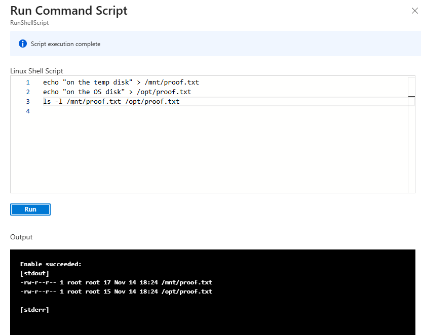

*Figure 3.6: One proof file on the temporary disk, one on the OS disk.*

### 6. Shut down from inside the OS (question 2)

`shutdown -h +1` halts Ubuntu in one minute; the delay lets Run Command report
back first (Figure 3.7). After refresh the portal shows **Stopped**, not
*Stopped (deallocated)* (Figure 3.8). Ubuntu stopped; Azure was never told,
so the server is still reserved and compute still bills.

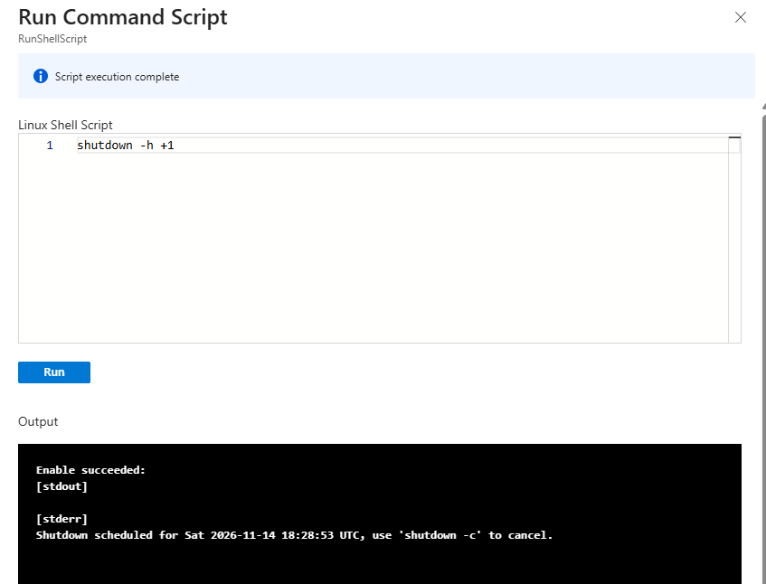

*Figure 3.7: An OS shutdown scheduled from inside the VM.*

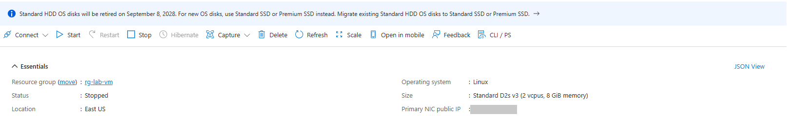

*Figure 3.8: After the OS shutdown: Stopped, not Stopped (deallocated). Compute is still billed.*

### 7. Stop from Azure

The portal's **Stop** asks for confirmation and states the billing rule
itself: compute charges stop, storage and networking continue (Figure 3.9).
*Force deallocate* was left off; a normal stop shuts the OS down cleanly
first. The status became **Stopped (deallocated)** (Figure 3.10).

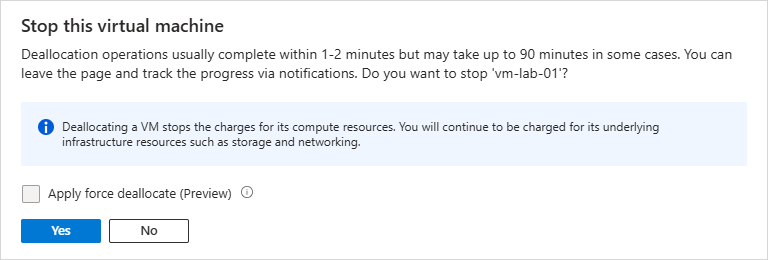

*Figure 3.9: The Stop prompt: compute charges stop, storage and networking keep billing.*

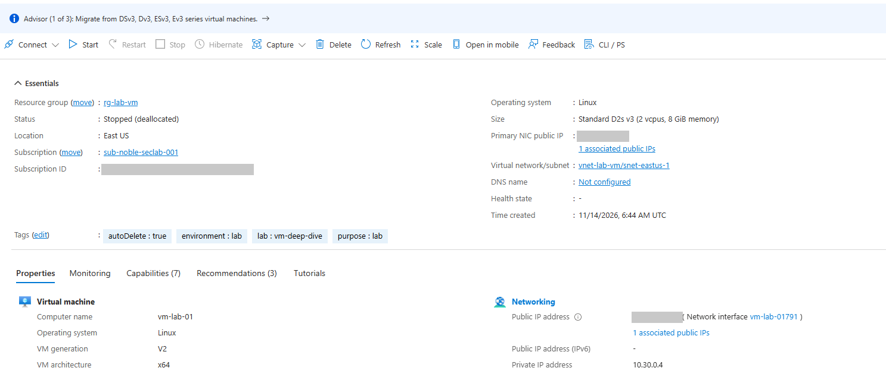

*Figure 3.10: Stopped (deallocated). The public and private IPs are still listed while the VM is off.*

### 8. Start it, and check what survived (question 3)

After **Start**, both IP addresses were unchanged (Figure 3.11), and the OS
disk file was there while the temp disk file was gone (Figure 3.12).

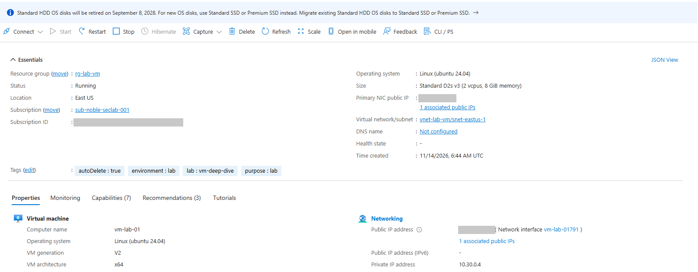

*Figure 3.11: Running again after deallocate: same public IP (redacted) and same private IP, 10.30.0.4.*

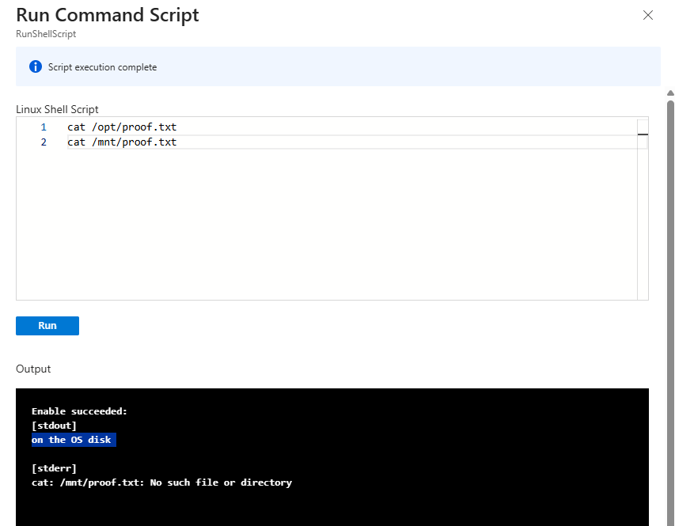

*Figure 3.12: After deallocate and start: the OS disk file survived; the temp disk file did not.*

### 9. Open SSH to one address

The VM was built with *Public inbound ports: None*, so the first SSH attempt
timed out (see [Break it](#break-it)). An inbound rule lets in port 22 from
one source address only (Figures 3.13 and 3.14):

| Field | Value | Why |
|---|---|---|
| Source | My IP address | only this laptop |
| Source port | `*` | the client picks a random port; only the VM's end is locked |
| Destination | Any | the NSG is on this one NIC, so "any" means this VM |
| Service / port | SSH, TCP 22 | |
| Priority | 100 | checked long before `DenyAllInBound` at 65500 |
| Name | `allow-ssh-from-my-ip` | |

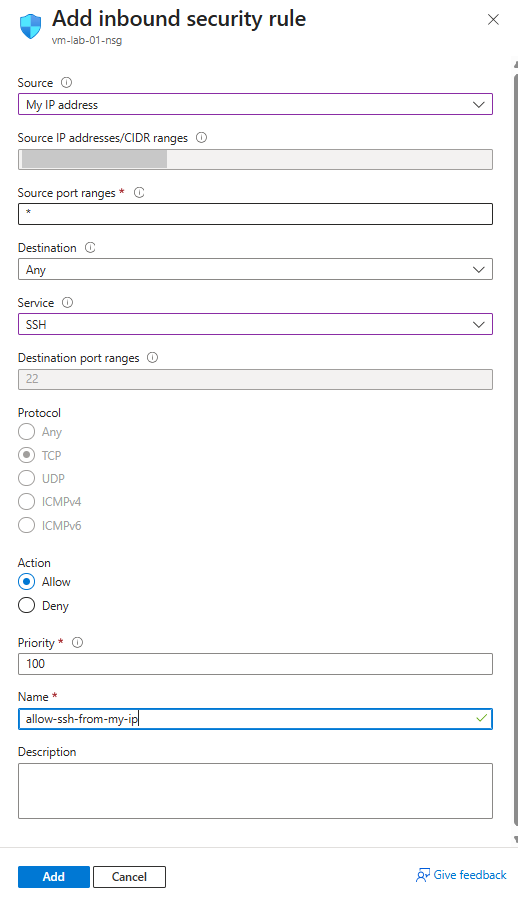

*Figure 3.13: The inbound rule: SSH from one address (redacted), priority 100.*

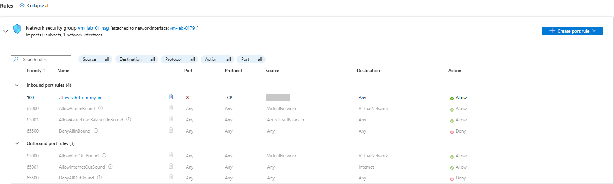

*Figure 3.14: The new rule sits above the three default inbound rules.*

```powershell
ssh -i $HOME\.ssh\vm-lab-01 azureuser@<public-ip>
```

The login banner (Figure 3.15) reports `IPv4 address for eth0: 10.30.0.4`:
the VM only ever sees its private address. Azure translates the public one at
the edge, before the NSG checks the traffic, which is also why an NSG rule
would name the private IP, never the public one.

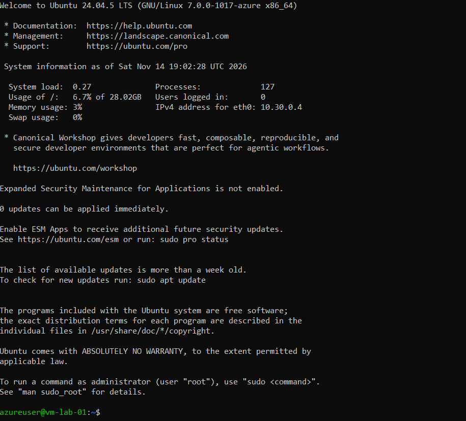

*Figure 3.15: Signed in over SSH with the key; the VM reports only its private IP.*

## Break it

**SSH with no inbound rule.** The first attempt returned
`ssh: connect to host <public-ip> port 22: Connection timed out`. A timeout
(not *connection refused*) means the packets were dropped before reaching
anything: the NSG had only the defaults, and `DenyAllInBound` matches
internet traffic. A public IP is an address, not an open door. Fixed in
step 9 with one narrow rule.

## Rebuild it as code

[`bicep/main.bicep`](https://github.com/noble-antwi/az-104-labs/blob/master/03-vm-deep-dive/bicep/main.bicep) builds the same seven resources, in the
order they depend on each other:

| Portal step | Bicep resource | Note |
|---|---|---|
| Networking tab | `vnet` with subnet `snet-eastus-1` | 10.30.0.0/16, 10.30.0.0/24 |
| Step 9 | `nsg` with `allow-ssh-from-my-ip` | the source address is a parameter |
| Networking tab | `pip` | Standard, static |
| (made silently) | `nic` | joins subnet, NSG and public IP; owns the private IP |
| Basics + Disks | `vm` | Trusted Launch, key-only SSH, OS disk deleted with the VM |
| Management tab | `shutdown` | name must be `shutdown-computevm-<vm>` for the portal to find it |

Two deliberate differences from the portal build: the OS disk is **Standard
SSD** (Standard HDD OS disks retire in 2028), and the auto-shutdown time zone
is **Central Standard Time** (the portal build was set to *Central America* by
mistake). Email notification is off so no address sits in the template.

Nothing personal is stored: the SSH **public** key and the allowed source
address are passed at deploy time (Figure 3.16).

```powershell
cd 03-vm-deep-dive\bicep
$myIp = Invoke-RestMethod https://api.ipify.org
$key = (Get-Content $HOME\.ssh\vm-lab-01.pub -Raw).Trim()
az group create -n rg-lab-vm-iac -l eastus --tags environment=lab purpose=lab lab=vm-deep-dive autoDelete=true -o table
az deployment group create -g rg-lab-vm-iac --template-file main.bicep `
  --parameters sshPublicKey="$key" sshSourceAddress="$myIp/32" --query properties.outputs
```

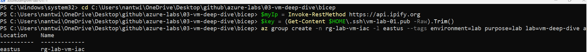

*Figure 3.16: The Bicep deploy, with the key and address read into variables rather than typed.*

**Result (14 Nov 2026):** the deployment succeeded first time and printed the
SSH command as an output. Checked from the CLI: seven resources,
`Standard_D2s_v3`, `StandardSSD_LRS`, password login off, auto-shutdown
`Enabled 0100 Central Standard Time`. SSH worked straight away with no extra
step, because the NSG rule was part of the template (Figure 3.17), and the VM
again reported `10.30.0.4`: the first free address in the subnet (Azure keeps
.0 to .3 for itself).

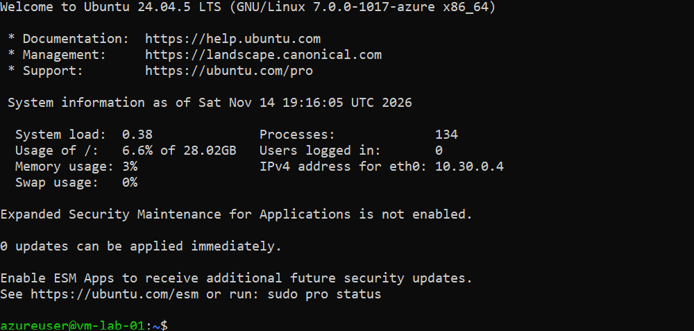

*Figure 3.17: Signed in to the Bicep-built VM; same private IP, 10.30.0.4.*

## What I found

- **"One VM" is seven resources.** Deleting the VM alone leaves the disk, NIC,
  IP, NSG and network behind, and two of those keep billing.
- **Only Azure can stop the bill.** Shutting down inside the OS leaves the VM
  *Stopped* and still charged. *Stopped (deallocated)* comes only from the
  portal, the CLI or auto-shutdown.
- **The OS disk travels with the VM; the temp disk stays with the server.**
  Anything on `/mnt` is gone after a deallocate. Never keep data there.
- **IPs belong to the NIC and the public IP resource, not to the server.** Both
  survived a deallocate, even though the VM most likely came back on a
  different host.
- **The portal can silently keep a default.** The size reverted to D2s_v3.
  Check the Review page.

The sentence to keep: *a stopped VM is not a free VM until Azure says
"deallocated".*

## Cost

`Standard_D2s_v3` is about 9.6 cents per hour of compute while running. While
deallocated, the OS disk (Standard HDD, billed as 32 GiB, about $1.54 a month)
and the static public IP (about $3.65 a month) keep billing. That is why the
lab is deleted as soon as nothing else needs it.

## Teardown

The Bicep copy was deleted as soon as it was verified (14 Nov 2026):

```bash
az group delete --name rg-lab-vm-iac --yes --no-wait
```

The portal build was kept, deallocated, for labs 04 and 05, then deleted on
19 Nov 2026:

```bash
az group delete --name rg-lab-vm --yes --no-wait
```

`NetworkWatcherRG` is left alone. Azure created it by itself when the first
virtual network appeared in East US; it holds one free Network Watcher per
region and is shared by every lab.
