> **Intent:** Build a least-privilege custom RBAC role and test its exact boundaries. Follow-up to lab 01's finding that P1's identity got Contributor where Tag Contributor would do.

> **Status:** built in the portal, every boundary tested, rebuilt in Bicep and verified (14 Nov 2026). `rg-lab-vm` deleted 19 Nov 2026; the two role definitions and the test user remain (free).

## What this lab is

Built-in roles are broad. **Virtual Machine Contributor**, the obvious choice
for "someone who looks after VMs", carries `Microsoft.Compute/virtualMachines/*`:
every VM action, delete included. This lab writes a role with only the five
actions an operator needs, gives it to a test user on one resource group, then
tries everything the role should and should not allow, on both the management
plane and the data plane. It reuses the lab 03 VM.

## Questions

1. **Can a Virtual Machine Contributor delete a VM?**
2. **With only start/stop actions, what happens when the user clicks Delete?**
3. **Does a management-plane role let someone log in to the VM?** What does?
4. **Does a User Login role give `sudo`?**

### Predictions (written before testing)

| # | My prediction | What actually happened |
|---|---|---|
| 1 | Yes: Contributor is a powerful role. | **Right.** `Microsoft.Compute/virtualMachines/*` covers delete (Figure 4.5). |
| 2 | A permission error: the role has no delete action. | **Right.** *does not have authorization to perform action Microsoft.Compute/virtualMachines/delete* (Figure 4.19). |
| 3 | Denied: the role is management plane, not a data action. | **Right.** Entra SSH was refused until **Virtual Machine User Login** was added (Figures 4.21, 4.22). |
| 4 | Denied: User Login has no sudo. | **Right.** *not in the sudoers file* (Figure 4.23). |

## Key ideas, from zero

| Term | Plain meaning |
|---|---|
| **Role definition** | A named list of permissions. Built-in (Microsoft's) or custom (yours). |
| **Actions** | **Management (control) plane**: what you can do *to* a resource: create, change, start, delete. |
| **DataActions** | **Data plane**: what you can do *inside* it: read a blob, log in to a VM. |
| **NotActions** | Carve-outs from a wildcard. Not a deny: another role can still grant them. |
| **Wildcard `*`** | Everything under that path, including actions Microsoft adds later. |
| **Assignable scope** | Where a role *may* be handed out (the menu). Ours: the subscription. |
| **Assignment scope** | Where it *is* handed out (the gift). Ours: `rg-lab-vm` only. Inherited by everything inside. |
| **Managed identity** | An Entra identity for the VM itself, with credentials Azure manages. System-assigned = born and deleted with the VM. Grants nothing on its own. |
| **Entra SSH login** | SSH where Entra issues a short-lived certificate after password + MFA, and the VM checks the user's role. No key file to leak. |

## Architecture

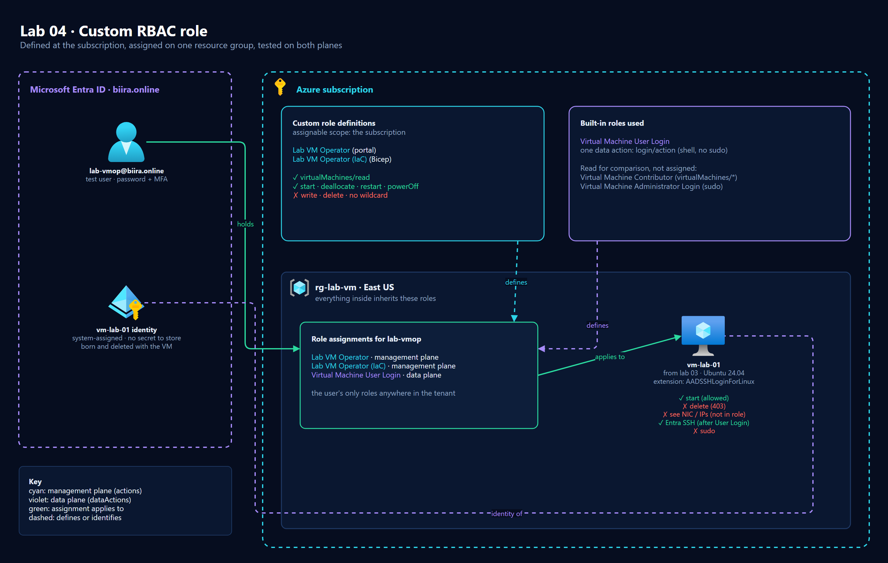

*Figure 4.2: Lab 04 architecture. Source: [`diagrams/architecture.drawio`](https://github.com/noble-antwi/az-104-labs/blob/master/04-custom-rbac-role/diagrams/architecture.drawio).*

## What gets built

| Item | Setting | Why |
|---|---|---|
| Custom role `Lab VM Operator` | 5 actions, assignable at subscription | the least-privilege role |
| User `lab-vmop@biira.online` | member, MFA registered | a test identity separate from the IAM lab users |
| Assignment | Lab VM Operator on `rg-lab-vm` | the management-plane test |
| VM system-assigned identity + `AADSSHLoginForLinux` | on `vm-lab-01` | so Entra can decide who logs in |
| Assignment | Virtual Machine User Login on `rg-lab-vm` | the data-plane test |
| `Lab VM Operator (IaC)` | same role from Bicep | the rebuild |

## Build it in the portal

### 1. Read the built-in role first

`rg-lab-vm` → **Access control (IAM)** → **Roles** → **Virtual Machine
Contributor** → **View**. It holds **412 actions** and **0 data actions**
(Figures 4.3, 4.4). The JSON tab shows why: one wildcard line,
`Microsoft.Compute/virtualMachines/*` (Figure 4.5). A VM Contributor can
delete a VM but cannot log in to it.

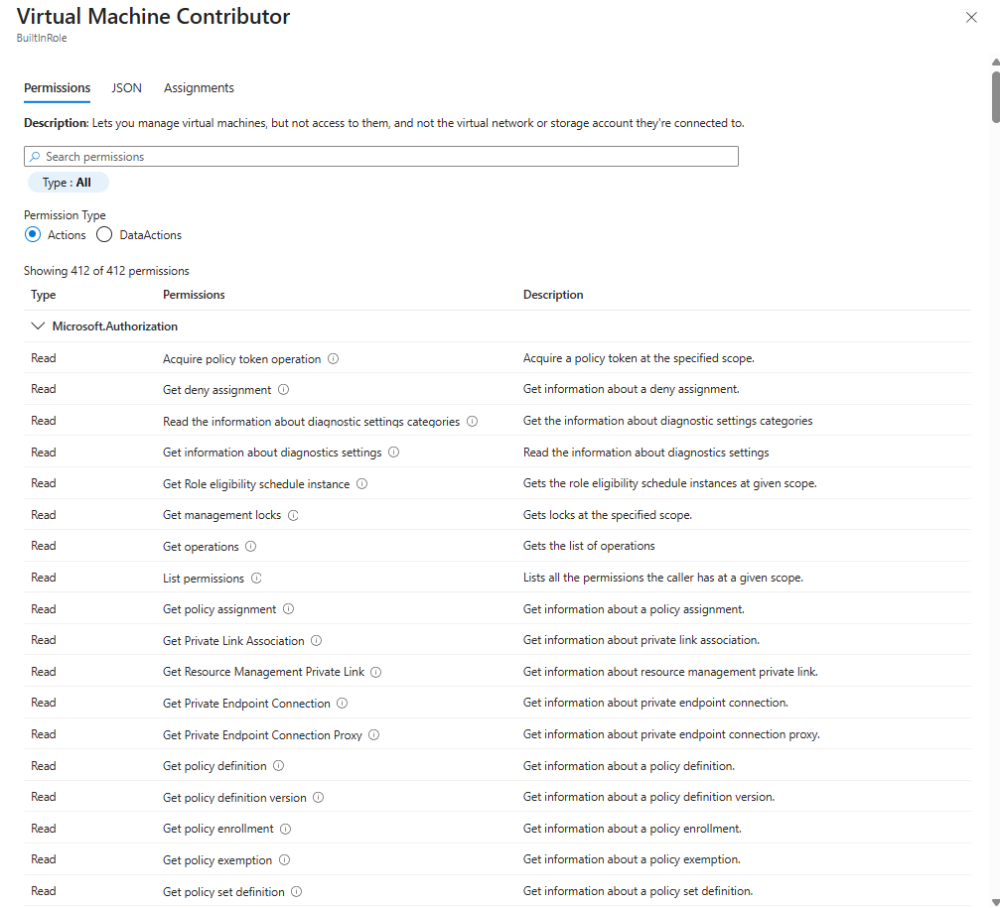

*Figure 4.3: Virtual Machine Contributor lists 412 management-plane actions.*

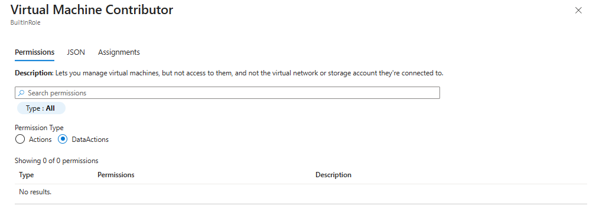

*Figure 4.4: The same role has no data actions: it cannot read data or log in.*

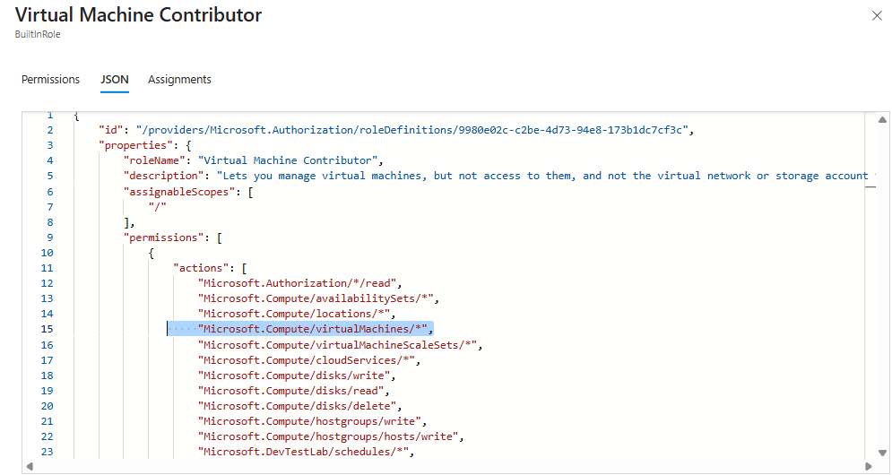

*Figure 4.5: The JSON view. Line 15, `virtualMachines/*`, includes delete.*

### 2. Create the custom role

**+ Add → Add custom role**, start from scratch (Figure 4.6), then
**+ Add permissions → Microsoft Compute** and tick exactly five boxes under
`Microsoft.Compute/virtualMachines` (Figures 4.7, 4.8):

| Permission | Why |
|---|---|
| `read` | see the VM |
| `start/action` | start |
| `deallocate/action` | the Stop that ends compute billing (lab 03) |
| `restart/action` | restart |
| `powerOff/action` | OS-style stop (still billed) |

No `write`, no `delete`, no wildcard. **Assignable scope** set to the
subscription, replacing the default `rg-lab-vm`, so the role survives the
group's deletion (Figure 4.9). The JSON tab shows the finished definition
(Figure 4.10); it was created (Figures 4.11, 4.12).

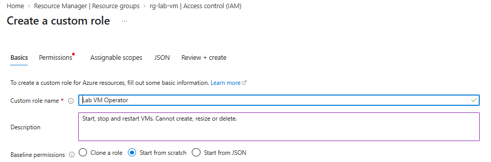

*Figure 4.6: Basics: Lab VM Operator, started from scratch.*

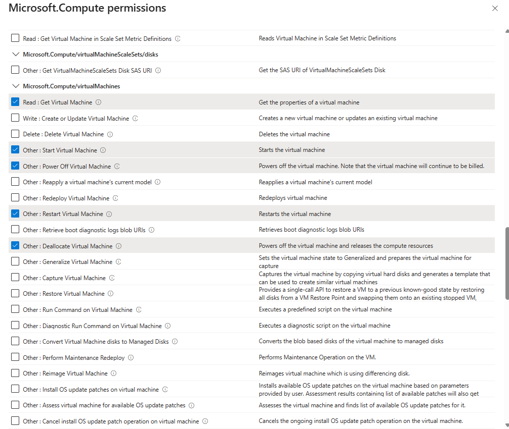

*Figure 4.7: Five boxes ticked; Write and Delete left empty.*

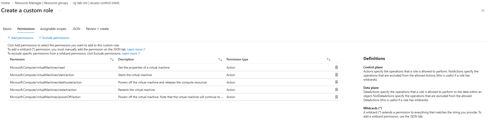

*Figure 4.8: The role's permissions: five actions, all Microsoft.Compute/virtualMachines.*

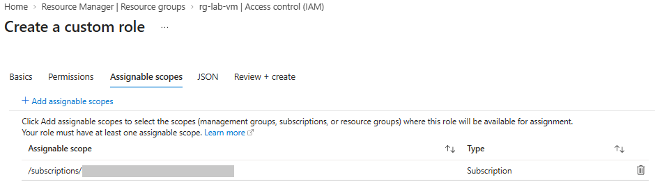

*Figure 4.9: Assignable scope: the subscription (ID redacted).*

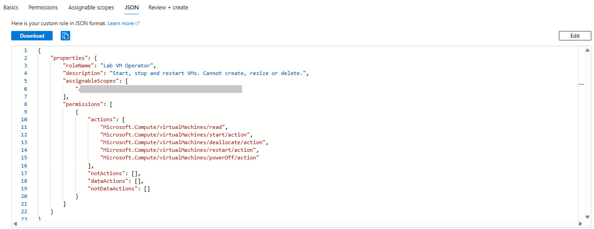

*Figure 4.10: The custom role in JSON: same four parts as the built-in role.*

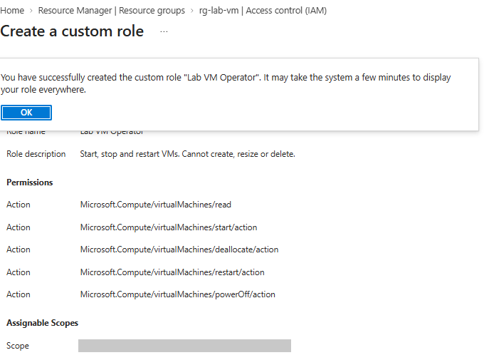

*Figure 4.11: Created.*

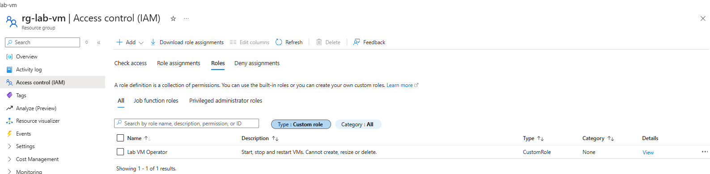

*Figure 4.12: Listed with type CustomRole.*

### 3. A test user, and the assignment

A dedicated user `lab-vmop@biira.online` (Figure 4.13), then **Add role
assignment** on `rg-lab-vm`: Lab VM Operator (Figure 4.14) to that user
(Figure 4.15). The CLI confirmed it as the user's only role before any test.

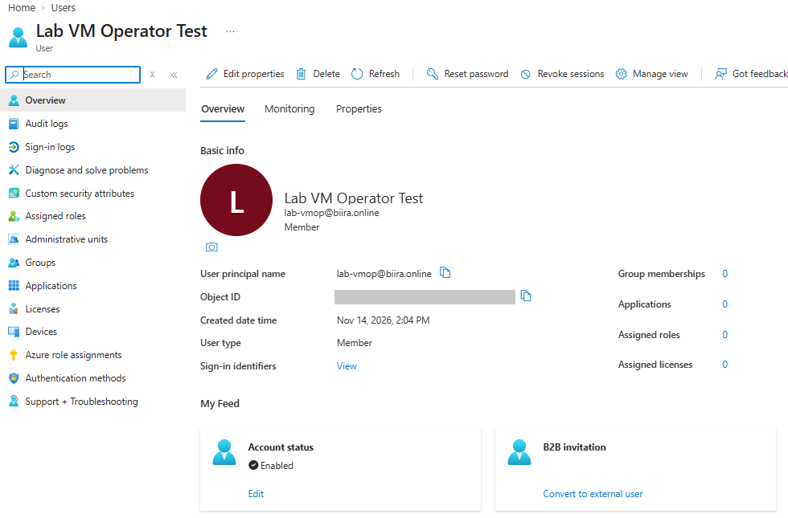

*Figure 4.13: The test user, with no roles yet (object ID redacted).*

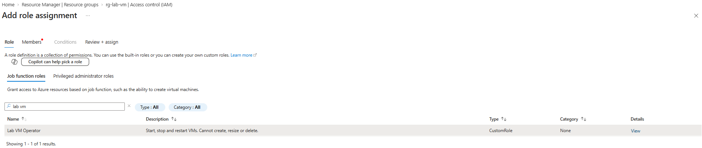

*Figure 4.14: The custom role appears under Job function roles.*

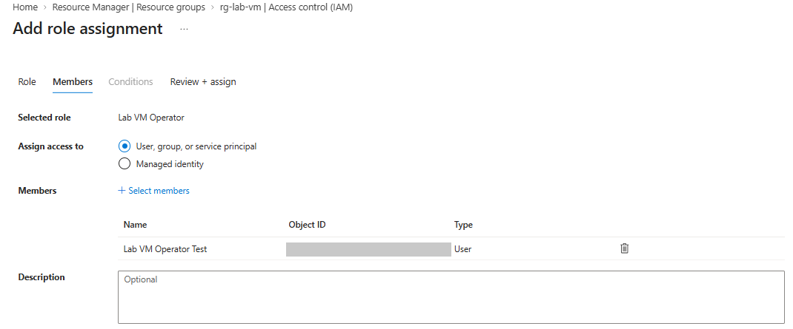

*Figure 4.15: Assigned to the test user on rg-lab-vm.*

### 4. Test the management plane as the user

In an InPrivate window, signed in as `lab-vmop` (first sign-in forced a
password change and MFA registration; Figure 4.16):

- **Start**: succeeded (Figure 4.17).
- **Networking details**: the public IP, private IP and VNet all show `-`.
  The role reads the VM, not the NIC, IP or VNet, which are separate
  resources (lab 03). Least privilege, felt.
- **Delete**: the portal still offers the button and the dialog (Figure 4.18);
  Azure refuses the call (Figure 4.19). The VM and all seven resources
  were untouched.

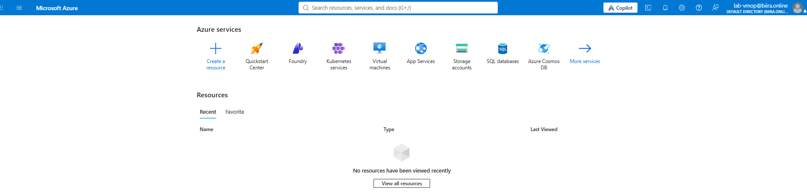

*Figure 4.16: Signed in as lab-vmop.*

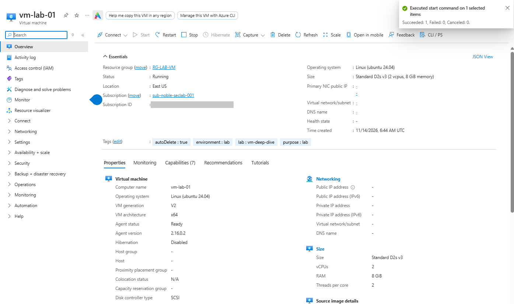

*Figure 4.17: Start succeeded; note the Networking fields showing "-".*

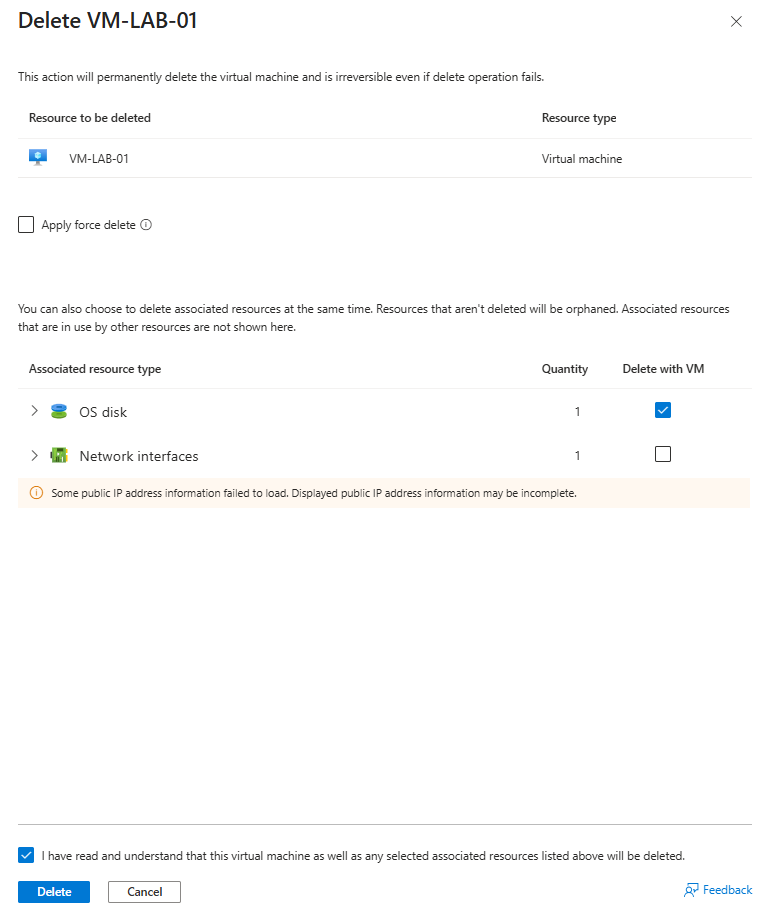

*Figure 4.18: The portal does not hide Delete: the check happens when the request reaches Azure.*

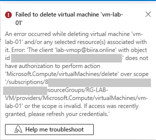

*Figure 4.19: Denied: no authorization for Microsoft.Compute/virtualMachines/delete (IDs redacted).*

### 5. Test the data plane: logging in

Azure roles do not govern a plain SSH key; anyone with the private key gets in.
To make Entra decide, the VM needs **Entra login**:

```powershell
az vm identity assign -g rg-lab-vm -n vm-lab-01
az vm extension set -g rg-lab-vm --vm-name vm-lab-01 --publisher Microsoft.Azure.ActiveDirectory --name AADSSHLoginForLinux
```

The extension first failed with *Managed System Identity is required*; the
identity has to come first (Figure 4.20).

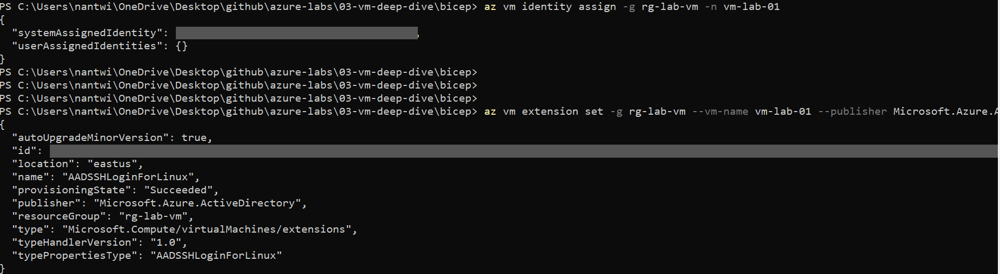

*Figure 4.20: System-assigned identity on, then the Entra login extension installed (IDs redacted).*

As `lab-vmop`, in a separate CLI profile (`$env:AZURE_CONFIG_DIR`), with no
key file and no username:

```powershell
az ssh vm --ip <public-ip>
```

- With only Lab VM Operator: **Permission denied (publickey)** (Figure 4.21).
- After adding **Virtual Machine User Login** (one data action,
  `virtualMachines/login/action`) on `rg-lab-vm`: **logged in** as
  `lab-vmop@biira.online` (Figure 4.22).
- `sudo whoami`: Entra asked for a fresh sign-in, then **not in the sudoers
  file** (Figure 4.23). `sudo` needs **Virtual Machine Administrator Login**.

Note: newer Azure CLI rejects `az role assignment create --resource-group`;
it needs `--scope` with the full ID:

```powershell
az role assignment create --assignee lab-vmop@biira.online --role "Virtual Machine User Login" --scope $(az group show -n rg-lab-vm --query id -o tsv)
```

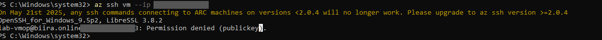

*Figure 4.21: Entra SSH with only the management-plane role: denied.*

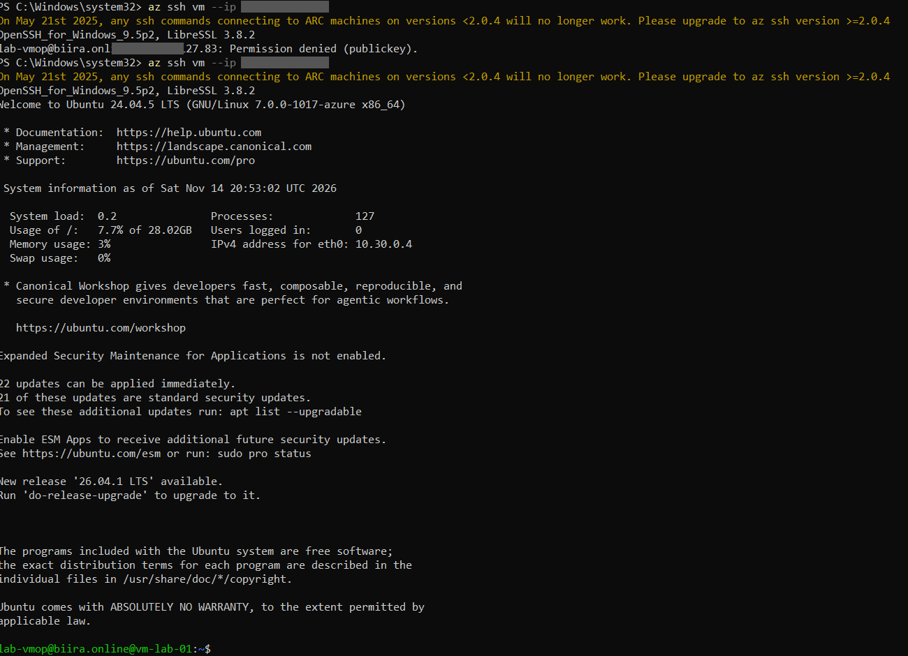

*Figure 4.22: After Virtual Machine User Login: signed in as the Entra user, no key file.*

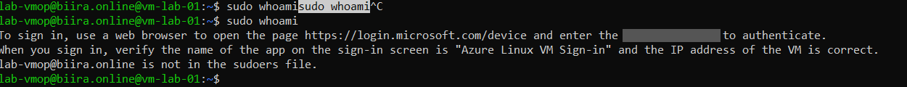

*Figure 4.23: User Login is not Administrator Login: no sudo (sign-in code redacted).*

## Break it

The lab broke itself twice, usefully:

- **Entra login extension without an identity**: install fails with exit
  code 52 and *Managed System Identity is required*. The VM needs its own
  Entra identity to check sign-ins.
- **Role assignment with `--resource-group`**: current CLI demands `--scope`.

## Rebuild it as code

[`bicep/main.bicep`](https://github.com/noble-antwi/az-104-labs/blob/master/04-custom-rbac-role/bicep/main.bicep) deploys **at subscription level**,
because that is where role definitions live, and hands the assignment to
[`bicep/assign.bicep`](https://github.com/noble-antwi/az-104-labs/blob/master/04-custom-rbac-role/bicep/assign.bicep), a module scoped to one resource
group:

| Portal step | Bicep | Note |
|---|---|---|
| Basics + Permissions | `roleDefinitions` with five `actions` | name is a GUID from `guid()`, stable across deploys |
| Assignable scopes | `assignableScopes: [ subscription().id ]` | the menu |
| Add role assignment | module `assign.bicep` at `resourceGroup('rg-lab-vm')` | the gift |

The role is named **Lab VM Operator (IaC)**: role names must be unique in a
tenant, so it cannot share the portal role's name while both exist. The user's
object ID is looked up at deploy time, never stored:

```powershell
cd 04-custom-rbac-role\bicep
az deployment sub create -l eastus -f main.bicep `
  -p principalId=$(az ad user show --id lab-vmop@biira.online --query id -o tsv) `
  --query properties.outputs
```

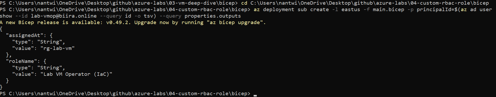

*Figure 4.24: The subscription-level deployment: role created and assigned on rg-lab-vm.*

**Result (14 Nov 2026):** deployed first time. Checked from the CLI: both
custom roles hold the identical five actions, and `lab-vmop` holds three
assignments, all on `rg-lab-vm`: Lab VM Operator, Lab VM Operator (IaC) and
Virtual Machine User Login.

## What I found

- **Built-in roles are wide by wildcard.** One line,
  `virtualMachines/*`, gives VM Contributor delete. Read a role's JSON before
  assigning it.
- **The portal shows buttons it will not honour.** Delete was offered and
  then refused by Azure. The check is on the request, not the menu.
- **Least privilege has a visible cost.** The operator could start the VM but
  not see its IP addresses, because those live on other resources.
- **Management plane and data plane are separate locks.** A role that can
  delete a VM cannot log in to it, and a role that can log in cannot delete
  it. Plain SSH keys sit outside both: only Entra login brings logins under RBAC.
- **Login is a role too.** User Login = shell; Administrator Login = shell +
  `sudo`.

The sentence to keep: *read the `actions` list, not the role name.*

## Cost

Roles, assignments, users and managed identities are free. The only cost was
the lab 03 VM running during the tests (about 10 cents an hour).

## Teardown

`rg-lab-vm` was deleted on 19 Nov 2026, which removed every assignment on it,
the VM's identity and its extension. Nothing in this lab bills any more. The
leftovers are free and are removed with:

```powershell
az role definition delete --name "Lab VM Operator (IaC)"
az role definition delete --name "Lab VM Operator"
az ad user delete --id lab-vmop@biira.online
```
