> **Intent:** Create users and groups at scale: bulk invite, dynamic membership rules, and group-based licensing, and see where dynamic rules lag.

> **Status:** free-tier parts done (15 to 19 Nov 2026): bulk users, guests, groups, nesting, a role through a nested group, and a Bicep rebuild, deployed and verified. Dynamic groups, group-based licensing and SSPR need Entra ID P1 or P2 and are deferred to a P2 trial alongside lab 19.

## What this lab is

The tenant has no paid licences, so this lab does everything Entra ID Free
allows and records the rest as deferred. It creates six staff for a fictional
Biira Bank branch and treasury team, invites two outside guests, groups the
staff by team, nests both teams inside one all-staff group, and then gives a
single Azure role to that one group to prove the access reaches people two
levels down.

## Questions

1. **Where does a guest's password live: in our tenant or theirs?**
2. **What does a guest's user principal name look like in our tenant?**
3. **A group whose members are two groups: how many members does it have?**
4. **If L5-All-Staff gets Reader on a resource group, does Kofi, who is only in L5-Branch-Operations, get Reader too?**

### Predictions (written before testing)

| # | My prediction | What actually happened |
|---|---|---|
| 1 | In their tenant, not mine. | **Right.** The guest signs in at home (here, Google). Our tenant holds a pointer account with no password. |
| 2 | (not answered) | Their email with `@` changed to `_`, then `#EXT#@<tenant>.onmicrosoft.com` (Figure 5.5). |
| 3 | (not answered) | **Direct members 2, all members 8**: the two groups plus the six people (Figures 5.11, 5.12). |
| 4 | Yes, through inheritance. | **Right.** Check access on Kofi shows Reader on `rg-lab-vm`, assigned to **L5-All-Staff** (Figure 5.14). |

## Key ideas, from zero

| Term | Plain meaning |
|---|---|
| **Member user** | An account that belongs to this tenant. Its password lives here. |
| **Guest (B2B) user** | An outside person invited in. They sign in with their own home account; our tenant keeps a guest object to hang access on. |
| **`#EXT#`** | The marker in a guest's UPN that says "identity lives elsewhere". |
| **Security group** | A list of identities used to grant access. The kind Azure RBAC uses. |
| **Microsoft 365 group** | A group that also gets a mailbox, calendar and SharePoint site. Not used here. |
| **Assigned membership** | Members are added by hand (or by script). Free. |
| **Dynamic membership** | Members are added by a rule, such as `user.department -eq "Treasury"`. Needs P1. |
| **Nested group** | A group that is a member of another group. |
| **Direct vs all members** | Direct: what was added to this group. All: everyone reached by following the nesting. |
| **Check access** | IAM view that shows a person's effective roles and *which assignment* they come from. |

## Architecture

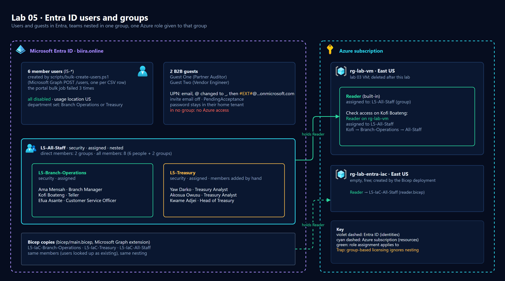

*Figure 5.2: Lab 05 architecture. Source: [`diagrams/architecture.drawio`](https://github.com/noble-antwi/az-104-labs/blob/master/05-entra-users-groups/diagrams/architecture.drawio).*

## What gets built

| Item | Setting | Why |
|---|---|---|
| 6 users `l5-*@biira.online` | disabled, usage location US, job title and department set | staff to group; disabled so nobody can sign in |
| 2 guests | invite email off, no group | outside identities with nothing granted |
| `L5-Branch-Operations` | security, assigned: Ama, Kofi, Efua | team group |
| `L5-Treasury` | security, assigned: Yaw, Akosua, Kwame | team group |
| `L5-All-Staff` | security, assigned: the two groups, no people | the nested group |
| Role assignment | Reader on `rg-lab-vm` to L5-All-Staff | access through nesting |

The `l5-` prefix keeps these users apart from the identity-lab users already in
the tenant.

## Build it in the portal

### 1. Six users from a CSV

**Users → Bulk operations → Bulk create** takes a CSV built from the portal's
own template ([`other_files/CreateUsersTemplate.csv`](https://github.com/noble-antwi/az-104-labs/blob/master/05-entra-users-groups/other_files/CreateUsersTemplate.csv)).
Each row needs a name, UPN, initial password and `accountEnabled`. The
passwords were generated locally and kept in a file Git ignores
(`*.WITH-PASSWORDS.csv`); the committed copy,
[`other_files/bulk-create-users.example.csv`](https://github.com/noble-antwi/az-104-labs/blob/master/05-entra-users-groups/other_files/bulk-create-users.example.csv),
has them replaced.

The bulk job **failed three times** with *An unexpected error occurred on the
server*: with the full 17-column file, with a trimmed 9-column file, and through
the "original experience" link. The audit log showed the job being created and
then no *Add user* attempts at all, so the fault was in Microsoft's bulk
service, not in the data (see Break it).

The same CSV went through Microsoft Graph instead, with
[`scripts/bulk-create-users.ps1`](https://github.com/noble-antwi/az-104-labs/blob/master/05-entra-users-groups/scripts/bulk-create-users.ps1): one
`POST /users` per row, the call the portal makes underneath. Passwords are sent
only to Graph and never printed. All six were created (Figure 5.3) and checked
from the CLI: disabled, right department, usage location US.

```powershell
powershell -ExecutionPolicy Bypass -File .\bulk-create-users.ps1 -CsvPath ..\other_files\bulk-create-users-v2.WITH-PASSWORDS.csv
```

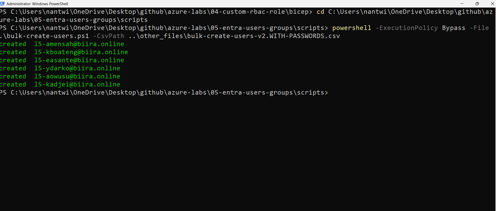

*Figure 5.3: Six users created through Microsoft Graph after the portal bulk job failed.*

### 2. Two guests

**Users → New user → Invite external user**, with **Send invite message**
unticked: the guest object is created either way, and the person could accept
later through the redirect link (Figure 5.4).

The first attempt used a Gmail `+` address and was refused with *The Primary
SMTP Address is an invalid value*; no guest was created. A dot address worked.
Both guests show as **Guest**, **PendingAcceptance** (Figure 5.5).

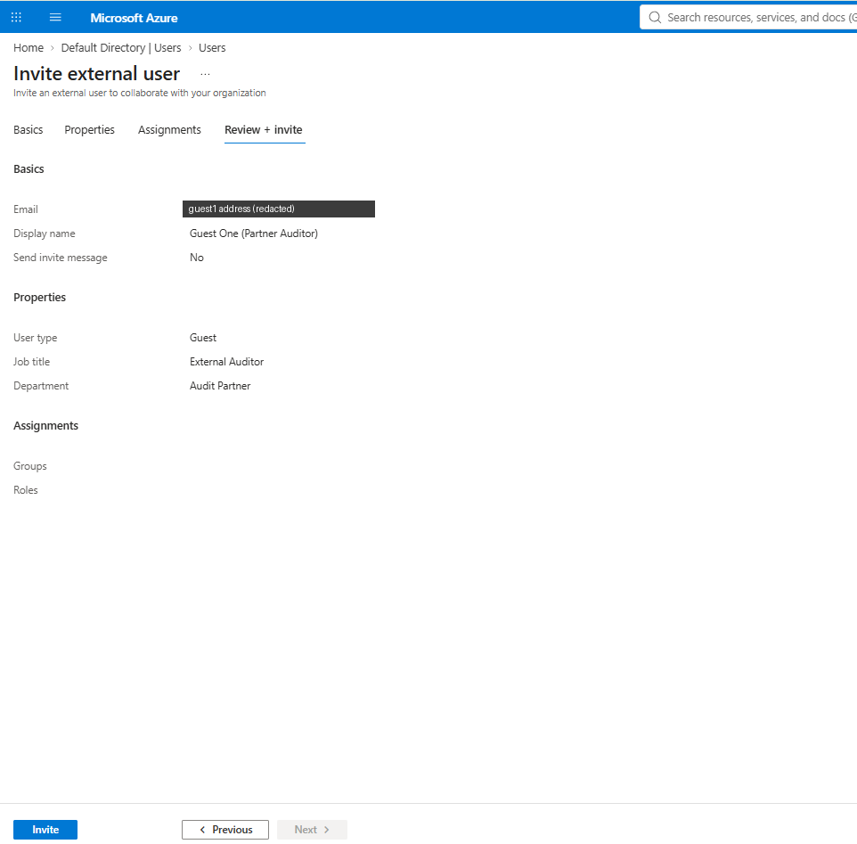

*Figure 5.4: Invite review: Guest, job title and department set, Send invite message: No (email redacted).*

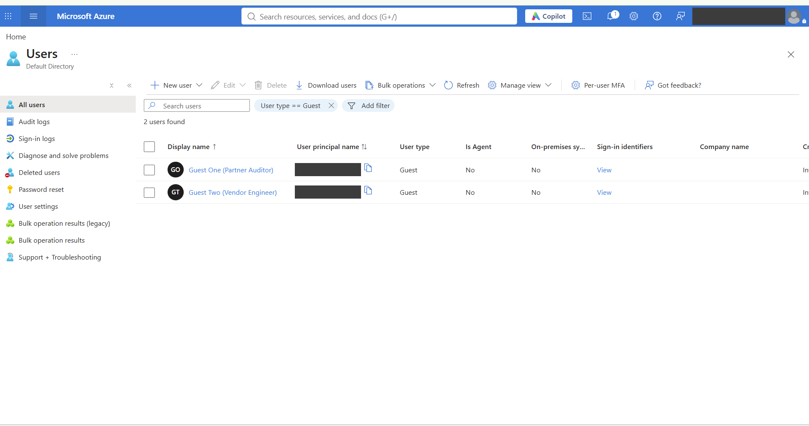

*Figure 5.5: Two guests. The UPN column holds the email with `@` as `_` plus `#EXT#` (redacted).*

### 3. Team groups

**Groups → New group**: Security, Assigned. `L5-Branch-Operations` got its
three members in the form (Figures 5.6, 5.7).

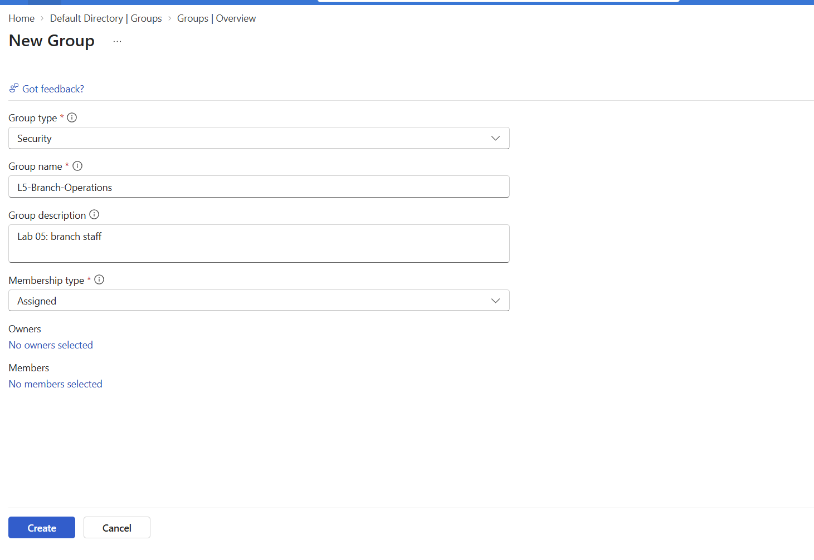

*Figure 5.6: Security group, Assigned membership. Dynamic would need P1.*

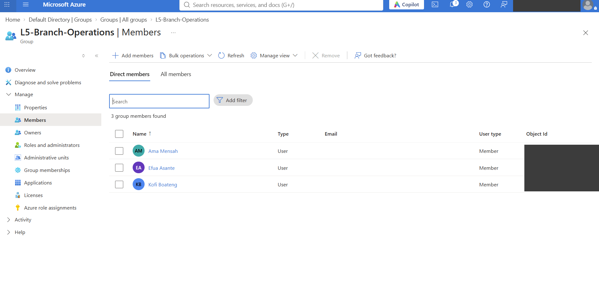

*Figure 5.7: L5-Branch-Operations: three direct members (object IDs redacted).*

`L5-Treasury` was created empty to try **Members → Bulk operations → Import
members** with [`other_files/treasury-members.csv`](https://github.com/noble-antwi/az-104-labs/blob/master/05-entra-users-groups/other_files/treasury-members.csv).
The portal skips the template's second ("Example:") line, so it stays. Both
imports **Failed** (Figure 5.8), the same bulk-service fault as step 1. The
three members were added by hand (Figure 5.9).

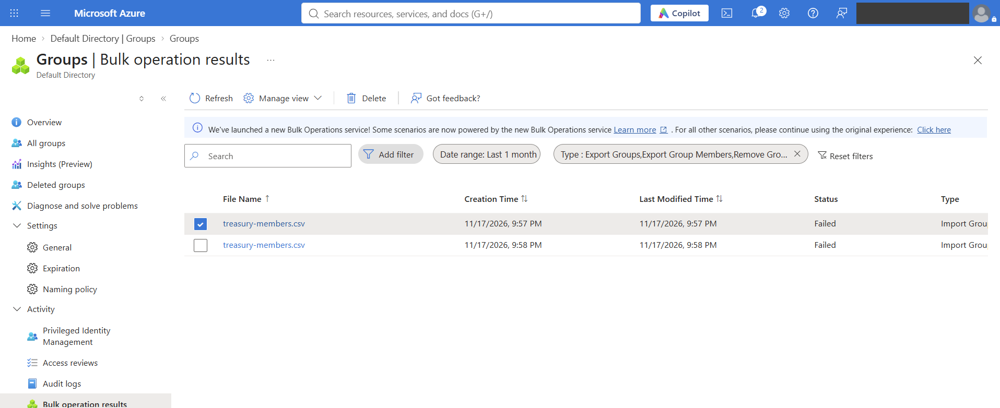

*Figure 5.8: Both bulk member imports: Failed.*

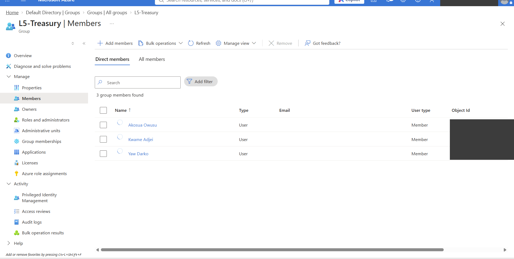

*Figure 5.9: L5-Treasury: three members added by hand (object IDs redacted).*

### 4. The nested group

`L5-All-Staff` takes the **two groups** as members and no people (Figure 5.10).
**Direct members** shows 2 (Figure 5.11). **All members** shows 8: the six
people plus the two groups, because Entra follows the nesting (Figure 5.12).

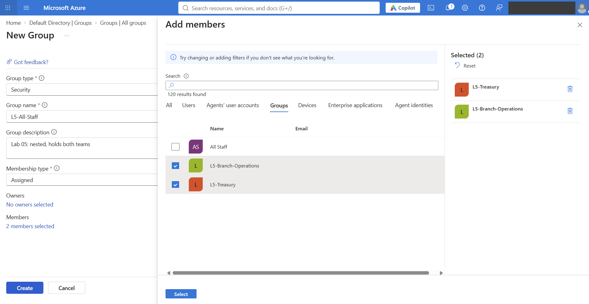

*Figure 5.10: The Groups tab of the picker: both team groups selected.*

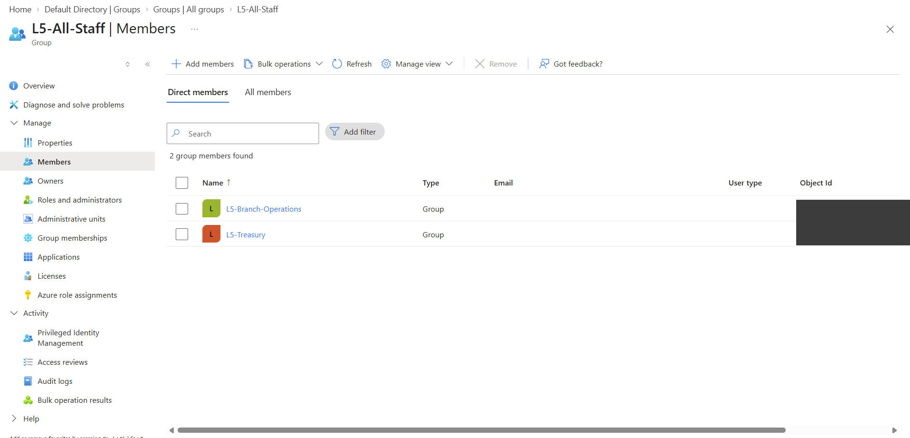

*Figure 5.11: L5-All-Staff, direct members: two groups (object IDs redacted).*

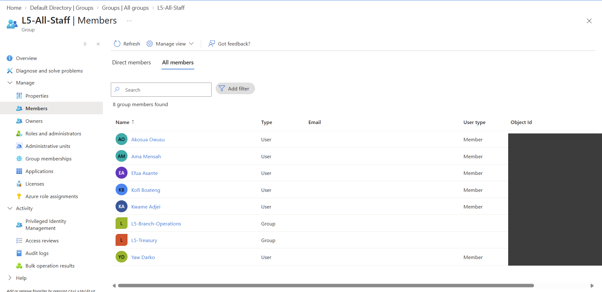

*Figure 5.12: L5-All-Staff, all members: eight (object IDs redacted).*

### 5. One role for the nested group

`rg-lab-vm` (from lab 03) → **Access control (IAM)** → **Add role
assignment** → **Reader** → **L5-All-Staff** (Figure 5.13). Then **Kofi
Boateng → Azure role assignments**: Reader on `rg-lab-vm`, **Assigned To
L5-All-Staff** (Figure 5.14). Kofi was never named; he is in
Branch-Operations, which is in All-Staff. Reader holds only read actions
(Figure 5.15).

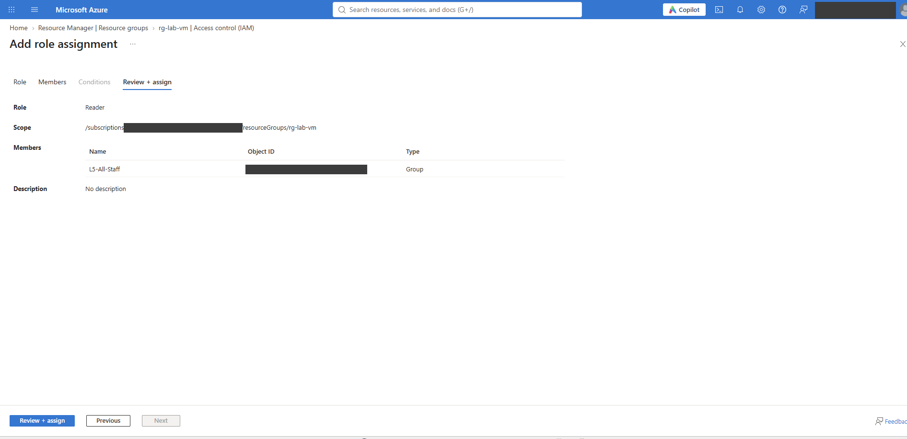

*Figure 5.13: The assignment: one group, Reader, on rg-lab-vm (subscription and object IDs redacted).*

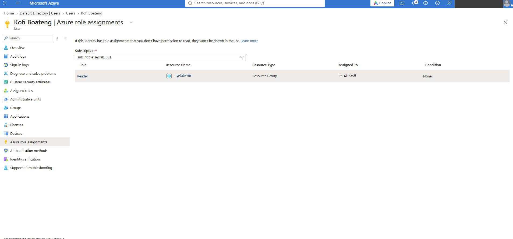

*Figure 5.14: Kofi has Reader on rg-lab-vm, assigned to L5-All-Staff: access through nesting.*

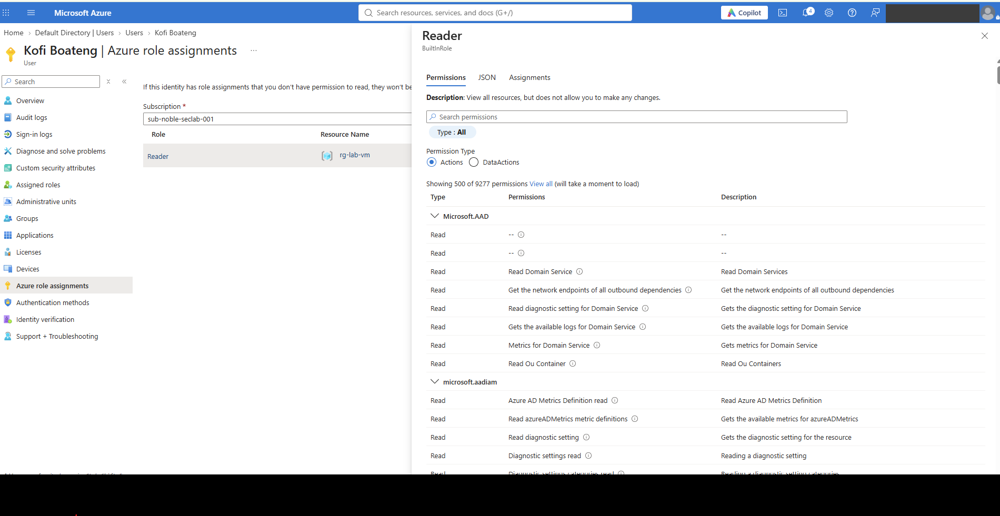

*Figure 5.15: Reader: read actions across every provider, no writes.*

## Break it

The lab broke itself three times, usefully:

- **Portal bulk create users: failed 3 of 3.** Different files, both
  experiences, same *unexpected error*. The audit log is what proved it was
  the service: a `CreateBulkJob` success and no user creation attempts.
  **Fix: call the API the portal uses** (Graph `POST /users`).
- **Portal bulk import members: failed 2 of 2.** Same service, same fault.
  For three members, clicking is faster than debugging.
- **Guest invite with a `+` address: refused** (*The Primary SMTP Address is
  an invalid value*). A valid email address can still be one Entra will not
  invite.

## Rebuild it as code

Groups live in Entra ID, not in Azure Resource Manager, so plain Bicep cannot
create them. The **Microsoft Graph Bicep extension** can
([`bicep/bicepconfig.json`](https://github.com/noble-antwi/az-104-labs/blob/master/05-entra-users-groups/bicep/bicepconfig.json) pins it at `1.0.0`).
[`bicep/main.bicep`](https://github.com/noble-antwi/az-104-labs/blob/master/05-entra-users-groups/bicep/main.bicep) runs at subscription level and hands the
role assignment to [`bicep/reader.bicep`](https://github.com/noble-antwi/az-104-labs/blob/master/05-entra-users-groups/bicep/reader.bicep):

| Portal step | Bicep | Note |
|---|---|---|
| Users already exist | `Microsoft.Graph/users@v1.0` **existing**, by UPN | IDs looked up at deploy time, never stored |
| New group, Security, Assigned | `Microsoft.Graph/groups@v1.0` | `uniqueName` is how Bicep finds the group again on redeploy |
| Add members | `members: { relationships: [ ...ids ] }` | |
| Nested group | `relationships: [ branchOps.id, treasury.id ]` | groups as members |
| Add role assignment | module `reader.bicep`, `principalType: 'Group'` | Reader's built-in ID is the same in every tenant |

The copies are named `L5-IaC-*` and the assignment lands on a new, empty, free
resource group, `rg-lab-entra-iac`, because `rg-lab-vm` was deleted with lab 03.

```powershell
cd 05-entra-users-groups\bicep
az deployment sub create -l eastus -n lab05-groups -f main.bicep --query properties.outputs
```

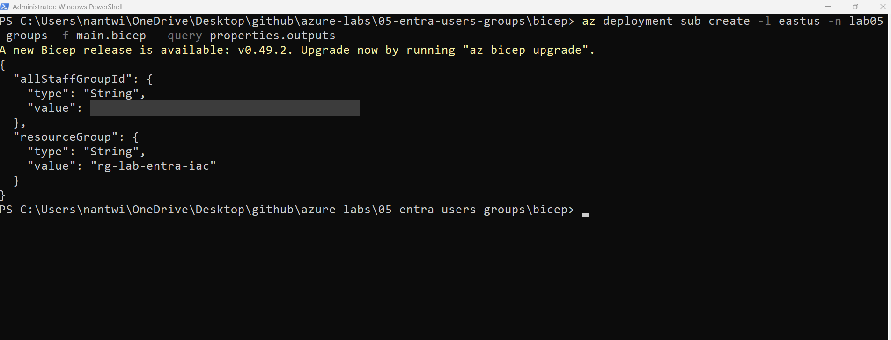

*Figure 5.16: The subscription-level deployment: the nested group's ID and the new resource group (group ID redacted).*

**Result (19 Nov 2026):** deployed first time. Checked from the CLI: the two
team groups hold the same three people each, `L5-IaC-All-Staff` holds the two
team groups, and `rg-lab-entra-iac` (no resources) has one assignment: Reader
to `L5-IaC-All-Staff`, type Group.

## What I found

- **When a portal tool fails, the API underneath usually works.** The bulk
  service failed five times in two places; Graph created the same users first
  time. The audit log tells you which side is broken.
- **A guest is a pointer, not an account.** No password in our tenant; the
  UPN is their email rewritten with `#EXT#`.
- **Membership is the access.** The guests were invited but in no group, so
  they got nothing.
- **Give roles to groups, not people.** One assignment covered six people two
  levels down. Adding someone to a team is the whole access change.
- **Nesting works for Azure roles, not for everything.** Group-based
  licensing ignores nested groups: a licence given to L5-All-Staff would reach
  nobody. (Exam trap.)

The sentence to keep: *assign to groups; check effective access with Check
access, which names the group it came from.*

## Deferred to a P2 trial (with lab 19)

| Topic | Why deferred |
|---|---|
| Dynamic groups (`user.department -eq "Treasury"`) | needs P1; the department values are already set on the six users |
| Group-based licensing | needs a licence to assign |
| Self-service password reset for users | needs P1 |

## Cost

Free. Users, guests, groups and role assignments cost nothing, and the
Bicep resource group is empty. The only cost in this lab was the lab 03 VM's
disk and public IP while `rg-lab-vm` existed.

## Teardown

`rg-lab-vm` was deleted on 19 Nov 2026, which removed the Reader assignment.
The users, guests and groups stay for the P2 trial (dynamic groups by
department). When finished:

```powershell
az group delete --name rg-lab-entra-iac --yes --no-wait
# then the L5-IaC-*, L5-* groups, the six l5- users and the two guests, in the portal or with az ad group/user delete
```
