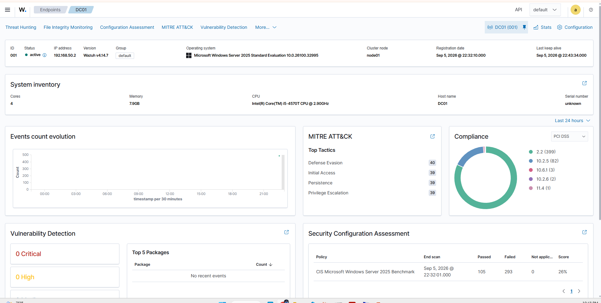
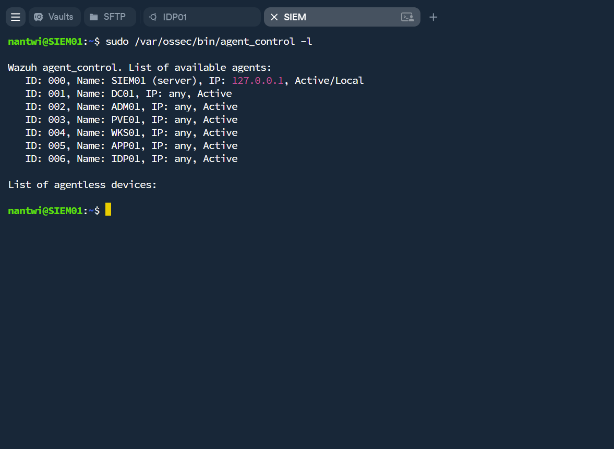
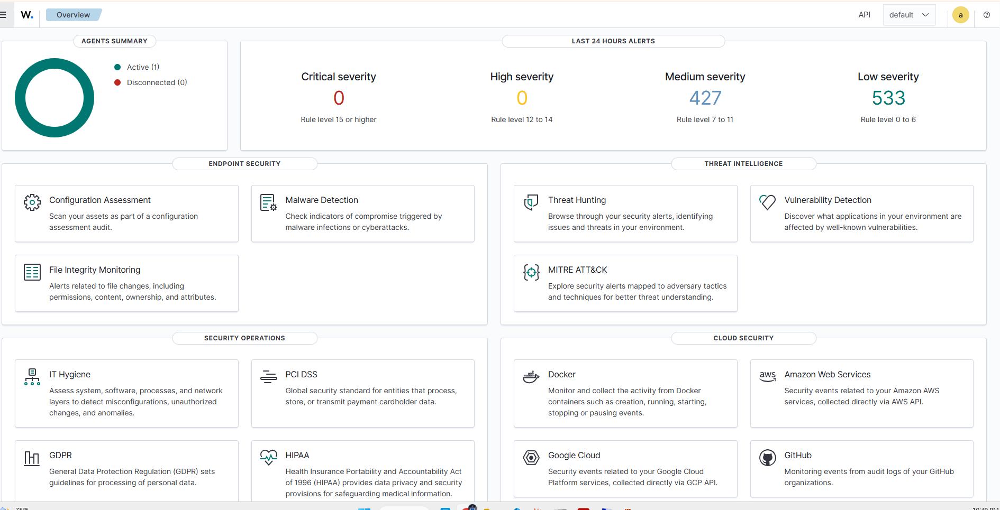
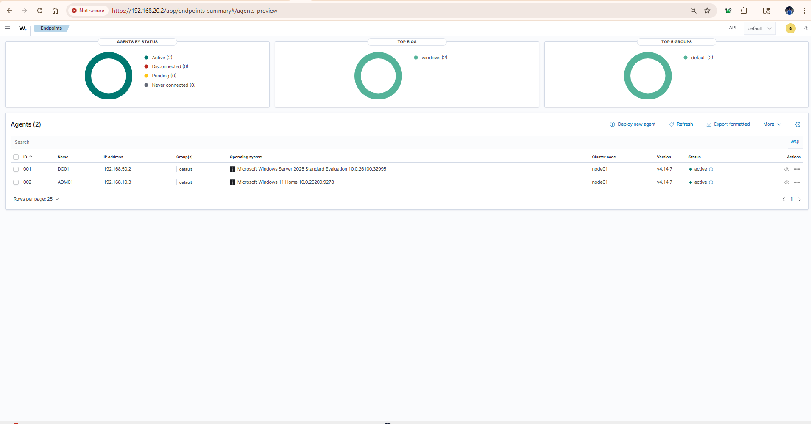
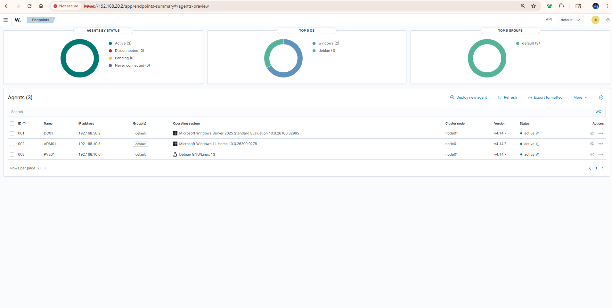

## In plain words

A monitoring server only sees the machines that report to it. Each machine needs a program, called an agent, that sends its activity to the server. I installed that program on the lab's machines one at a time, and worked through the network and installation problems that came up along the way, until each machine was reporting.

## What I did, step by step

1. Installed the agent on the domain controller and found that nothing appeared on the monitoring server.
2. Corrected the firewall rule, reloaded the firewall and saw the first machine connect (Figure 14.3).
3. Enrolled the administrative workstation and saw, from its recorded address, that its traffic had gone around the firewall.
4. Added a fixed route so the traffic crosses the firewall, and confirmed it by the agent's new address (Figure 14.4).
5. Worked through three failed installs on the hypervisor, the machine every virtual machine depends on, then installed cleanly.
6. Confirmed three machines reporting across two operating-system families (Figure 14.5).
7. Enrolled four more machines afterwards, including the identity provider before its own software went on it (Figure 14.2).

## The background

A SIEM with no agents only watches itself: the Wazuh manager monitors its own host as agent `000`, and everything else has to be enrolled. The first three agents, DC01, ADM01 and PVE01, were reporting by 6 September 2026. WKS01, APP01, IDP01 and VAULT01 followed as agents 004 to 007.

## Who reports, and what they send

| Host | Role | Note |
|---|---|---|
| DC01 | Domain controller | Agent 001, the first enrolled |
| ADM01 | Administrative workstation | Where domain credentials are typed |
| PVE01 | Proxmox hypervisor | Every guest depends on it |
| WKS01 | Workstation | Agent 004 |
| APP01 | Hosts Stock Copilot, an internal app | Agent 005, reads the app's identity audit log as JSON |
| IDP01 | Identity provider (Keycloak) | Agent 006, enrolled before Keycloak was installed |
| VAULT01 | Secrets (HashiCorp Vault) | Agent 007, also reads Vault's audit log |

Sysmon runs on the three Windows machines. APP01 is the unusual one: it ships an application's identity audit log rather than operating-system events.

Figure 14.1 shows how much one agent install delivers on DC01.

*Figure 14.1: DC01 as the SIEM sees it. Inventory, ATT&CK tactic counts, vulnerability detection and a CIS Windows Server 2025 run, from one agent install.*

IDP01 was enrolled before the software it exists to run. Figure 14.2 shows it listed on SIEM01 as agent 006.

*Figure 14.2: IDP01 enrolled with the SIEM as agent 006 before Keycloak went on it. An identity provider is a Tier 0 system, so it was watched from its first day.*

## The rule goes where the conversation starts

Agents dial out to the manager, and the manager listens. A pfSense rule governs who may start a conversation, so the rule that lets DC01 report belongs on the interface DC01's traffic arrives on, not on the SIEM's own segment.

DC01's agent installed, the service started, and nothing appeared in the dashboard. There were two causes in sequence. The firewall rule had been copied from another rule and carried the wrong source and service, so it matched nothing. Once that was corrected, the filter had not been reloaded: a saved rule is not an enforced rule.

With both fixed, DC01 connected. Figure 14.3 shows the overview with one agent active and none disconnected.

*Figure 14.3: One agent active and none disconnected. The alert counts on the overview now include a real endpoint rather than the manager alone.*

From the dashboard, an agent that cannot reach its manager looks exactly like a broken one. A port test to the manager on 1514 from the endpoint separates the two in seconds.

## The agent that went around the firewall

ADM01 enrolled with the same procedure, and what the SIEM recorded was the interesting part. The agent registered with a Tailscale address, not the laptop's VLAN 10 address of `192.168.10.3`. The traffic had not crossed the firewall at all.

pfSense acts as a Tailscale subnet router and advertises the lab networks into the tailnet, so the laptop held a `/24` route to the SIEM's network over the overlay, and a `/24` beats the default route. The management rule was correct, applied, and had passed no traffic. The SIEM's own asset inventory is what exposed it.

The fix beats specificity with more specificity: a persistent host route to SIEM01 through the VLAN 10 gateway. After a service restart the agent re-registered as `192.168.10.3`, which is the evidence that the rule is carrying traffic. Figure 14.4 shows both agents after the change. Away from home the gateway is unreachable, the route drops out, and the agent falls back to Tailscale.

*Figure 14.4: DC01 and ADM01 both active. ADM01's registered address is `192.168.10.3` rather than its earlier tailnet address, which confirms the management rule is being exercised.*

## Three surprises on the hypervisor

PVE01 needed no new firewall rule, because the management rule was written against the subnet rather than a single address. I checked the route before installing anything, the habit ADM01 produced. The install then failed three times:

1. **`sudo: command not found`.** The dashboard's generated command assumes `sudo`. Proxmox is a minimal Debian operated as root, so the download succeeded and the install never ran.
2. **A missing dependency.** `dpkg -i` installs exactly the file it is given and does not resolve dependencies.
3. **`Invalid server address found: 'MANAGER_IP'`.** The manager address is substituted into the configuration on first install only. The earlier attempt had already unpacked the package, so the placeholder survived the retry. A purge and a clean install fixed it, and I verified the configuration before starting the service.

Figure 14.5 shows the result: three agents active across two operating-system families.

*Figure 14.5: Three agents active across two operating-system families: two Windows and one Debian. PVE01 is registered from `192.168.10.6`, the host's real address.*

## What I took from it

- An agent's registered address reports the path the traffic took, not the machine's primary identity.
- A firewall rule that has never passed traffic proves nothing, however correct it looks.
- A failed installation is not a neutral state. Purge before retrying.

The full runbook, with every command, is [chapter 16 in the repository](https://github.com/noble-antwi/enterprise-security-homelab/blob/main/docs/16-siem01-build.md).
