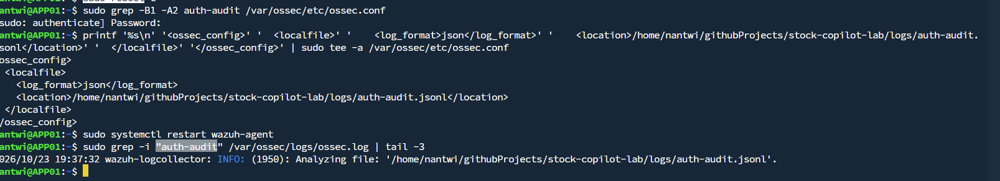
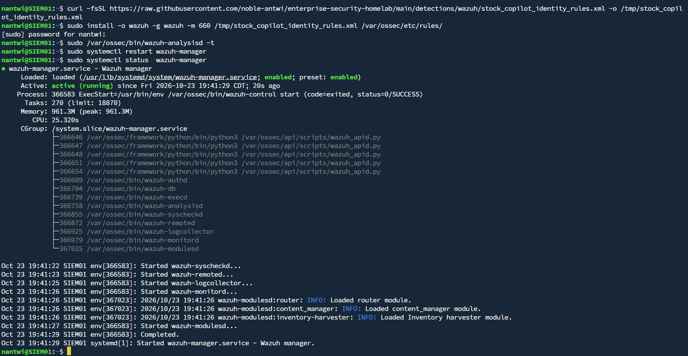
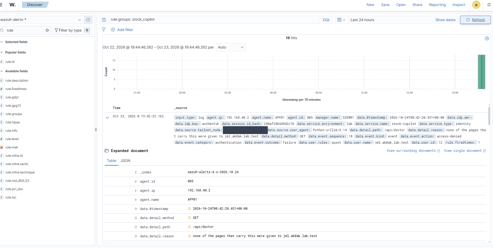

## In plain words

When an application turns someone away at sign-in, only that application knows it happened and why. I connected the sign-in audit log of Stock Copilot, an application in my lab, to the monitoring server (the system that collects every machine's activity log) and wrote thirty rules to read it. Forged or misused credentials now raise an alert, while routine sign-ins are recorded quietly.

## What I did, step by step

1. Wrote thirty rules for the application's audit log and mapped them to MITRE ATT&CK, a catalogue of attack techniques.
2. Kept ten of the thirty as quiet records that never page anyone, such as an ordinary sign-in.
3. Tested them in a throwaway copy of the monitoring software, replaying 61 sample events and 676 real ones from the lab's history.
4. Corrected two rules whose first versions were wrong.
5. Configured the reporting agent on the application's server to read the audit log, and confirmed it was following the file (Figure 16.1).
6. Installed the rules on the monitoring server from version control, checked them and loaded them (Figure 16.2).
7. Proved it that evening: the application's attack probe produced 18 alerts, every one decoded into its fields (Figure 16.3).

## The background

Most of my lab's alerts come from operating systems: Windows event logs, Sysmon, a Linux audit trail. A forged SAML assertion being turned away, a token used past its scope, or someone resetting the break-glass account happens somewhere else. Only the application that checked the credential knows it refused one, and why.

Stock Copilot runs on APP01, in the DevOps segment. It signs people in through more than one identity provider, provisions accounts over SCIM, issues API tokens and rotates its own signing keys. Every one of those decisions writes a line to an audit log.

## One log shape, one parent rule

Each event is one line of JSON with the same shape: who (`user.name`), from which device on the tailnet (`source.tailnet_node`), through which provider (`idp.key`), what happened, and for refusals a `detail.reason` in plain words. The Wazuh agent on APP01, agent 005, reads the file as JSON, so the fields arrive already decoded.

Every rule hangs off one parent, rule 100400, which claims an event only when `service.name` is `stock-copilot` and `service.type` is `identity`. On its own it is silent, at level 0. The set has its own numbering block, 100400 to 100499.

## Thirty rules, mapped to MITRE ATT&CK

A sample of the thirty:

| What it watches | ATT&CK | Level |
|---|---|---|
| A forged token, unsigned or using algorithm confusion | T1606 | 12 |
| An unsigned, wrapped or tampered SAML assertion | T1606.002 | 12 |
| Signing keys changed outside any declared rotation | T1556 | 12 |
| Five refused credentials from one device in two minutes | T1110 | 10 |
| A SCIM call without a valid credential | T1136 | 10 |
| An API token used beyond its scope | T1550.001 | 8 |

Ten of the thirty never page anyone. A sign-in is level 3, a refused sign-in level 5, a scheduled key rotation or a signed-off access review level 3. They are the building blocks, since the password-guessing alert counts a quiet rule firing rather than raw events. They also hold the hardest decisions. A key rotation declared in advance is a drill. The same change with no declaration is level 12, and the difference is one field.

## Tested before deployment

A malformed rules file stops the Wazuh manager from starting at all, so nothing was copied to SIEM01 until it had passed somewhere disposable. The test starts a throwaway Wazuh 4.14.7 manager container with no network, checks the file, and replays events through `wazuh-logtest`:

- **61 sample events** written by the app's own audit code, all 61 reaching the rule they were written for.
- **676 real events** from the lab's own history: earlier attack scenarios, key rotation drills and an attack probe. Every refusal landed on its rule. The forged-token rule fired nine times, the forged-SAML rule twice, the SCIM rule thirteen times.

The rules went live on SIEM01 on 23 October 2026. Figure 16.1 shows the agent on APP01 being told to read the app's audit log and confirming that it is following the file. Figure 16.2 shows the rules file being installed on SIEM01, checked and loaded.

*Figure 16.1: The agent on APP01 reading the app's identity audit log as JSON, confirmed in its own log.*

*Figure 16.2: The rules deployed from version control: installed, tested and loaded, with the manager back to active.*

That evening the app's attack probe was fired at 19:42 and produced 18 alerts, every event arriving on SIEM01 decoded, under `rule.groups: stock_copilot`. Figure 16.3 is that result.

*Figure 16.3: Eighteen alerts from the probe, each decoded into fields on SIEM01. One address is redacted.*

## Two rules that were wrong

**Count credentials, not refusals.** The first password-guessing rule counted every refused sign-in. On the lab's own traffic it raised seven false alerts, all of them refusals by policy: a person who was never provisioned, a group with no mapping to a role. It now counts refused credentials only, and counts them per tailnet device rather than per username, because a refused passkey names nobody and a guesser can change the email on every try.

**A word is not a meaning.** The forged-SAML rule first matched any reason containing "assertion". That would have paged "assertion expired", which is usually clock skew, as forgery at level 12. It now matches only the signature failures, and a test in the app's repository checks every rule against the app's real refusal wording.

## What I took from it

- The application is the only witness to its own refusals.
- Decide what stays quiet first. The ten rules that never page are where the judgement is.
- Test against your own history, not only samples.

The longer account is in [Watching the Front Door](/lab-notes/2026/10/27/watching-the-front-door.html).

The full table, the numbering blocks and the deployment steps are kept with [the rules, in version control](https://github.com/noble-antwi/enterprise-security-homelab/tree/main/detections).
