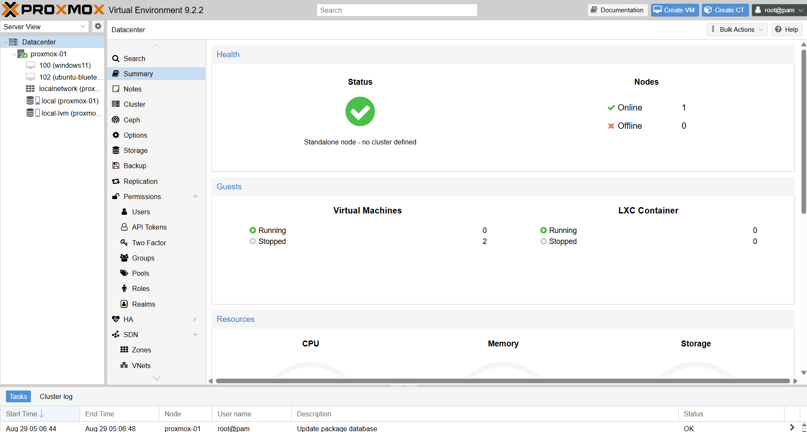
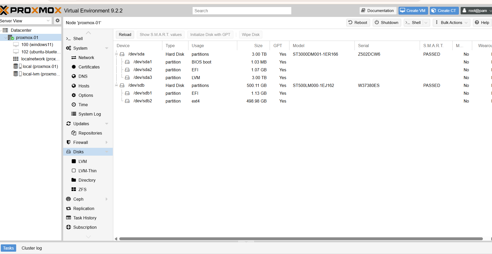
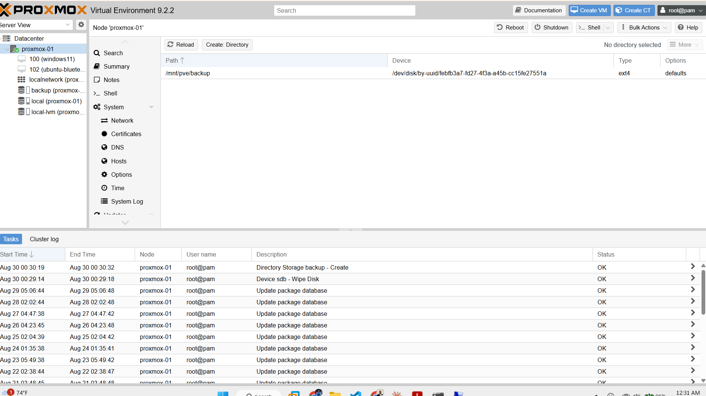
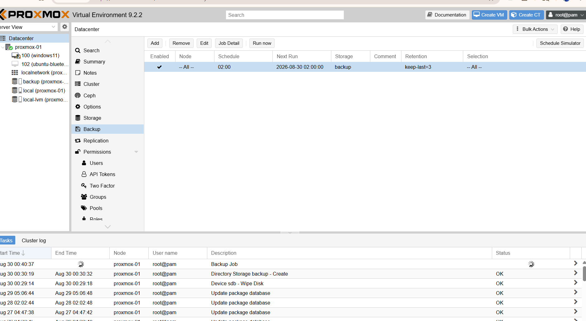

## In plain words

A backup is a separate, kept copy of a machine that survives when the original is lost or damaged. Every guest machine on the lab's virtual machine host is now copied each night to a different physical disk from the one it runs on. A lost or broken machine then becomes a restore, not a rebuild.

## What I did, step by step

1. Reviewed the host's two physical disks, which both reported a passing health status (Figure 6.2).
2. Wiped the second disk, which had been an old operating system disk, and made it dedicated backup storage (Figure 6.3).
3. Scheduled one job on 30 August 2026 to back up every guest machine daily at 02:00 and keep the last three copies.
4. Ran the job by hand instead of waiting for the schedule, and it finished successfully (Figure 6.4).
5. Confirmed that backup files were present on the backup disk for both guest machines that existed at the time.

## The background

A running VM is not a backup of itself. Snapshots help with a quick rollback, but a real backup is an independent, retained copy that survives disk loss, a bad change or a corrupted guest. Two failures of physical machines in this lab, a server NIC and the Wazuh host losing power, made the point concretely: anything not backed up is one hardware fault away from a rebuild. So every guest on the hypervisor is now backed up nightly to a separate physical disk.

## Where the backups live

The Proxmox host is a standalone node with eight cores, about 32 GiB of RAM and two physical disks. Figure 6.1 is its Datacenter summary view in Proxmox.

*Figure 6.1: The Proxmox Datacenter summary: a healthy standalone node, `proxmox-01`, with no cluster. This is the top-level health and inventory view.*

The two disks have separate roles.

| Disk | Size | Role |
|---|---|---|
| `/dev/sda` | 3 TB | Proxmox OS and primary guest storage (`local`, `local-lvm`) |
| `/dev/sdb` | 500 GB | Backup target (`backup`, ext4 Directory storage) |

Figure 6.2 shows both disks as the node reports them.

*Figure 6.2: The two physical disks, `/dev/sda` at 3 TB and `/dev/sdb` at 500 GB, before `sdb` was repurposed. Both report SMART "PASSED".*

The second disk had previously been an operating system disk, with leftover EFI and ext4 partitions. I wiped it and created a Directory storage named `backup`, mounted at `/mnt/pve/backup`, with the content type set to VZDump backup file. Figure 6.3 shows the result.

*Figure 6.3: The `backup` Directory storage mounted at `/mnt/pve/backup` on the ext4 `sdb` disk. This is the dedicated backup target, separate from the disk that holds the running guests.*

The reason for a separate disk is a basic tenet of recoverable design: the backup must survive the thing it is protecting against. If the backups sat on the same disk as the running VMs, a failure or corruption of that disk would take both.

## The job

I configured one scheduled job on 30 August 2026.

| Setting | Value | Reason |
|---|---|---|
| Schedule | Daily at 02:00 | Off-hours, low activity |
| Selection | All guests | Future VMs and containers are included automatically, so there is no rule to forget |
| Mode | Snapshot | Backs up running guests with minimal disruption |
| Compression | ZSTD | Fast, with a good ratio |
| Retention | Keep last 3 | Recent restore points without filling the disk |
| Target | `backup` | Survives loss of the primary disk |

## Proving it ran

A schedule is a promise, not evidence, so I did not wait for 02:00. I started the job on demand and checked two things: the task finished with `TASK OK`, and backup files were present under the `backup` storage for both guests that existed at the time. Figure 6.4 shows the job, with that verification run as the task at the bottom.

*Figure 6.4: Nightly backup job, verified by an on-demand restore point. Mapped to NIST CP-9 in the runbook.*

Recovery is a short, documented path: open the `backup` storage, choose Backups, select the restore point and choose Restore. A lost or broken guest becomes a restore, not a rebuild. The runbook puts the principle bluntly: a backup never verified by a restore is only a hope.

## What the design changed elsewhere

The backup job turned out to shape a later decision. The Vault server was originally going to live on a physical host. It was built as a Proxmox guest instead, partly to keep it away from other applications, and partly because a guest inherits the nightly backup. That matters for Vault in particular, because its encrypted store is the one thing that cannot be reconstructed.

The same thinking about known-good state applies to what goes into the hypervisor in the first place. An installation image is verified against its publisher's SHA256 checksum before it is used (NIST SI-7). The Kali image for the attack host is the recorded example in the repository: verifying software before it enters the environment is a control in its own right, and it matters most for a machine that will run offensive tooling.

## What I took from it

Three habits came out of this build:

- Put the backup on a different physical disk from the thing it protects.
- Select all guests, so protection is the default and not a task.
- Run the job by hand once and look at the files, instead of trusting the schedule.

A Directory target is enough for a single node. Proxmox Backup Server, which adds deduplication and incremental backups, is the option to revisit if backup volume grows.

The runbook maps the scheduled, independent, retained backups to NIST SP 800-53 CP-9 and the documented restore procedure to CP-10. These are lab-appropriate implementations, not a claim of formal compliance.

The full runbook, with every command, is [chapter 14 in the repository](https://github.com/noble-antwi/enterprise-security-homelab/blob/main/docs/14-proxmox-storage-backup-capacity.md).
