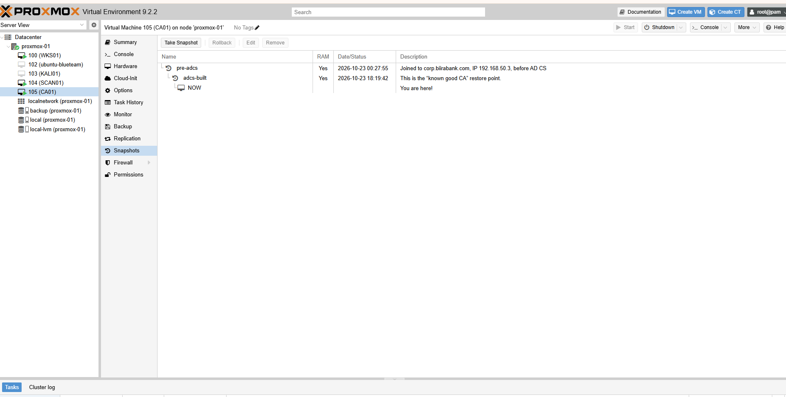
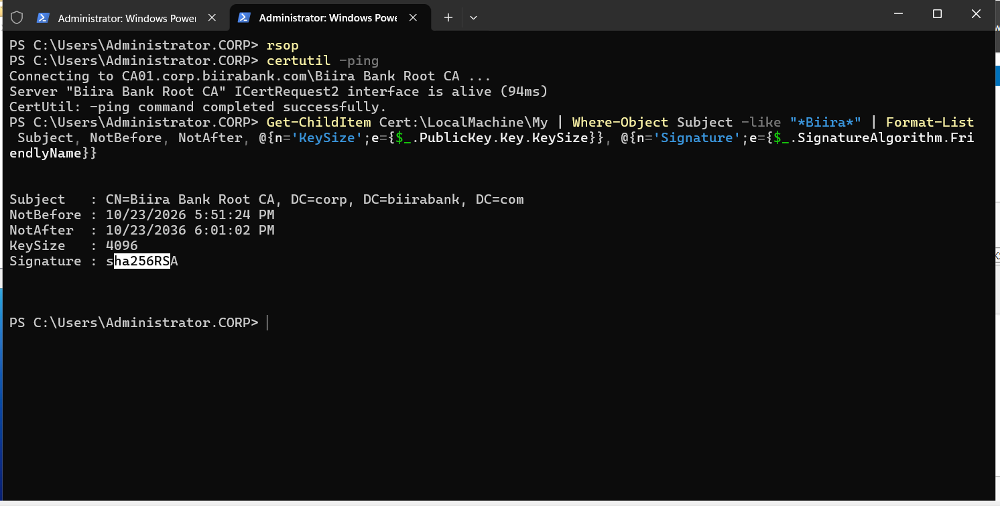
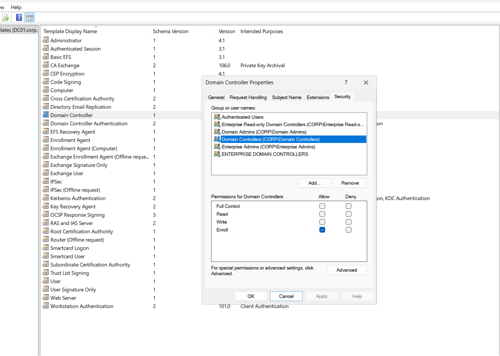
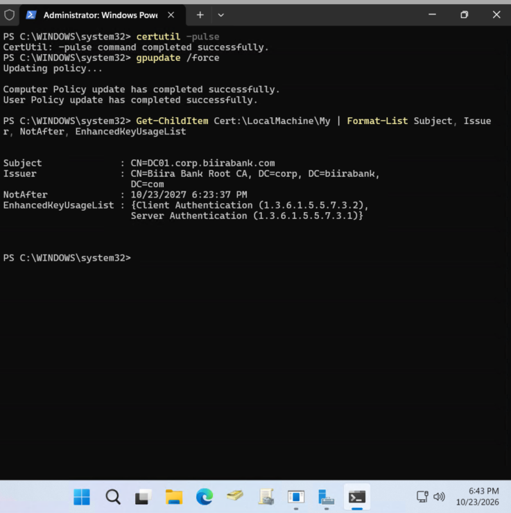
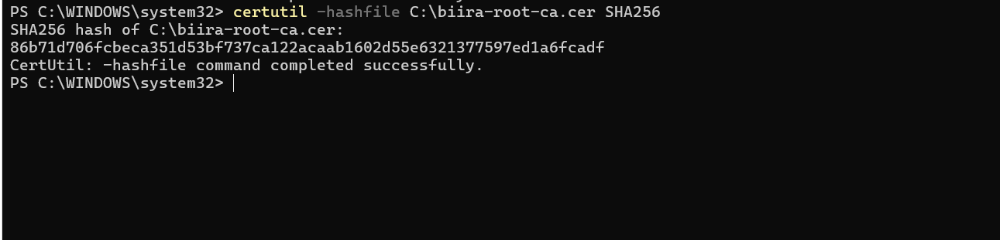
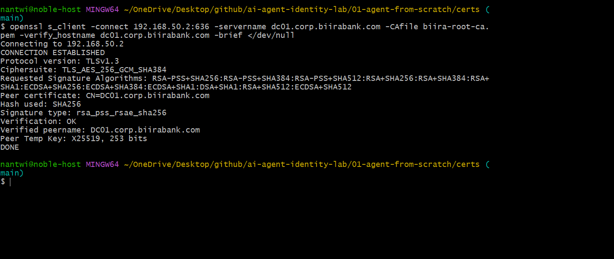

## In plain words

When an application checks a password against the company directory, that conversation should be encrypted, and the application should know it is talking to the real server. Both depend on a certificate, a signed proof of a server's identity, issued by an authority the other machines trust. I built that authority for the lab, and the domain controller (the server that holds every account) now answers over an encrypted connection that clients can verify.

## What I did, step by step

1. Built a Windows server beside the domain controller, joined it to the domain and took a restore point before the change (Figure 9.1).
2. Installed only the certificate authority role, then created the root authority with one recorded, repeatable command (Figure 9.2).
3. Ran two commands on the domain controller so it requested its own certificate, with its private key never leaving it (Figure 9.4).
4. Confirmed from inside the domain that the directory answered on its encrypted port, by name (Figure 9.5).
5. Exported the public half of the root certificate and computed its fingerprint before the file went anywhere (Figure 9.6).
6. Tested from a laptop outside the domain with the checked root, and the server's identity verified (Figure 9.7).
7. Proved the check matters by repeating it without the root, which could not confirm who the server was (Figure 9.8).

## The background

Applications that use Active Directory as their source of users sign in to it over LDAP, with a password. Two were waiting in the lab: an identity provider and an AI agent with its own service account. Plain LDAP on port 389 would have sent those passwords across VLANs where anything on the path could read them. LDAPS on 636 wraps the same conversation in TLS, but a domain controller only offers it once it holds a suitable certificate, and a certificate has to be issued by someone the clients trust. So Biira Bank needed its own certificate authority, and CA01 is it.

## The design

| Decision | Chosen | Why |
|---|---|---|
| CA type | Enterprise root | Integrated with the directory, so domain machines enrol themselves through templates |
| Key | RSA 4096, SHA-256 | A long-lived root is worth a key size that will outlast it |
| Validity | Ten years for the root, one year for what it issues | A root outlives what it signs, and short-lived certificates renew automatically |
| Placement | VLAN 50, `192.168.50.3`, beside DC01 | A CA lives with the identity tier it serves, and no firewall rule is needed between the two |

A CA is a Tier 0 asset: whoever controls it can mint a certificate the whole domain accepts.

## Building it

CA01 is a Windows Server 2025 guest on Proxmox, joined to `corp.biirabank.com` and moved into the servers OU. Two snapshots bracket the change, one before the CA existed and one of the known-good CA, so either side can be returned to in seconds. Figure 9.1 shows both.

*Figure 9.1: Two restore points around the change: `pre-adcs`, taken once the machine was joined and addressed, and `adcs-built`, the known-good CA.*

I installed only the Certification Authority role service. The web enrolment pages add listening services that nothing here needs. The CA itself was created with one command, the setup wizard written down so it can be reviewed and repeated. Figure 9.2 shows the result: the CA answering, and its root certificate.

*Figure 9.2: CA01 alive: an enterprise root CA, RSA 4096 and SHA-256, valid for ten years. A CA is a Tier 0 asset, so it lives beside the domain controller it serves.*

## DC01 enrols itself

Nobody requested a certificate for DC01 by hand, and no private key was copied anywhere. Two commands on DC01 set it off. `gpupdate /force` made it read what the new CA had published to the directory, so the root arrived in its trusted store. `certutil -pulse` ran auto-enrolment at once: DC01 found a certificate template it is allowed to enrol for, generated its own key pair locally, and sent CA01 only its name and public key to sign. The private key never left it. Figure 9.3 shows why DC01 was allowed to ask: the Domain Controllers group holds Enroll on the template. Figure 9.4 shows the certificate in DC01's own store.

*Figure 9.3: Template permissions are the CA's access control: they decide who may obtain which kind of certificate. Here the Domain Controllers group holds Enroll.*

*Figure 9.4: DC01 enrolled itself: gpupdate and certutil -pulse, and its own store holds a certificate for DC01.corp.biirabank.com. The private key was made on DC01 and has never left it.*

No restart and no LDAP configuration were needed. The directory service finds a suitable certificate by itself and now answers LDAPS on 636. Figure 9.5 is the proof from inside the domain, with `ldp.exe` connecting by name and reading the directory's root entry.

*Figure 9.5: LDAPS answering on 636, by name. Before the CA, the same connection was reset at the handshake.*

## Trust from outside the domain

Domain members trust the root because Group Policy put it in their stores. A machine that never joined the domain has to be given the root deliberately, and should check it was given the right one. I exported the root certificate, the public half only, and computed its SHA-256 fingerprint before the file went anywhere, as Figure 9.6 shows. The fingerprint is published in the runbook, so anyone who copies the root can compare.

*Figure 9.6: The root certificate fingerprinted before it went anywhere. Trusting a root is the most powerful trust decision a machine makes, so it is never made on an unchecked file.*

Then I tested from a laptop that never joined the domain. With the checked root, Figure 9.7 shows `openssl` reporting `Verification: OK` and the verified peer name.

*Figure 9.7: From a laptop that never joined the domain, holding the checked root: TLS 1.3, Verification: OK, verified peer name DC01.corp.biirabank.com.*

Figure 9.8 is the same command without the root: error 20, unable to get local issuer certificate.

*Figure 9.8: The same command without the root: error 20. The connection is encrypted, but nothing proves who is at the other end, so a real client stops here.*

Both connections are encrypted. Only one of them knows who is at the other end.

## What I took from it

- **A certificate is issued to a name.** Clients must dial `DC01.corp.biirabank.com`. The address works for the network and fails the identity check.
- **Encryption without verification protects against eavesdroppers, not impostors.**
- **The private key never travels.** DC01 made its own key pair and sent only the public half.
- **Read the hardware before the first boot.** The VLAN tag was first entered as 6 and corrected to 50 in a review before Windows was installed. A one-digit tag decides which network a CA lives on.

The first consumer is an [AI agent with its own identity](/work/ai-agent-identity-lab/), which signs in to DC01 over LDAPS as a read-only service account and verifies the certificate against this root by name.

The full runbook, with every command, is [chapter 22 in the repository](https://github.com/noble-antwi/enterprise-security-homelab/blob/main/docs/22-certificate-authority-ca01-and-ldaps.md).
