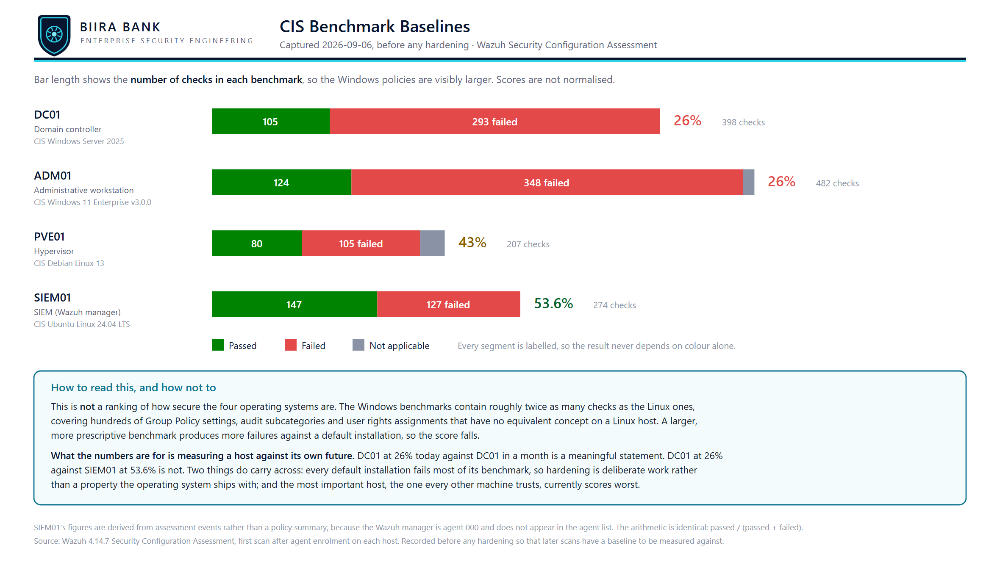
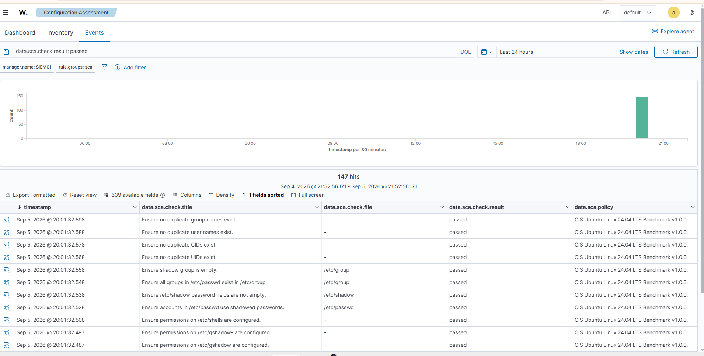

## In plain words

A hardening benchmark is a published checklist of settings that make a computer harder to attack. My monitoring software scores each machine against the checklist for its own operating system. Before changing anything, I recorded those first scores for four machines, because a starting point cannot be measured later, and it is what later improvement is judged against.

## What I did, step by step

1. Enrolled each machine with the monitoring server, which ran the assessment automatically.
2. Recorded the four results before changing anything: one per machine and operating system.
3. Worked out the monitoring server's own score from its assessment events, because its summary view cannot be opened (Figure 20.2).
4. Charted the four with bars proportional to the size of each benchmark, so the chart is not misread as a ranking (Figure 20.1).
5. Kept the four scores as the "before" half of a before-and-after, to compare with the same assessment after hardening.

## The background

Wazuh ships CIS Benchmark policies and evaluates each host against its own platform's benchmark. Every agent runs that assessment when it enrols, and the manager assesses itself. The results are not detections of an attack. They are an audit of the machine's own hardening. Before changing anything on any host, I recorded the four results the lab produced: one per host and operating system.

## Why I captured them first

A baseline cannot be recreated later. Once the first setting is changed, the starting position is gone, so it was captured before any hardening work began. They are the "before" half of a before-and-after, the same shape as the management-plane isolation test elsewhere in this lab, where a control was measured, changed and measured again.

There is a control behind the habit too. Security Configuration Assessment is continuous configuration monitoring, which is the family NIST SP 800-53 describes in CM-2 (baseline configuration) and CM-6 (configuration settings). The firewall rule register in this lab satisfies that family by hand for pfSense. The assessment does the same job automatically for hosts.

## The four baselines

Figure 20.1 shows the four side by side, and the table gives the benchmark behind each one.

*Figure 20.1: Four CIS baselines captured before any hardening: DC01 26%, ADM01 26%, PVE01 43%, SIEM01 53.6%. Bars are proportional to benchmark size on purpose; the Windows benchmarks have twice the checks, which is most of the score difference.*

| Host | Role | Benchmark | Checks | Score before hardening |
|---|---|---|---|---|
| DC01 | Domain controller | CIS Microsoft Windows Server 2025 | 398 | 26% |
| ADM01 | Administrative workstation | CIS Microsoft Windows 11 Enterprise v3.0.0 | 482 | 26% |
| PVE01 | Hypervisor | CIS Debian Linux 13 | 207 | 43% |
| SIEM01 | SIEM | CIS Ubuntu Linux 24.04 LTS | 274 | 53.6% |

SIEM01's figure is worked out from the assessment events rather than read from a policy summary. The Wazuh manager is agent `000`, which does not appear in the agent list, so the summary view cannot be opened for it. The arithmetic is identical: passed divided by passed plus failed. Figure 20.2 shows the passed half of that count, taken from the manager's first assessment.

*Figure 20.2: The 147 passing checks on SIEM01, counted from assessment events. Most are account and permission hygiene that Ubuntu gets right by default, such as shadowed passwords and no duplicate UIDs.*

## Why the four scores are not a ranking

The obvious reading of that chart is the wrong one. It is not a ranking of how secure the four operating systems are, and presenting it as one would be a mistake.

The number of checks is the missing variable. The Windows benchmarks contain roughly twice as many checks as the Linux ones: 482 and 398 against 274 and 207. They cover hundreds of Group Policy settings, audit subcategories, user rights assignments and security options that have no equivalent concept on a Linux host. A larger and more prescriptive benchmark produces a lower score against a default installation, whatever the operating system underneath.

That is why the chart keeps the bars proportional to benchmark size instead of stretching each one to 100%. Normalising would make the four look directly comparable, which is precisely the misreading to avoid.

## What the numbers are for

They measure a host against its own future. DC01 at 26% before hardening, against DC01 after a round of it, is a meaningful statement about work performed. DC01 at 26% against SIEM01 at 53.6% is not a statement about anything.

One conclusion does carry across all four. No default installation arrives hardened. Hardening is deliberate work that has to be scheduled and done, and four independent data points make that hard to argue with.

The "after" half follows the same pattern each time: choose a set of checks, harden against them, run the assessment again, and record both numbers next to each other.

## What I took from it

- **Capture the starting position before touching anything.** It is the one measurement that cannot be taken later.
- **Check what a score is a fraction of before comparing it.** Two percentages from two different benchmarks are not on the same scale.
- **A score on its own proves nothing. A score that moves proves the work happened**, and that is what an auditor is actually asking for.

The full runbook, with every command, is [chapter 16 in the repository](https://github.com/noble-antwi/enterprise-security-homelab/blob/main/docs/16-siem01-build.md).
