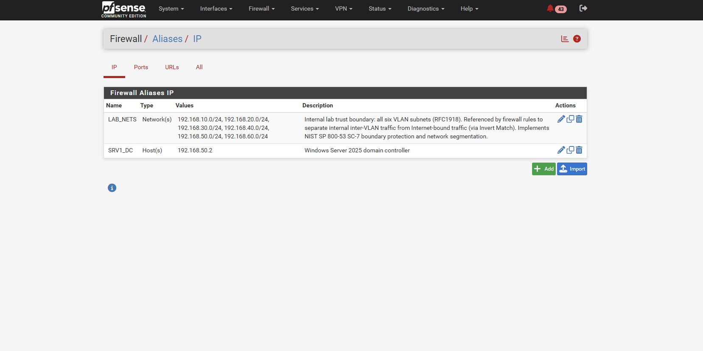
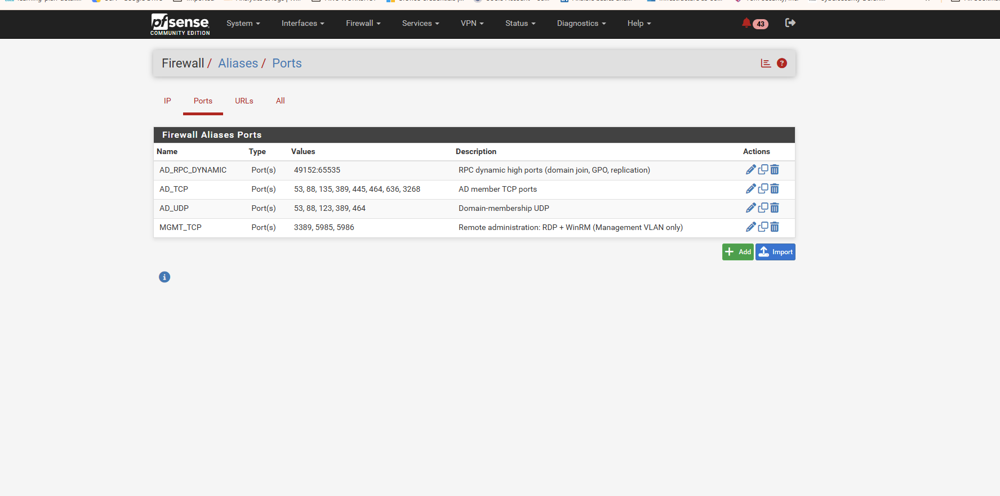
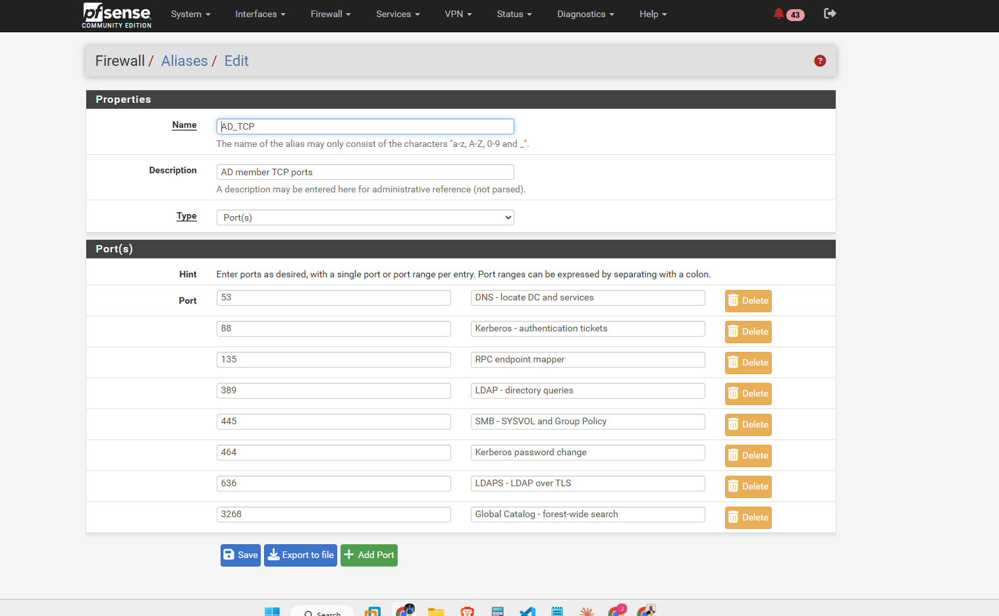
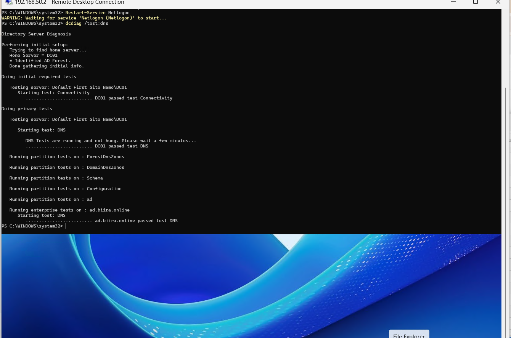
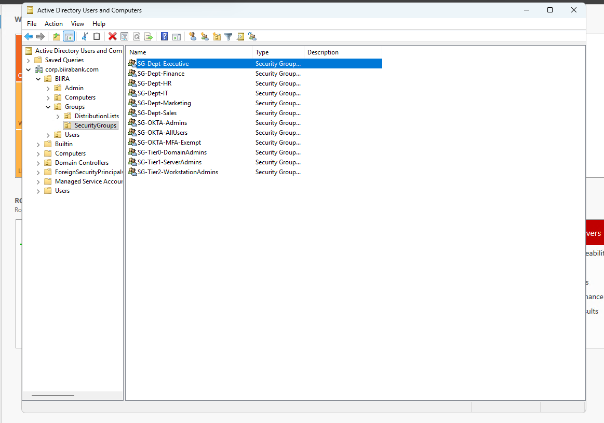

## In plain words

The domain controller is the server that holds every account and checks who people are when they sign in. Other machines need to reach it in roughly a dozen specific ways, so I opened exactly those paths through the firewall, and kept the paths for administering the server separate. A network can then use the directory without also getting a remote console on the server.

## What I did, step by step

1. Worked out what a member machine needs from the domain controller: finding it, signing in, reading the directory and downloading policy.
2. Grouped the server's address and the needed ports into named firewall groups, called aliases, so each rule states its intent (Figure 7.1).
3. Kept the administration ports in their own group, apart from the ports needed for membership (Figure 7.2).
4. Labelled every port inside a group with its role, so the setting explains itself (Figure 7.3).
5. Granted the management network both membership and administration, and gave the attack network no standing access.
6. Renamed the server to DC01 on 30 August 2026, with its directory health test clean before and after (Figure 7.4).
7. Enrolled it on 6 September 2026 as the first agent of the security monitoring system, which then showed its inventory and benchmark results.

## The background

DC01 is the domain controller for Biira Bank: a Windows Server 2025 machine on dedicated hardware at `192.168.50.2`, on the EnterpriseLAN segment (VLAN 50). It runs Active Directory Domain Services and DNS, with AD-integrated forward and reverse zones, and it answers a clean `dcdiag`.

## What a domain controller asks of the network

Every machine that joins the domain relies on DC01 for four things: finding it (DNS), proving who you are at logon (Kerberos), reading the directory (LDAP), and downloading policy (SMB). None of these is a single port. Together they are roughly a dozen ports across TCP and UDP, and blocking even one does not give a clean failure. A machine joins but nobody can log on, or logon works and Group Policy silently fails.

pfSense sits between every VLAN in the lab, so before any machine outside VLAN 50 could be a domain member, the firewall needed rules that open exactly that bundle to exactly this host.

## How access to it is built

One rule per port would mean about thirteen rules per source VLAN that nobody could read. I used pfSense aliases instead, so each rule states its intent.

| Alias | Holds | Purpose |
|---|---|---|
| `SRV1_DC` | `192.168.50.2` | The domain controller itself |
| `AD_TCP` | 53, 88, 135, 389, 445, 464, 636, 3268 | TCP ports a domain member needs |
| `AD_UDP` | 53, 88, 123, 389, 464 | UDP ports a domain member needs |
| `AD_RPC_DYNAMIC` | 49152 to 65535 | RPC high ports negotiated at runtime |
| `MGMT_TCP` | 3389, 5985, 5986 | RDP and WinRM, for administration only |

Figure 7.1 shows the host alias as built in pfSense. It kept the name `SRV1_DC` when the host was later renamed, because it points at the address and not the host name.

*Figure 7.1: The domain controller as a named object. `SRV1_DC` holds its one address, beside `LAB_NETS`, the alias for the six internal VLAN subnets.*

The split is deliberate. The three `AD_` aliases are what it takes to be a member of the domain. `MGMT_TCP` is what it takes to administer the server. Keeping them apart means a client segment can be granted membership without a remote console on the controller. The Management VLAN, home of the admin laptop and the Ansible controller, gets both. The attack segment gets nothing: RedTeam reaching DC01 is a deliberate exercise, opened on purpose and closed afterwards, never a standing rule.

Figure 7.2 shows the four port groups as built, with the administration ports apart from the membership bundle.

*Figure 7.2: The four port groups. `AD_TCP`, `AD_UDP` and `AD_RPC_DYNAMIC` are the domain-membership bundle; `MGMT_TCP` is administration, kept separate on purpose.*

Each port inside an alias carries a description of its role, as Figure 7.3 shows for `AD_TCP`. The intent is recorded where the setting lives, so the alias explains itself to the next person who opens it.

*Figure 7.3: The `AD_TCP` alias as configured, each port carrying an inline description of what it is for.*

pfSense attaches a rule to the interface where traffic enters, so who may reach DC01 is written on the source VLAN's tab. The ENTERPRISELAN tab controls the other direction, what DC01 itself may start: DNS forwarding to pfSense for names outside the directory, NTP, web traffic out for Windows Update and certificate revocation checks, and the Wazuh manager on 1514 and 1515.

Each decision maps to a NIST SP 800-53 control, among them SC-7 for the boundary and CM-7 for opening only the required ports.

## How it was proved

When the host was renamed from `SRV1` to `DC01` on 30 August 2026, to fit the lab's role-based naming, `dcdiag /test:dns` was clean before and after, and Netlogon was restarted so the controller re-registered its service records under the new name. Figure 7.4 shows the test after the rename.

*Figure 7.4: `dcdiag /test:dns` on DC01 after the rename and the Netlogon restart. Connectivity, DNS, every partition test and the enterprise DNS test all pass, so the rename left Active Directory healthy.*

It was the first agent. On 6 September 2026 DC01 enrolled with the Wazuh manager as agent 001. Wazuh agents dial out and the manager listens, so the rule that lets DC01 report lives on the ENTERPRISELAN tab, not on the SIEM's own segment. From that one install the SIEM shows system inventory, MITRE ATT&CK tactic counts, vulnerability detection and a CIS Windows Server 2025 benchmark run.

## What went wrong

The agent installed, the service started, and nothing appeared in the dashboard. There were two causes, one after the other. The rule had been copied from another one and still carried the wrong source and service, so it matched nothing. Once that was corrected, the agent still could not connect until the firewall's filter was reloaded. That became the ninth principle of the rulebase: a saved rule is not an enforced rule until the filter is reloaded.

The diagnostic I kept is `Test-NetConnection` to the manager on port 1514, run from the endpoint. It separates a blocked network path from a broken agent, which look identical from the dashboard.

## What it became

The same hardware was later demoted and promoted again as the first controller of a new forest, `corp.biirabank.com`, with the directory rebuilt from an export. The `corp.` prefix is deliberate. A domain controller becomes the DNS authority for its own name, so a flat `biirabank.com` would have made DC01 authoritative for the public zone and broken the public website from inside the lab.

Figure 7.5 shows the directory on the new forest, with the security groups restored from the export.

*Figure 7.5: The same controller serving `corp.biirabank.com`: the BIIRA tree rebuilt, and the twelve security groups restored under it.*

The full runbook, with every command, is [chapter 11 in the repository](https://github.com/noble-antwi/enterprise-security-homelab/blob/main/docs/11-domain-controller-firewall.md).
