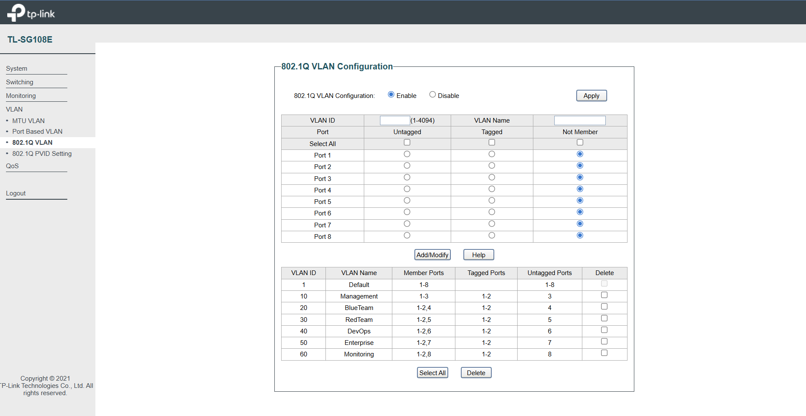
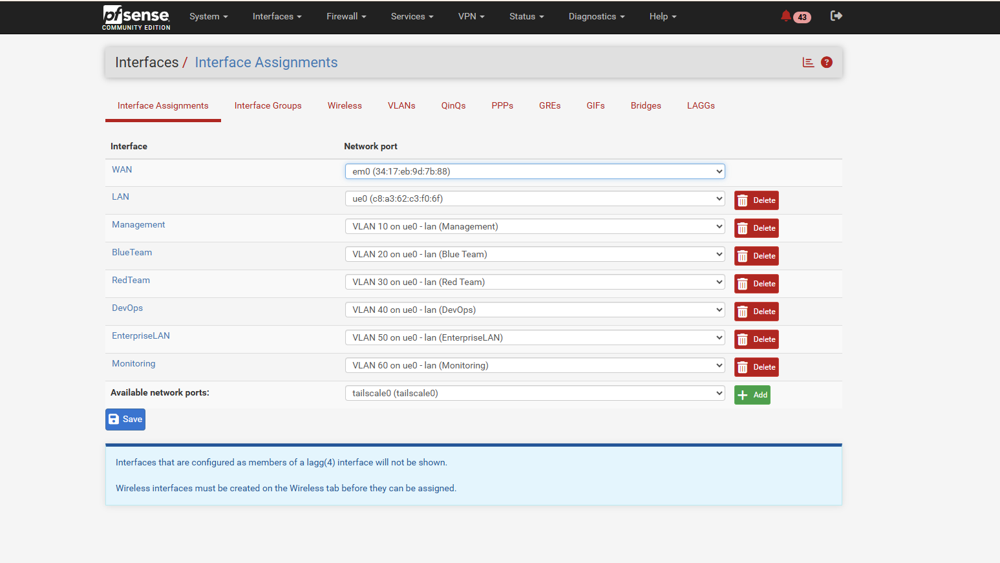
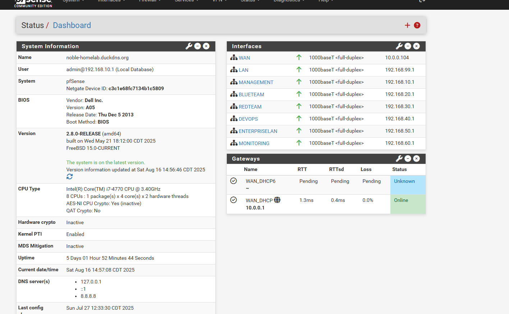
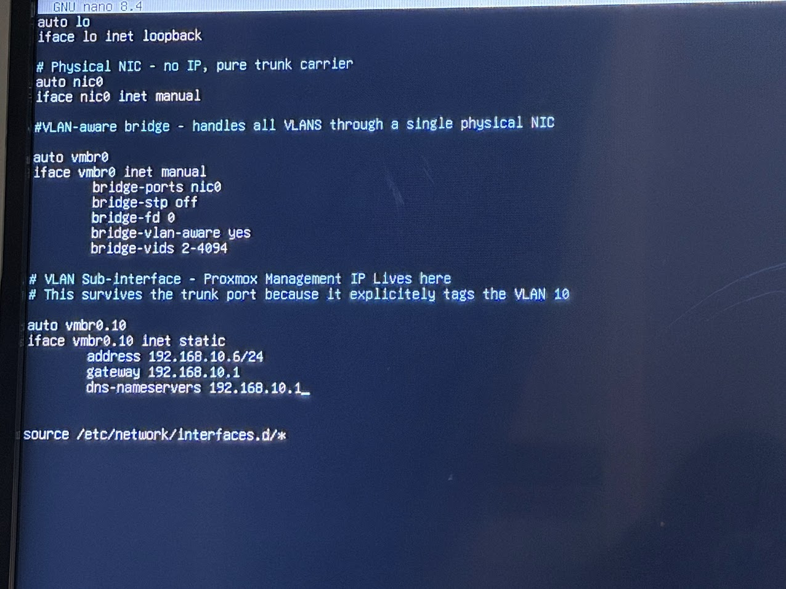
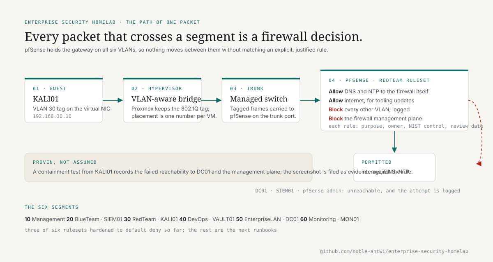
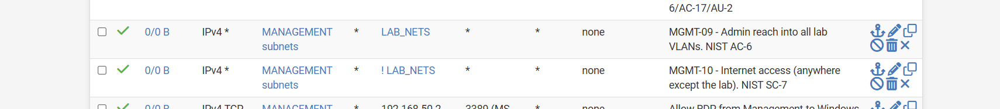
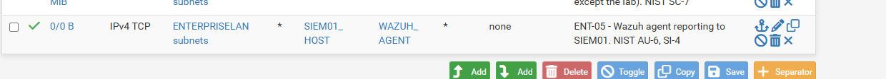
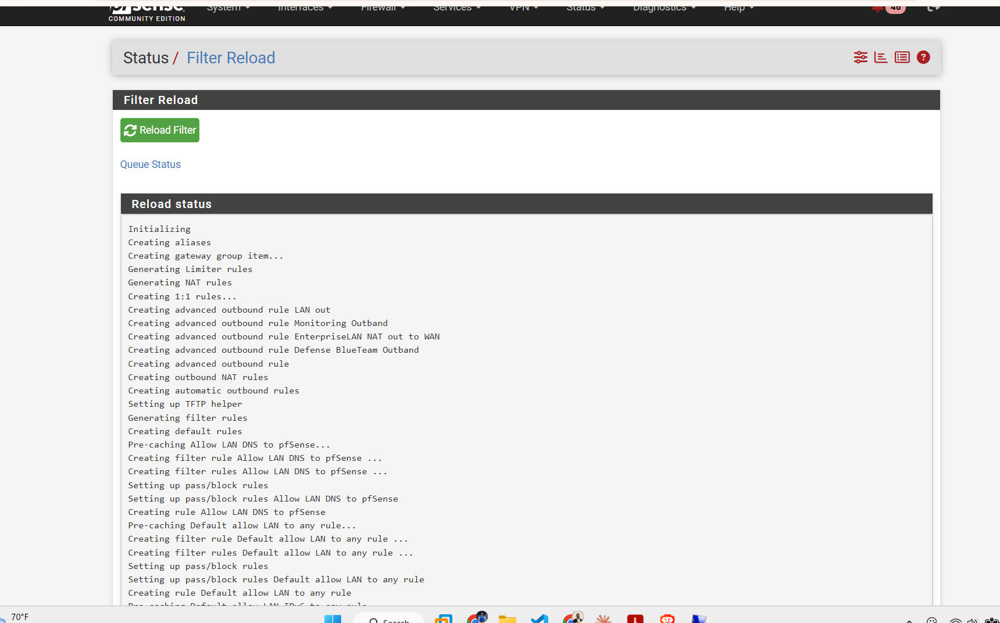

## In plain words

The lab is split into six separate networks, and one firewall stands between all of them. I set that firewall to refuse everything by default, so traffic only passes where I have written a rule that allows it. This matters because separate networks only mean something if traffic cannot wander between them, and every rule has a recorded reason for existing.

## What I did, step by step

1. Divided the switch into six separate networks, with two shared trunk ports and one ordinary port for each network (Figure 1.1).
2. Connected every network to the firewall over one cable, so anything travelling between two networks has to cross it (Figure 1.3).
3. Joined the virtual machine host to the same link, so one tag on a virtual machine decides which network it sits on (Figure 1.4).
4. Wrote a short list of explicit allow rules for the management, enterprise and attack networks, with everything else denied (Figure 1.6).
5. Recorded every rule in a register with a fixed ID, a business reason and a matching control from a published security standard.
6. Corrected a rule that failed twice: first a bad copy, then a correct rule the firewall had not yet loaded (Figure 1.7).
7. Reloaded the firewall's rules by hand and repeated the isolation tests, which then returned the expected result (Figure 1.8).

## The background

Six VLANs only mean something if traffic cannot wander between them, so the pfSense rulebase is deny by default: nothing passes unless a rule allows it, and every interface ends in an implicit deny. Three of the six interfaces now carry a hardened, tested ruleset: MANAGEMENT (VLAN 10), ENTERPRISELAN (VLAN 50) and REDTEAM (VLAN 30).

## One firewall in the path of every packet

Segmentation starts at the switch. In Figure 1.1, ports 1 and 2 are tagged trunks, towards pfSense and the hypervisor, and ports 3 to 8 are untagged access ports, one per VLAN.

*Figure 1.1: The 802.1Q VLAN table on the managed switch: six VLANs, two trunk ports, six access ports.*

On pfSense, each VLAN is a tagged sub-interface of one physical NIC, a router-on-a-stick design. Figure 1.2 shows the assignments: Management to Monitoring, each one a VLAN on the parent interface `ue0`.

*Figure 1.2: Interface assignments on pfSense. Each of the six VLANs is a tagged sub-interface of the single LAN NIC, so one cable to the switch trunk carries every segment.*

Figure 1.3 shows the result: no route between two VLANs avoids the firewall.

*Figure 1.3: pfSense holds the .1 gateway on every segment, so every inter-VLAN packet crosses the firewall.*

Proxmox joins the same trunk through the VLAN-aware bridge in Figure 1.4. The physical NIC has no address and carries tagged frames, and a guest is placed on a segment by one tag on its virtual NIC.

*Figure 1.4: The VLAN-aware bridge on Proxmox. A VM's segment is decided by one tag on its virtual NIC, not by cabling.*

Figure 1.5 follows one packet from the attack host through all three.

*Figure 1.5: The path of one packet from the attack segment: tagged at the guest, carried on the trunk, decided by the RedTeam ruleset. Everything not listed is blocked and logged.*

## A register, not just a ruleset

A firewall configuration on its own is not auditable. A reviewer asks why each rule exists, who approved it and whether it is still needed. So every rule carries a stable ID, a business justification and a NIST SP 800-53 control mapping in a living rule register, with a change log that records tester, rollback and validation evidence.

| Interface | Rules | What they allow |
|---|---|---|
| MANAGEMENT (VLAN 10) | MGMT-01 to MGMT-12 | Firewall administration (logged), DNS, NTP, ping, the domain controller, the SIEM, internet |
| ENTERPRISELAN (VLAN 50) | ENT-01 to ENT-05 | DNS, NTP, outbound ping, internet, Wazuh agents to SIEM01 |
| REDTEAM (VLAN 30) | RED-01 to RED-03 | DNS, NTP, internet only |

Rules use aliases, so each reads as its intent, and internet access is an inverted destination, "not `LAB_NETS`", which allows the internet without allowing anything internal. Figure 1.6 shows the finished MANAGEMENT tab.

*Figure 1.6: The MANAGEMENT ruleset after hardening: explicit rules, then default deny. Each carries a justification and a control mapping in the rule register.*

REDTEAM deliberately has no ICMP-to-any rule, because outbound ping would let the attack host sweep the internal VLANs for live hosts.

## A rule can be valid, applied and dead

ENT-05, in Figure 1.7, lets machines on VLAN 50 report to the Wazuh manager. It failed twice. The first version was a copy of MGMT-11 with only the description changed, so it kept a management source and an admin service, which on this interface matches nothing. pfSense accepted it without complaint. The second time the rule was right, but the running filter had not loaded it.

*Figure 1.7: ENT-05: agents dial out, so the rule that lets DC01 report lives on the ENTERPRISELAN interface, not the BlueTeam one. It failed twice before it passed traffic; the runbook records both reasons.*

## What I took from it

A stale filter caused three separate incidents in this lab, with three different symptoms and hours of diagnosis. The register now has a ninth principle, learned the hard way: a saved rule is not an enforced rule until the filter is reloaded. After every change I run Status > Filter Reload, then test. Figure 1.8 shows that step.

*Figure 1.8: Status > Filter Reload on pfSense. Reloading by hand compiled and loaded the current ruleset, and the VLAN 50 isolation tests then returned the expected result.*

The full runbook, with every command, is [chapter 13 in the repository](https://github.com/noble-antwi/enterprise-security-homelab/blob/main/docs/13-firewall-rulebase-governance.md).
