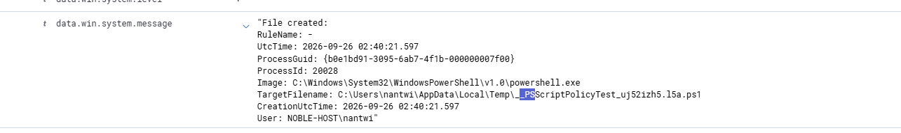
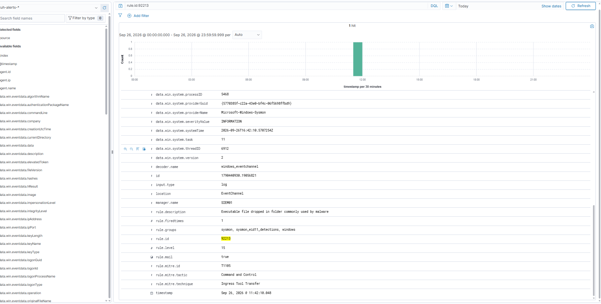
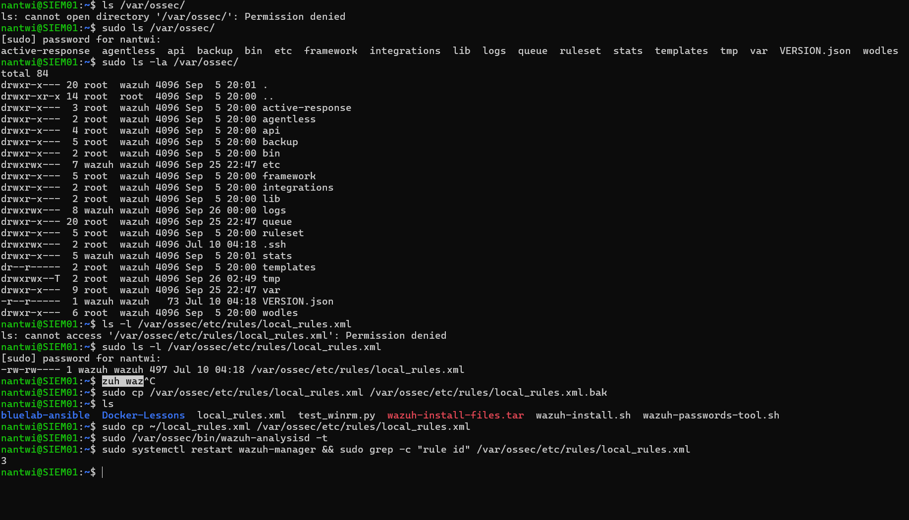
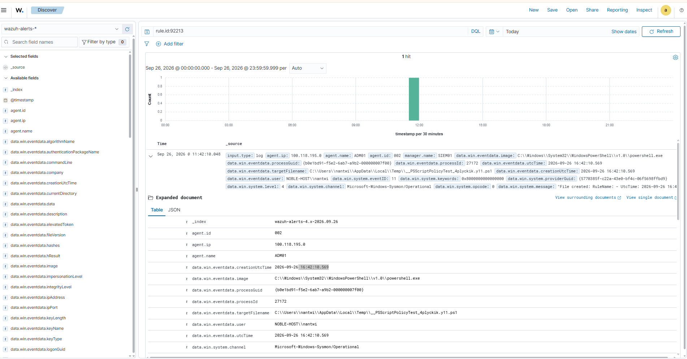
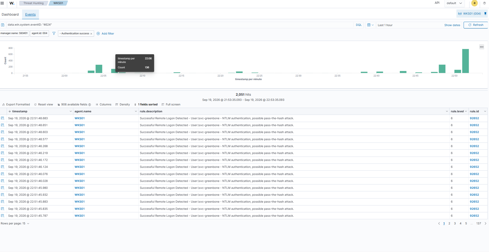
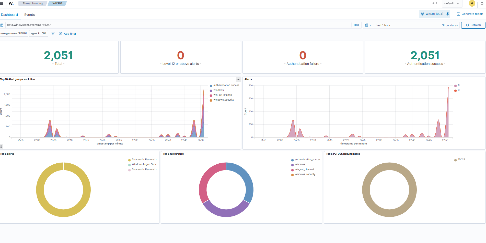
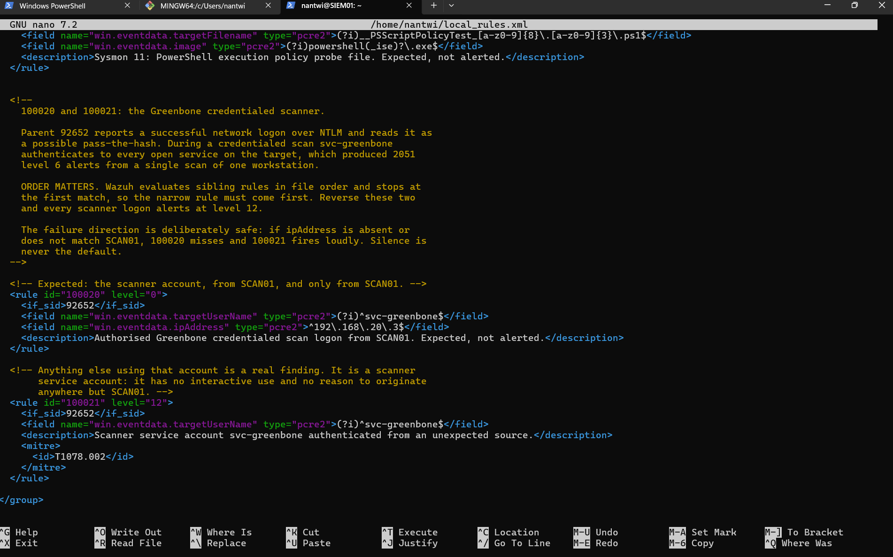
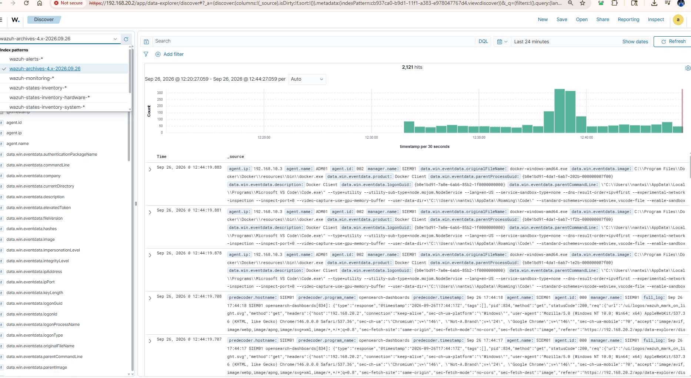

While reviewing the Wazuh dashboard on 25 September 2026 I saw a Sysmon FileCreate event: `powershell.exe` had written a `.ps1` file into a temporary folder. Figure 15.1 shows the event as it appeared in the dashboard.

*Figure 15.1: The event as it appeared in the dashboard: a PowerShell process writing a script file into a temporary folder. Every element of that sentence looks suspicious in isolation.*

The rule behind it was what made me stop. Figure 15.2 shows rule 92213, "Executable file dropped in folder commonly used by malware", at level 15, the top of Wazuh's severity scale, tagged T1105, Ingress Tool Transfer.

*Figure 15.2: The first piece of detection engineering. A built-in rule at the top of the severity scale, tagged as an attacker transferring tools, firing several times an hour on every Windows endpoint. It was PowerShell checking its own execution policy.*

## The rule was not wrong

Attackers really do stage tooling in temporary folders, so the heuristic is sound. What the rule cannot know is that Windows does the same thing to itself. Before running a script, PowerShell resolves its execution policy by writing a throwaway `__PSScriptPolicyTest_` file, reading the verdict and deleting it. An analyst who sees level 15 forty times a day stops reading level 15, so tuning is what keeps the queue readable.

## An exception that needs two conditions

The fix is a child rule, 100010, at level 0: the event is decoded and matched, and deliberately raises no alert. Rule 92213 itself is untouched. The exception requires both the probe's exact random-name shape and that the writing process is PowerShell, so it cannot be entered by copying a file name.

| Event | Alerts? |
|---|---|
| PowerShell writes its execution policy probe | No |
| Any other file dropped in the same folder | Yes, level 15 |
| A file named like the probe, written by anything else | Yes, level 15 |

My first version would never have fired, and a rule that does not match says nothing. Testing against a real event with `wazuh-logtest` found two traps: Sysmon path fields arrive with doubled backslashes, and the probe does not live in one folder. The final rule anchors on the file name and contains no backslashes at all.

The ruleset lives in the repository and is deployed from it: pulled onto SIEM01, validated with `wazuh-analysisd -t` because a malformed file stops the manager starting at all, then checked rather than assumed. Figure 15.3 shows that sequence on SIEM01.

*Figure 15.3: The deployment in one screen: the existing file's ownership read first, a backup taken, the new ruleset copied into place, validated, the manager restarted, and three rules confirmed present.*

It went in at 11:56 on 26 September. Figure 15.4 is the proof on live data.

*Figure 15.4: Proof on live data: one alert from that rule all day, at 11:42. The tuned ruleset went in at 11:56, and nothing has fired since. The exception needs two conditions, so the rule itself still alerts on anything else.*

## The scanner's 2,051 sign-ins

The opposite problem was already on record. A credentialed vulnerability scan authenticates to every service it probes, and built-in rule 92652 reads each successful NTLM network logon as possible pass-the-hash. Figure 15.5 shows what the SIEM made of one scan, and Figure 15.6 the same hour in numbers.

*Figure 15.5: What the SIEM made of it: about two thousand successful sign-ins in an hour from one service account, flagged as possible credential abuse. The rule is not wrong, so the fix was a pair of rules rather than a switch-off.*

*Figure 15.6: The scan window as the SIEM saw it: 2,051 successful sign-ins and no failures in one hour. A credentialed scan is a very large number of successful logons in a very short time.*

| Rule | Level | Matches |
|---|---|---|
| 100020 | 0 | The scan account from SCAN01 (`192.168.20.3`) |
| 100021 | 12 | The same account from anywhere else, mapped to T1078.002 |

Figure 15.7 shows the pair as written in the ruleset.

*Figure 15.7: Rules 100020 and 100021 in `local_rules.xml`. The narrow rule is deliberately placed first.*

Normal use is now silent and abnormal use is louder than it was. Wazuh stops at the first matching sibling, so the narrow rule comes first, and if the source address is absent the loud rule fires. On the next credentialed scan rule 92652 raised no alerts, against 2,051 the time before.

## Keeping the evidence

A suppression is only defensible if the evidence survives it. By default Wazuh indexes alerts, not events, so a level 0 rule also erased the event. Archives write down every decoded event regardless of what any rule decided. It took three changes in order: the manager writes the archive, Filebeat ships it, and an index pattern makes it searchable. Figure 15.8 shows the first results.

*Figure 15.8: Archives switched on: 2,121 events in the first 24 minutes, including events that raised no alert. Before this, about 5% of what the SIEM saw was ever written down, so a silenced alert also erased its evidence.*

Under the new load the manager dropped no events.

## What I took from it

- A failing rule is silent. Test detection logic against a real event.
- Never suppress on a single field.
- Verify a deployment. Restarting an unchanged configuration looks like success.

The story is written up in [The Alert That Cried Wolf](/lab-notes/2026/09/26/the-alert-that-cried-wolf.html).

The full runbook, with every command, is [chapter 20 in the repository](https://github.com/noble-antwi/enterprise-security-homelab/blob/main/docs/20-detection-engineering-tuning-and-archives.md).
