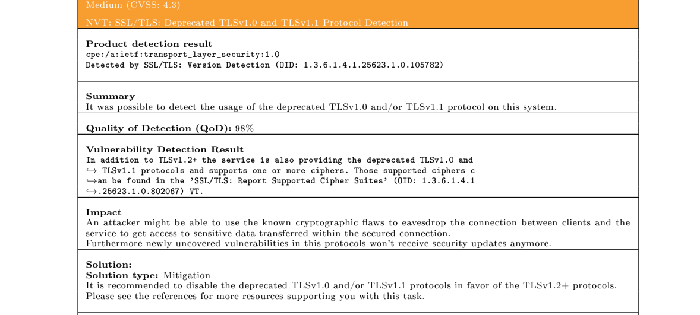
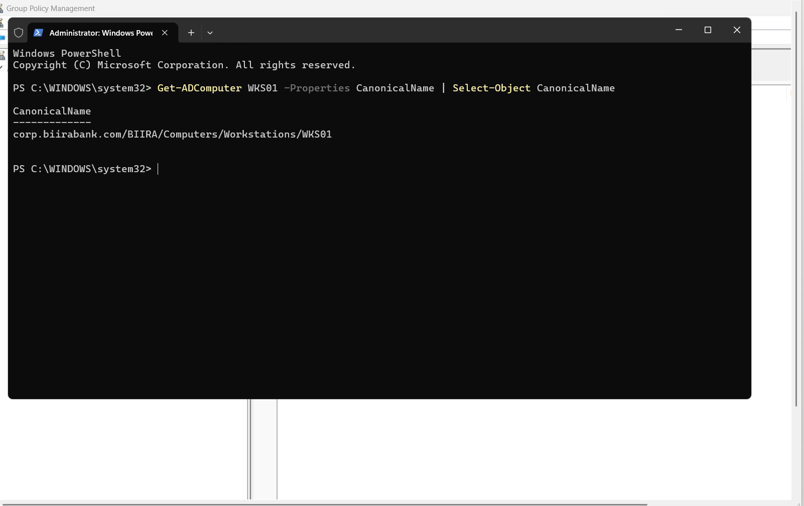
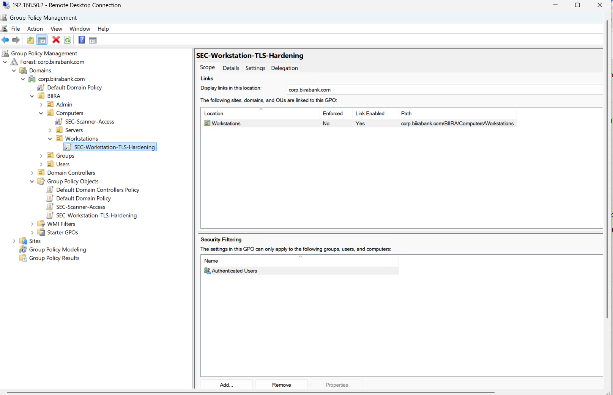
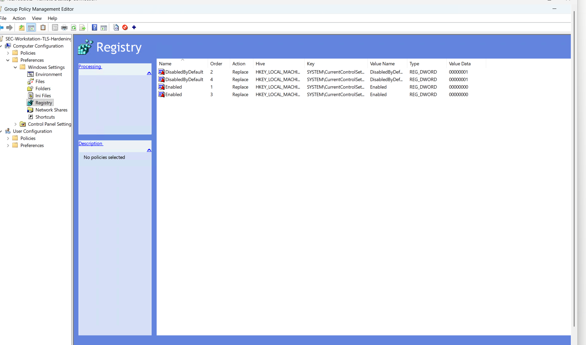
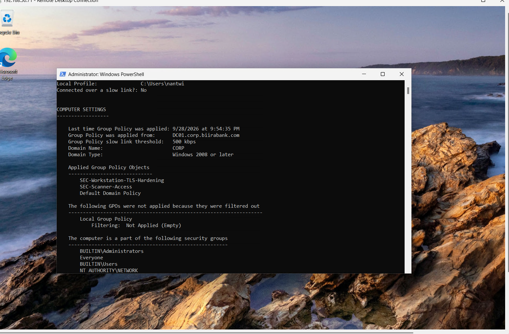
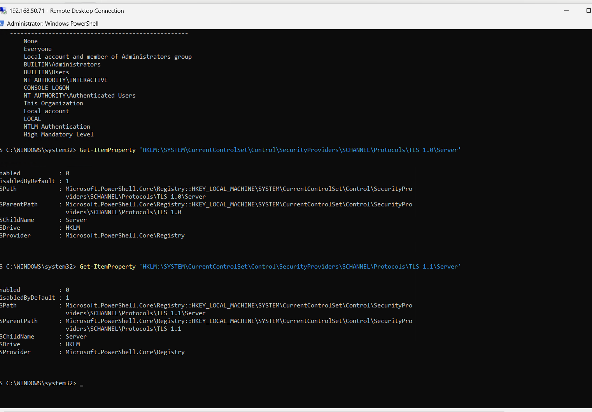
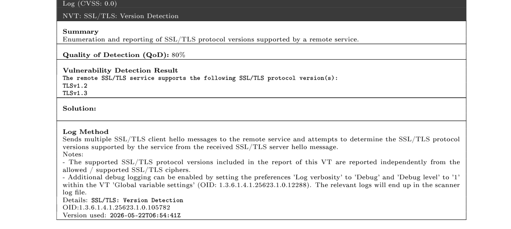
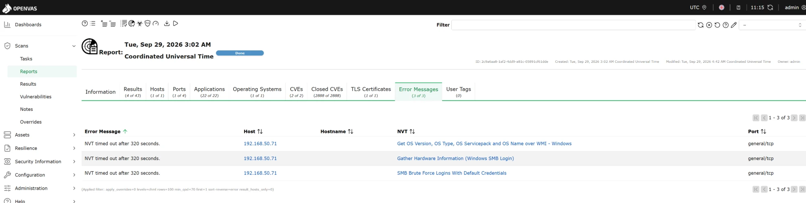

## In plain words

A security scan produces a list of weaknesses, but a list fixes nothing. This is one complete trip around the loop that does: scan, choose a finding, fix it, scan again and show it closed. The finding was that Remote Desktop on one workstation still offered two outdated versions of TLS, the encryption that protects the connection, and the final scan proves they are gone.

## What I did, step by step

1. Ran a signed-in scan of one workstation and chose one confirmed finding: Remote Desktop still offered TLS 1.0 and 1.1 (Figure 19.1).
2. Wrote a single-purpose policy with four settings that switch the old versions off and are removed if the policy is unlinked (Figure 19.4).
3. Read the workstation's location from the directory instead of assuming it (Figure 19.2).
4. Linked the policy to the workstations only (Figure 19.3).
5. Confirmed on the workstation itself that the policy had been applied (Figure 19.5).
6. Read the new values back from the machine, then restarted it to put them in force (Figure 19.6).
7. Ran the same scan a third time and proved the finding closed: only TLS 1.2 and 1.3 remained (Figure 19.7).

## The background

A single vulnerability report is a list. It says what was true at one moment, and nothing about whether anyone did anything about it. Vulnerability management is the loop around the list: scan, choose, fix, scan again, and show the finding closed. This is the lab's first complete trip around that loop, on one workstation, WKS01. Written up in [Find, Fix, Prove](/lab-notes/2026/10/09/find-fix-prove.html).

## Choosing what to fix

The first scan of WKS01 could not sign in, so it saw the machine only from outside. The second signed in, and Figure 19.1 shows the result I chose from it.

*Figure 19.1: The first finding chosen for the remediation loop: Remote Desktop on WKS01 still offering TLS 1.0 and 1.1, confirmed by handshake. Not the highest score on the report, but real, the lab's own configuration, and fixable by policy.*

A severity score describes how bad a weakness could be in general. Triage decides what it means on this machine. This result was the right first fix because it was confirmed by a completed handshake, it was this machine's own configuration rather than a defect waiting on a vendor, a policy could fix it on every workstation, and a rescan could prove it gone.

In plain terms: Remote Desktop sessions are protected by TLS, and the two ends agree on the highest version both support. TLS 1.0 and 1.1 are formally deprecated (RFC 8996). A modern client never needs them, so their only remaining use is to someone in the middle steering the negotiation down.

## A fix that is scoped and reversible

Windows keeps these switches in the registry, under the SCHANNEL protocol keys. The fix is two values for each old version, on the `Server` key that governs connections made to the machine.

| Value | Set to | Meaning |
|---|---|---|
| `Enabled` | 0 | The protocol is switched off for this role |
| `DisabledByDefault` | 1 | It is not offered to software that asks for the defaults |

A scoped, reversible Group Policy delivered the four values: a new policy with one job, separate from the scanner's access policy, so it can be unlinked on its own. My first link would have reached servers that had never been assessed. I read WKS01's location from the directory instead of assuming it, as Figure 19.2 shows, then moved the link. Figure 19.3 shows the result.

*Figure 19.2: WKS01's location read from the directory before the link was moved: `corp.biirabank.com/BIIRA/Computers/Workstations/WKS01`. Moving a link to the wrong unit would have silently dropped the target out of scope.*

*Figure 19.3: One policy with one job, linked to the Workstations OU only, after the directory confirmed where the target lives. The first link would have reached the servers too.*

Each registry item is set to be removed when the policy no longer applies, so unlinking is a real undo. Figure 19.4 shows all four items.

*Figure 19.4: The four registry items: `Enabled` set to 0 and `DisabledByDefault` set to 1 for both the TLS 1.0 and TLS 1.1 `Server` keys. The action reads Replace because each item is set to be removed when the policy no longer applies.*

## Proving it landed before any rescan

A policy in the management console proves the policy exists. It does not prove a machine applied it, so I checked each step on WKS01 itself. The machine's own policy report listed the new policy as applied, as Figure 19.5 shows. Figure 19.6 shows the next claim: the values, read back from the registry.

*Figure 19.5: WKS01's own policy report after a refresh: applied from `DC01.corp.biirabank.com`, with `SEC-Workstation-TLS-Hardening` listed alongside `SEC-Scanner-Access`.*

*Figure 19.6: Proved on the machine before any rescan: the values written. A reboot then put them in force, and Remote Desktop still connected on TLS 1.2.*

Written is not in force. SCHANNEL reads its configuration at startup, so until the restart the service still offers the old versions. That in-between state is how a "fixed" finding reappears on the next scan. After the reboot, Remote Desktop reconnected without complaint.

## The third scan

I ran the same task a third time: same target, same credential, same configuration. Figure 19.7 shows the finding gone, from three directions.

*Figure 19.7: The finding closed, from three directions: absent from the report, the supported versions listed as TLS 1.2 and 1.3 only, and a separate test unable to negotiate TLS 1.0. The same scan raised zero false sign-in alerts in the SIEM.*

A missing finding alone could mean the check did not run. A missing finding, plus a positive list of supported versions, plus an unrelated test failing to negotiate the old one, cannot. The rescan doubled as a load test of my Wazuh rules. The previous scan had raised 2,051 "possible pass-the-hash" alerts as the scanner signed in repeatedly. This one raised none, while the archive still recorded every sign-in.

## What I left alone, and what I took from it

Figure 19.8 shows a result I chose not to chase.

*Figure 19.8: A result left alone on purpose. WMI would let the scan account start processes on every workstation, so it stays closed and a few inventory checks time out. The trade-off is recorded, not chased.*

WMI stays closed to the scanner by decision, because it would let a stolen scan credential run commands everywhere. Over SMB alone the scan identity is a reader, and the facts that drive vulnerability matching still arrive.

- **A finding is closed by evidence, not by a change.** Making the change was the smallest part.
- **Settings written are not settings in force.** Each step is a different claim and needs its own check.
- **Confirm scope from the directory, not from memory.**
- **Build the way back into the change.**

The full runbook, with every command, is [chapter 21 in the repository](https://github.com/noble-antwi/enterprise-security-homelab/blob/main/docs/21-find-fix-prove-tls-on-wks01.md).
