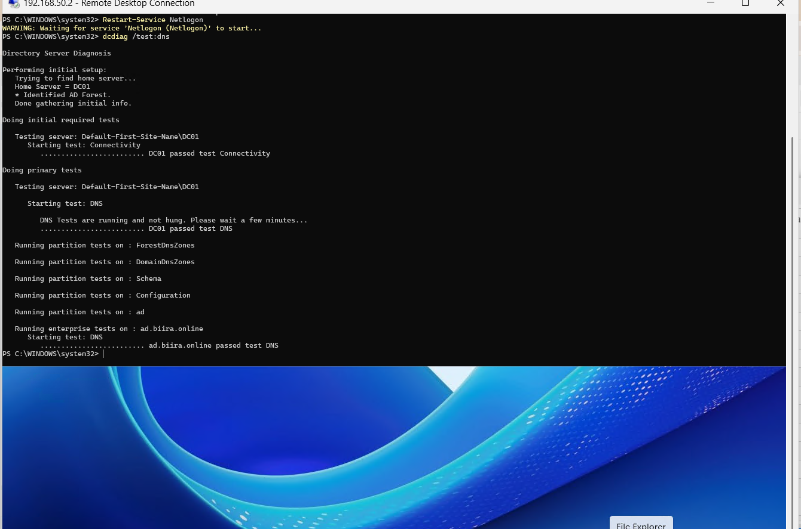

Biira Bank's public brand moved to `biirabank.com` while its Active Directory forest was still called `ad.biira.online`, after a domain that was being retired. I replaced it with a new forest, `corp.biirabank.com` (NetBIOS `CORP`), by taking the existing domain controller down to a standalone server, promoting it again as the first controller of the new forest, and recreating the directory from an export.

## Why a rebuild and not a rename

There were three options:

1. **Add a UPN suffix only.** Five minutes and no downtime, but the forest keeps a name tied to a domain no longer owned.
2. **Rename the forest with `rendom`.** Supported, but a multi-stage procedure that reboots every controller and every member twice, with no clean rollback if a stage fails.
3. **Demote and repromote into a new forest**, then replay the contents from an export.

I chose the third. The directory held roughly 35 accounts, 21 organisational units and a set of groups, all of which export to CSV and replay as a script.

The new forest is `corp.biirabank.com` and not a flat `biirabank.com`. A domain controller becomes the DNS authority for its own name, so the flat name would have made it authoritative for the public zone and broken the public website from inside the lab. Staff still sign in as `name@biirabank.com` through a UPN suffix.

The hardware did not change. Figure 8.1 shows the same controller on the old forest, just after it took the name DC01, with its DNS tests passing.

*Figure 8.1: The same controller on the old forest, just after it took the name DC01: Netlogon restarted and its DNS tests passing.*

## Export first, then demote and promote

The export is the only irreversible moment, so it came first. Organisational units, users and group memberships went to CSV files and were copied off the machine.

The demotion refused at first, because the controller was the last DNS server for an AD-integrated reverse lookup zone. That is a safety check, not a failure: the zone goes with the domain, so I added the documented flag and ran it again. The server rebooted as a standalone workgroup machine. When the first controller of a new forest is promoted, the local Administrator account is carried up to become the domain Administrator, keeping its password.

## The lockout

After the promotion reboot, the sign-in screen rejected the password I expected. I had set it over a Remote Desktop session, where a symbol was transmitted under one keyboard layout and typed back under another, so the stored value did not match what I was typing. The sign-in also showed a longer string than the password I had set, which pointed to a mismatch rather than a forgotten password.

Remote Desktop could not fix it, because every reset method needs console access. With a physical screen and keyboard attached, I booted the server from Windows Server installation media and reset the local Administrator password offline. Afterwards Server Manager showed AD DS, DNS and File and Storage Services all manageable on the new forest. It is in the runbook as an incident, not quietly fixed.

## Rebuilding the directory, and checking it

The new forest starts empty. I added the `biirabank.com` UPN suffix, then recreated the organisational units top down. Users were recreated from the export, filtered to the `BIIRA` tree so the built-in accounts were not touched, and each was placed back in its original unit. Every account received a temporary password that must be changed at first logon, because passwords are not exported and must not be.

I verified the rebuild by comparing the source data with the result, not by trusting the run:

| Check | Exported | Rebuilt |
|---|---:|---:|
| User accounts under the `BIIRA` tree | 32 | 32 |
| Members of the six departmental groups | 25 | 25 |
| Members of the three tiered administration groups | 7 | 7 |

Twenty organisational units and twelve security groups were restored, and the membership counts matched the export group for group. The Tier 0 administrators group holds one account and the MFA exemption group is empty, which is what both should look like.

## What I took from it

Set a password that will be typed at a console with simple, layout-safe characters, or set it at the console itself. A control is only in place when a login proves it, not when the tool reports success. And export before the step that cannot be undone: that is why the lockout cost time and not data.

The full runbook, with every command, is [chapter 17 in the repository](https://github.com/noble-antwi/enterprise-security-homelab/blob/main/docs/17-domain-migration-corp-biirabank.md).
