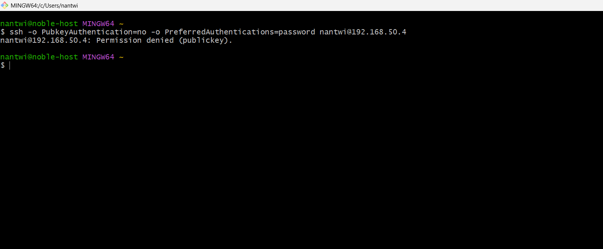
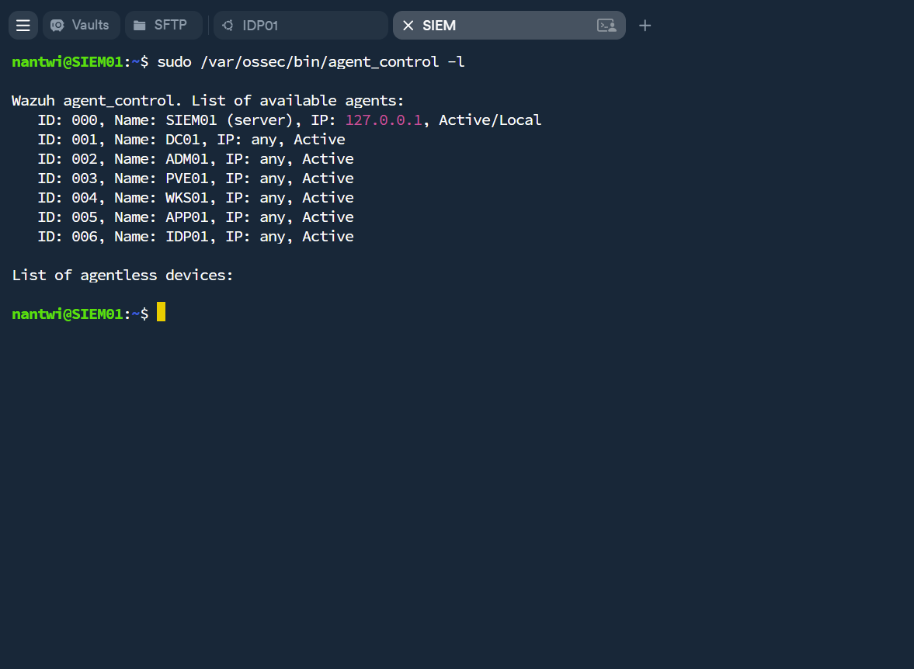
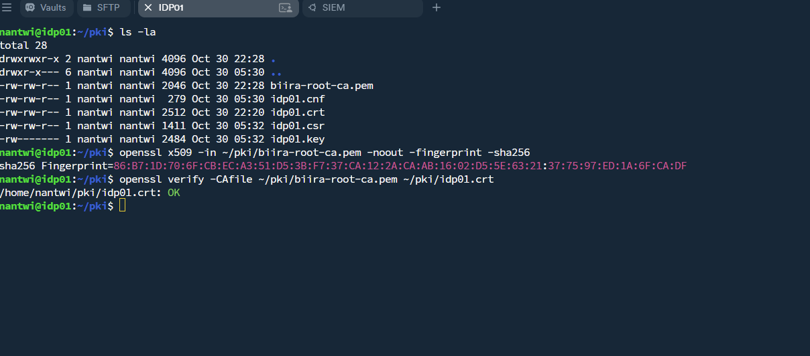
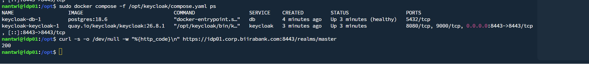
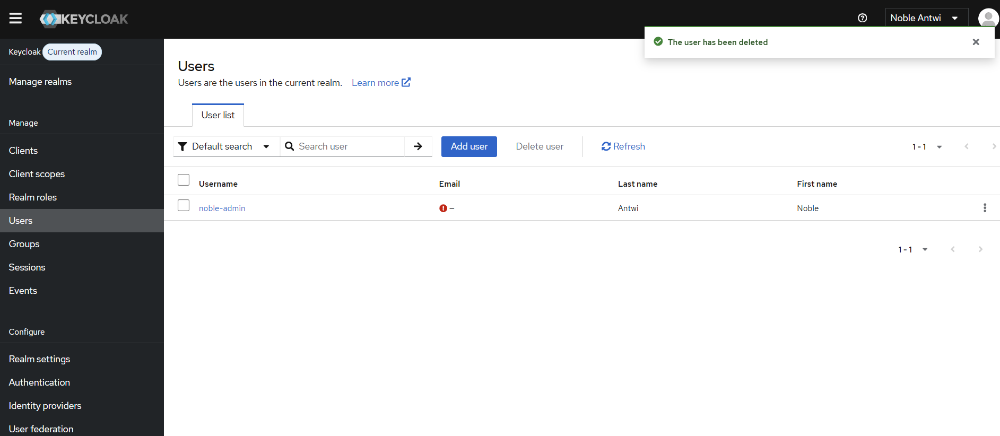
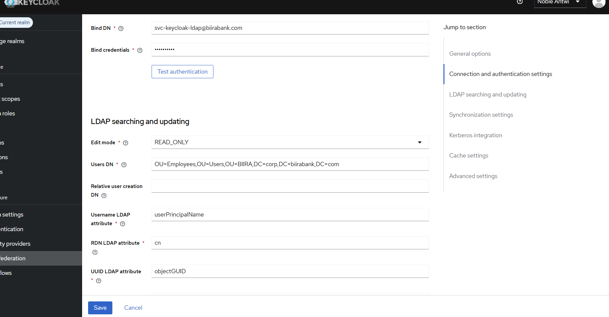
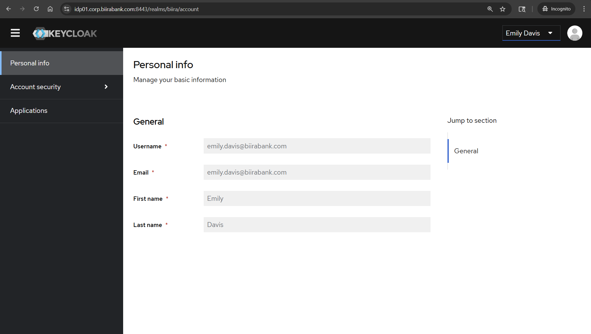
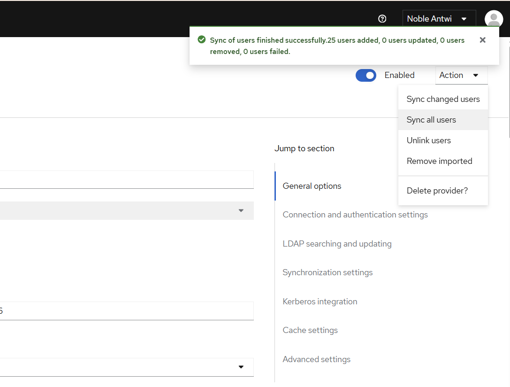

Every application that keeps its own user list adds another place to create, disable and audit accounts, and another password for people to reuse. An identity provider removes that. Applications hand sign-in to it, it checks the person, and the application receives a signed statement of who they are. Disable someone once and they are out of everything behind it.

Biira Bank already has a source of truth for people: Active Directory on DC01. IDP01 puts Keycloak in front of it. Whoever controls an identity provider can sign in as anyone behind it, so it is a Tier 0 system and sits on VLAN 50 at `192.168.50.4`, beside the domain controller and the certificate authority.

## The machine, hardened first

IDP01 is an Ubuntu Server guest on Proxmox. Before Keycloak went anywhere near it:

- **SSH is keys only.** Administration uses a dedicated ed25519 key with a passphrase. OpenSSH keeps the first value it reads for each setting, so a drop-in file named to be read before cloud-init's switches password sign-in off. I proved it with a client that refused to offer a key and was turned away with `Permission denied (publickey)`, as Figure 10.1 shows.
- **It reports to the SIEM.** IDP01 enrolled with Wazuh as agent 006 (Figure 10.2).
- **It has an HTTPS certificate from CA01.** IDP01 is not a domain member, so it cannot enrol itself the way DC01 did. It made its own key pair and a signing request, and only the request, a name and a public key, travelled to CA01. The private key never left the machine. The root certificate was matched against its published fingerprint before anything trusted it, and only then used to confirm that CA01 signed IDP01's certificate (Figure 10.3).

*Figure 10.1: Password sign-in refused. A client that will not offer a key is turned away with `Permission denied (publickey)`.*

*Figure 10.2: IDP01 enrolled with the Wazuh manager as agent 006 and active, beside the five existing agents.*

*Figure 10.3: The root certificate matched against its published fingerprint first, and only then used: `openssl verify` confirms CA01 signed IDP01's certificate.*

## Keycloak in Docker Compose

Keycloak 26.8.1 and PostgreSQL 18.6 run from one Compose file with exact versions pinned, so a rebuild next month gives the same software. The choices that matter:

| Choice | Why |
|---|---|
| The database has no published port | Only Keycloak, on a private container network, can reach PostgreSQL |
| HTTPS only, plain HTTP disabled, only 8443 published | Passwords are typed into this service |
| Secrets generated on the server, in a root-only file | They were never displayed |
| The administrator is not in the `docker` group | That group is root without a password, so every Docker command goes through `sudo` and is logged |

Figure 10.4 shows the result: both containers up, the database healthy, only 8443 published, and Keycloak answering over HTTPS by name.

*Figure 10.4: Both containers up, and only 8443 published to the network. The `200` from `curl` proves the name resolves, the certificate is trusted and Keycloak answers.*

Keycloak starts with a temporary bootstrap administrator and says so on every page. I created a named administrator with a one-time code required from the first sign-in, then deleted the bootstrap account in the console and removed its lines from the server. User events and admin events are switched on in both realms, and after a reboot both containers came back without intervention.

Figure 10.5 shows the console once the temporary account was gone.

*Figure 10.5: The temporary account deleted. The named administrator is the only one left.*

## Federated to Active Directory

Staff live in their own realm, `biira`, separate from `master`, so a mistake in a staff setting cannot reach the keys to the system. Keycloak connects to DC01 over LDAPS, by name, with its own service account. The connection is read-only and limited to the Employees OU, so administrative and service accounts cannot sign in through it. People sign in with the same `name@biirabank.com` they use on Windows. Figure 10.6 shows those settings.

*Figure 10.6: The federation settings: edit mode READ_ONLY, the search limited to the Employees OU, and the username taken from `userPrincipalName`, so people sign in exactly as they do to Windows.*

Keycloak never stores a directory password. When someone signs in, it finds them with its read-only account and asks Active Directory to check their password. Figure 10.7 is the proof: a test employee, Emily Davis, signed in with her directory password.

*Figure 10.7: IDP01 federated to Active Directory: a Biira Bank employee signs in with her directory password, and Keycloak shows details it read from AD but cannot change. Keycloak stored none of it; DC01 checked the password.*

That one sign-in exercised the whole chain. The browser trusted IDP01's certificate, Keycloak found her over LDAPS, and DC01 checked her password.

## What went wrong

| What happened | Cause | Lesson |
|---|---|---|
| The first directory sync imported nobody | Trailing spaces in a pasted OU name, which the directory treats as a different name | Read the saved configuration in the log, not the form. With the spaces removed, 25 users were added, matching the count in AD |
| CA01 refused the certificate request | I was signed in with the machine's local account, which an enterprise CA cannot look up in the domain | Run `whoami` before anything identity-based |
| An OTP enrolment page was captured in a screenshot | The QR code is the shared secret | Treat it as burned, enrol a fresh one, and take screenshots after enrolment, never during |

The first of those ended well. Figure 10.8 shows the synchronisation after the spaces were removed.

*Figure 10.8: With the trailing spaces removed, the synchronisation added 25 users and failed none, matching the count in the directory.*

The full runbook, with every command, is [chapter 23 in the repository](https://github.com/noble-antwi/enterprise-security-homelab/blob/main/docs/23-identity-provider-idp01-keycloak.md).
