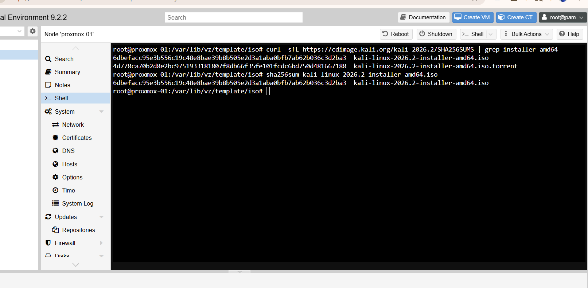
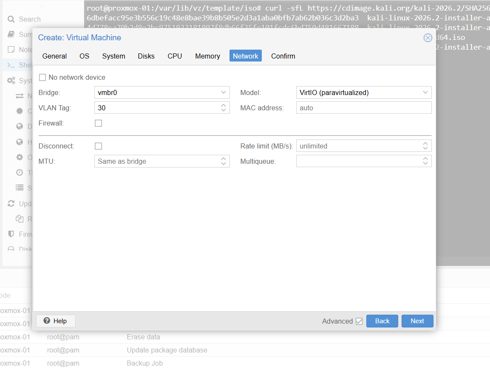
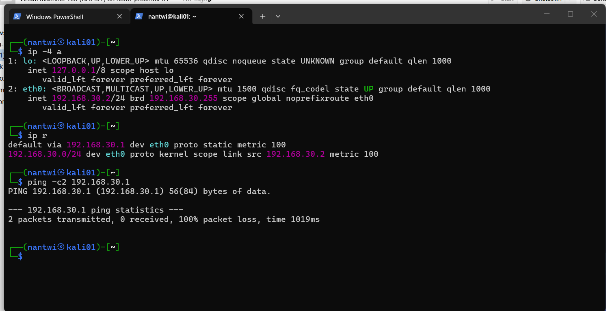
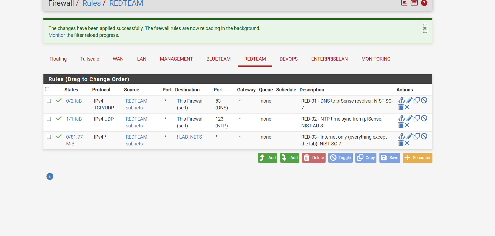
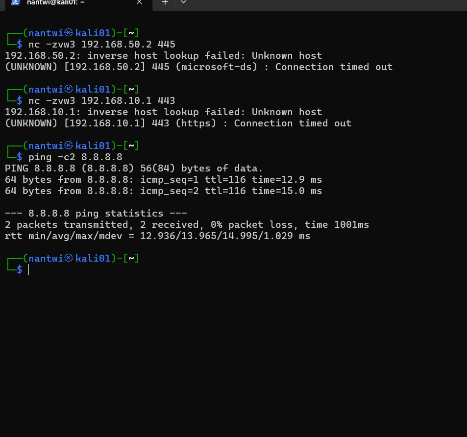
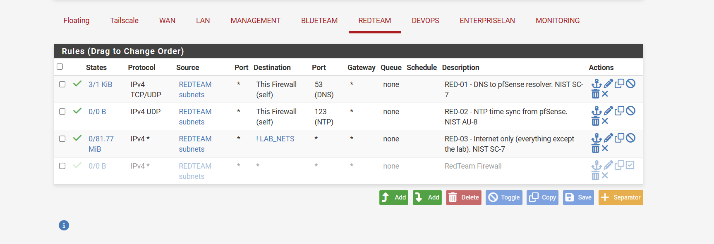
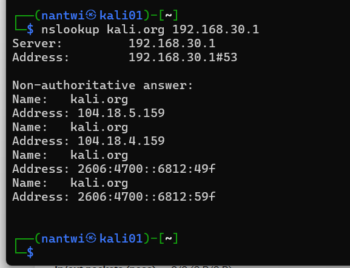
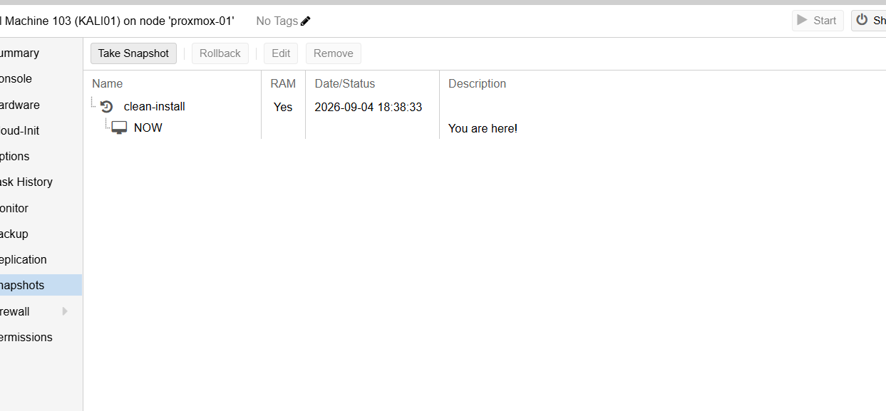

## In plain words

To know that a defence works, something has to attack it. I built a dedicated attack machine for the lab and placed it on the most tightly restricted network, so it can run exercises but cannot reach anything except on purpose. I then ran tests from that machine itself to prove it is contained and still works.

## What I did, step by step

1. Checked the downloaded installer against its published checksum, a fingerprint of the file, before installing it (Figure 3.1).
2. Placed the virtual machine on the attack network with one setting on the host, which nothing inside the machine can change (Figure 3.2).
3. Gave it a fixed address, because a machine named in firewall rules and test evidence needs a stable identity (Figure 3.3).
4. Wrote three firewall rules for its network: name lookups, time sync and internet access, with nothing internal allowed (Figure 3.4).
5. Fixed failing name lookups by adding that network to the firewall's lookup service, after the rule counters showed the traffic was passing (Figure 3.7).
6. Ran five tests from the machine on 4 September 2026: two blocked paths stayed blocked and three everyday services worked (Figure 3.5).
7. Saved a clean snapshot of the validated build, so every exercise starts from it and rolls back afterwards (Figure 3.8).

## The background

A lab that only contains defensive tooling can show that controls exist. It cannot show that they work. KALI01 is there so that every control is tested by something behaving the way an adversary behaves. That makes it the least trusted host in the lab, so it sits on the segment with the most restrictive rulebase: usable enough to run exercises, contained enough that it cannot reach anything except on purpose.

## How it was built

KALI01 is VM 103 on the Proxmox host: Kali Linux 2026.2 with Xfce, a 60 GB disk, and a `virtio` NIC on bridge `vmbr0` with VLAN tag 30. The ISO was checked against its published SHA256 before installation (NIST SI-7), and Figure 3.1 shows that check.

*Figure 3.1: The downloaded Kali ISO verified against the published SHA256 before installation. Checking software before it enters the environment is a control in its own right, and it matters most for the machine that runs offensive tooling.*

Figure 3.2 shows the setting that places the VM on the RedTeam segment.

*Figure 3.2: KALI01's placement is one number on its virtual NIC. Nothing inside the guest can move it to another segment, which is why the tag lives at the hypervisor.*

It then took a static address, `192.168.30.2`, because a host that appears in firewall rules and test evidence needs a stable identity. IPv6 is disabled, since the rulebase is written and tested in IPv4 only, and time comes from the firewall. Figure 3.3 confirms the address and the default route.

*Figure 3.3: `192.168.30.2/24` with `valid_lft forever`, a static address and not a lease, and a default route via `192.168.30.1`. The unanswered ping to the gateway is expected: no RedTeam rule permits ICMP to the firewall, by design.*

## What the segment may do

Figure 3.4 is the whole RedTeam ruleset: RED-01 for DNS and RED-02 for NTP, both to the firewall, and RED-03 for the internet only. Reaching a target for an exercise takes a temporary, specific pass rule, recorded in the change log and removed afterwards.

*Figure 3.4: The RedTeam ruleset: DNS and NTP to the firewall, internet for tooling, and nothing else. No ICMP-to-any, so the segment cannot discover internal hosts.*

## Proving containment from the host itself

On 4 September 2026 I ran five tests from KALI01. They are paired on purpose: two prove containment and three prove the host still functions, because a control that breaks the host gets removed the first time it is inconvenient.

| Test from KALI01 | Expected | Result |
|---|---|---|
| SMB to DC01, `192.168.50.2` port 445 | Blocked | Connection timed out |
| pfSense management, `192.168.10.1` port 443 | Blocked | Connection timed out |
| Ping to the internet | Reachable | 0% packet loss |
| DNS lookup against the firewall | Resolves | Answer returned |
| Clock state | Synchronised | Synchronised |

Figure 3.5 shows the run. Both denials are timeouts rather than refusals: pfSense drops silently, so a filtered host looks the same as one that does not exist.

*Figure 3.5: Containment test from KALI01: no reachability to the domain controller or the firewall management plane, and the attempt is logged.*

The runbook is explicit about what this does and does not prove. The test measures the routed paths that the pfSense rulebase governs. KALI01 runs no VPN client and its only route is the default via `192.168.30.1`, so every probe was evaluated on the REDTEAM interface. My own administrative session arrives over Tailscale, a separate path. So the accurate claim is the narrower one: VLAN 30 is contained from the lab's routed paths, and remote administrative reachability is governed separately, by Tailscale device membership. A test of a segmentation control must originate inside the segment.

## What went wrong

The first installation completed and would not boot. The Debian installer's second GRUB prompt, which device to install to, has no default, and pressing Enter selects nothing. Answering it with `/dev/sda` on a reinstall fixed it.

DNS also failed at first, although RED-01 was correct. In Figure 3.6 the States column shows live entries against the rule, and a blocked packet never creates a state, so the firewall was passing the queries and nothing was answering.

*Figure 3.6: RED-01 showing 3/1 KiB in the States column while DNS was failing, which proves the firewall accepted and delivered the queries. The greyed row at the bottom is the legacy any-to-any rule, disabled here and deleted once containment was proven.*

The DNS Resolver had never been bound to the REDTEAM interface. Once I added it, the same lookup returned an answer, as Figure 3.7 shows.

*Figure 3.7: The query that had been timing out now returns an answer from `192.168.30.1`. RED-01 works end to end: the rule passes the traffic and the service is listening.*

The habit I kept: read the state counters before changing any rule.

## Starting clean every time

Once the build was validated, and before any tooling was added, I took the snapshot in Figure 3.8. That rollback is why the attack host is virtual rather than physical (NIST CP-10).

*Figure 3.8: A clean-install snapshot of the attack host. Every exercise starts from here and rolls back afterwards, so nothing carries over between engagements.*

The full runbook, with every command, is [chapter 15 in the repository](https://github.com/noble-antwi/enterprise-security-homelab/blob/main/docs/15-kali-attack-host-build.md).
