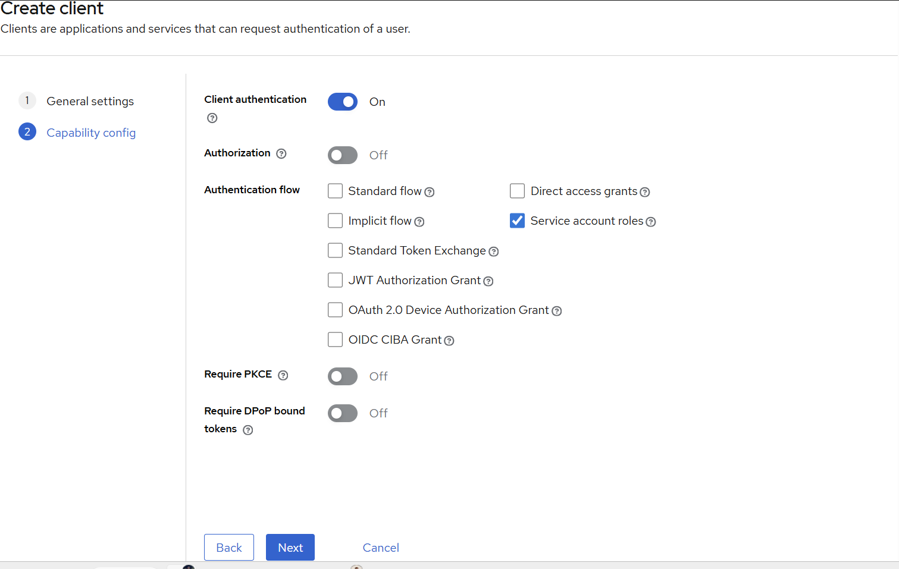
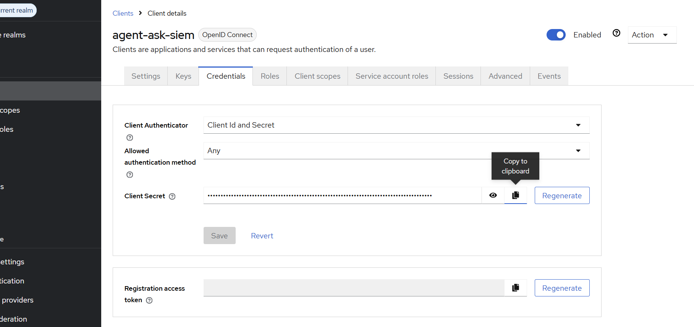
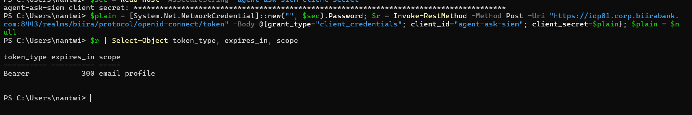
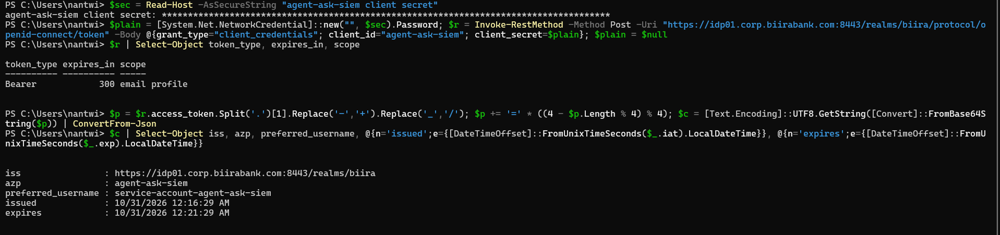
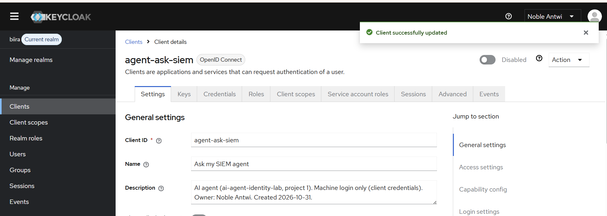
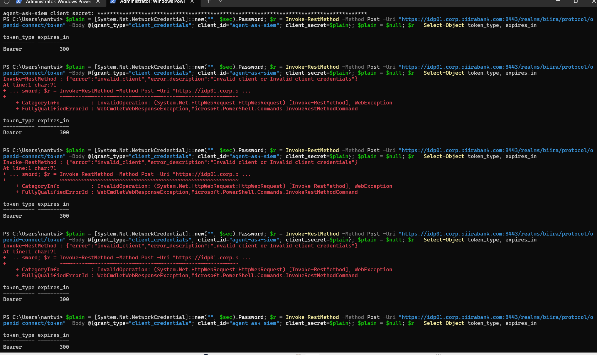
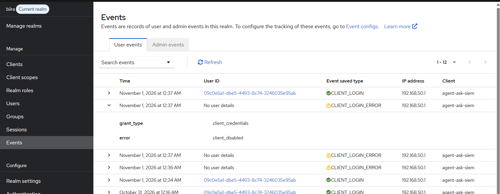

## In plain words

Software that works on its own, like my AI assistant that reads security alerts, needs an identity just as a person does. I gave the assistant its own account on the lab's sign-in system, with a named owner. It proves who it is with one secret and receives a pass, called a token, that expires after five minutes, and I can switch the account off in one place.

## What I did, step by step

1. Registered the assistant as its own identity on the lab's sign-in system, for programs only, with every browser sign-in switched off (Figure 11.1).
2. Copied the generated secret straight into the password manager, without it ever being displayed (Figure 11.2).
3. Requested a token from my laptop and received one valid for 300 seconds (Figure 11.3).
4. Decoded the token to confirm which system issued it and which identity it was issued to (Figure 11.4).
5. Disabled the identity in one place (Figure 11.5).
6. Repeated the request and saw every attempt refused until I re-enabled the identity (Figure 11.6).
7. Proved the refusal in the sign-in system's own log, which recorded the real reason under the assistant's name (Figure 11.7).

## The background

The "Ask my SIEM" agent in the [AI agent identity lab](/work/ai-agent-identity-lab/) reads Wazuh alerts. I wanted it to have the same governance a person gets: one identity, owned by someone, that issues short-lived proof and can be switched off in one place. So the agent became the first machine identity on IDP01, Biira Bank's identity provider.

## Why client credentials

OpenID Connect has a grant made for exactly this. With client credentials there is no person and no browser, just a program that proves it is a registered client and receives a signed token valid for minutes. SAML, which Keycloak also speaks, is built around a person in a browser, so it has no equivalent.

## The client

The agent is an OpenID Connect client in the `biira` realm with the client ID `agent-ask-siem`. Figure 11.1 shows the settings that define it.

*Figure 11.1: The AI agent's own identity on IDP01: a confidential client that must prove itself with a secret, and only service account roles. With every browser flow off, no person can sign in through it.*

| Setting | Choice | Why |
|---|---|---|
| Grant | Client credentials only | The agent is a program; there is no person to sign in |
| Client authentication | On | A confidential client: the token endpoint refuses anyone without the secret |
| Browser and password flows | Off | Nothing this client does needs them |
| Description | Purpose, owner, project, creation date | A non-human identity needs an accountable owner, the same as a person |

With the browser flows off there is no redirect address to register either, which removes the open-redirect class of mistakes from this client. The generated secret was never displayed. It went straight from Keycloak's copy button into the password manager, as Figure 11.2 shows. It is the agent's secret zero, the one credential it holds to get everything else, and Keycloak moves it up a layer so that everything downstream is short-lived.

*Figure 11.2: The generated client secret, masked on screen and never displayed. It was copied straight into the password manager with the copy button.*

## A token, without exposing anything

I requested a token from my laptop in PowerShell. The secret is typed into a hidden prompt, held for the one request, then cleared, and the token itself is never printed. What came back was a bearer token valid for 300 seconds, as Figure 11.3 shows.

*Figure 11.3: A Bearer token valid for 300 seconds. Only its type, lifetime and scope are shown, never the token itself.*

A token's payload is only encoded, not encrypted, so anyone holding it can read it and it must never carry secrets. What makes it trustworthy is the signature, which only Keycloak's private key can produce. Decoding just the payload shows what Keycloak asserted, as in Figure 11.4.

*Figure 11.4: A token for the agent, valid for 300 seconds: issued by the biira realm on IDP01, to agent-ask-siem, as its own service account. The secret itself never appears on screen.*

## The off switch

The point of a central identity is that turning it off works everywhere at once. I disabled the client in Keycloak, as Figure 11.5 shows, and repeated the same request. Figure 11.6 shows the sequence.

*Figure 11.5: The client switched to Disabled, in one place. Its description records the owner and the purpose.*

*Figure 11.6: The off switch: one token issued, every request refused with invalid_client while the client is disabled, tokens again once it is re-enabled.*

The caller learns nothing useful from `invalid_client`. Keycloak's own event log, in Figure 11.7, keeps the real reason under the agent's name.

*Figure 11.7: The caller is told only invalid_client; Keycloak's own record keeps the real reason, client_disabled, under the agent's name.*

Two facts make the switch strong. A token already issued stays valid until it expires, at most five minutes, because services check its signature without calling Keycloak. That is the trade-off of short-lived tokens, and the reason the lifetime is short. And every new request is refused the moment the client is disabled, so an agent that misbehaves loses all access within one token lifetime, from one place.

## What surprised me

In Figure 11.6 a "Bearer 300" line appears under each refusal, as if a token had been issued anyway. None was. A failed `Invoke-RestMethod` does not overwrite the variable holding the last response, so PowerShell printed the previous value again. The lesson is to clear the variable before each attempt, or to read the error and not the table.

The event in Figure 11.7 also records the firewall as the source address. At the time, Tailscale on pfSense was relabelling remote connections; that was fixed afterwards, so events now name the real device.

The next step is for VAULT01 to accept this token and release a short-lived, read-only Wazuh credential to the agent.

The full runbook, with every command, is [chapter 23 in the repository](https://github.com/noble-antwi/enterprise-security-homelab/blob/main/docs/23-identity-provider-idp01-keycloak.md).
