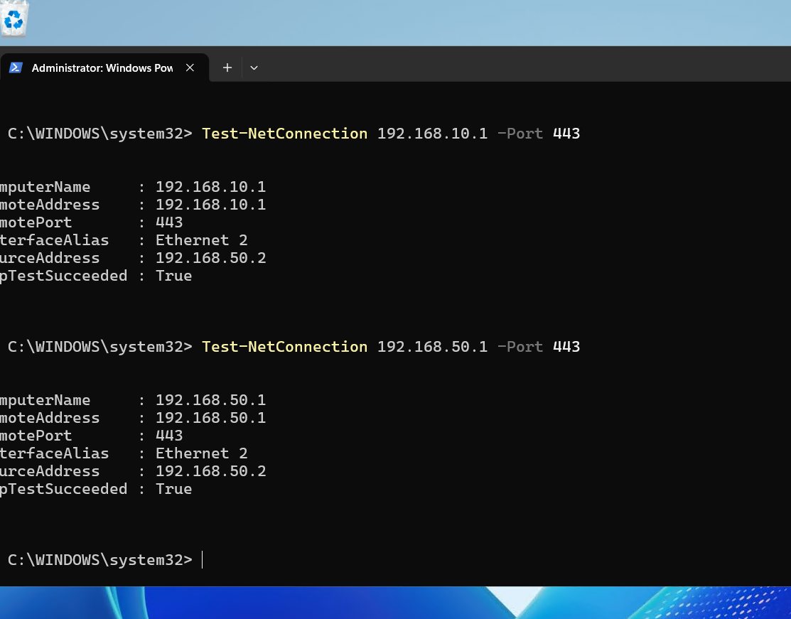
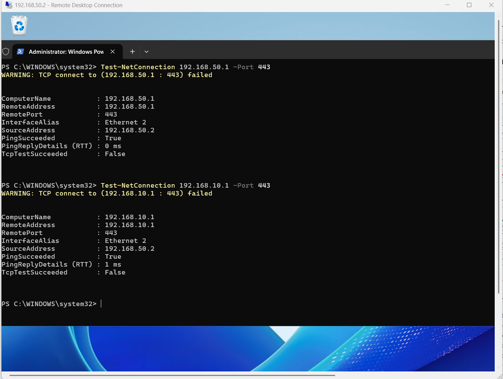
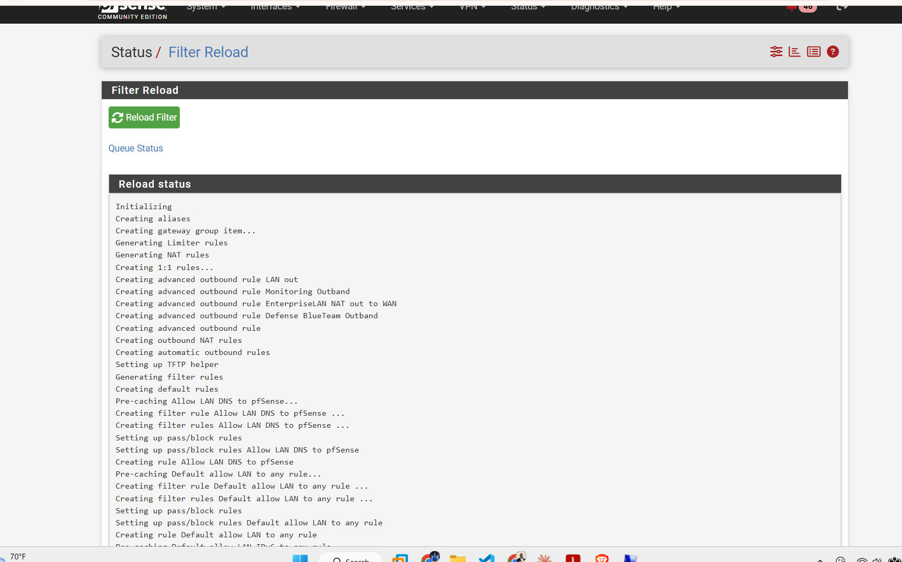

The firewall's administrative interface is the one place from which every other control in the lab can be rewritten, so only the management plane should be able to reach it. This build makes that true for ENTERPRISELAN, the segment the domain controller lives on. Hosts on VLAN 50 cannot open the pfSense admin interface on their own gateway address or on any other VLAN's, and they keep the DNS, NTP and internet access they legitimately need.

## The rules that do it

The ENTERPRISELAN tab governs what VLAN 50 hosts may initiate. Access to the domain controller from elsewhere is decided on the source VLANs' tabs, and replies are stateful, so this tab only has to permit what the segment legitimately originates.

| Rule | Destination | Service | Why |
|---|---|---|---|
| ENT-01 | This firewall | TCP/UDP 53 | DNS resolution and forwarding |
| ENT-02 | This firewall | UDP 123 | Time sync, which Kerberos and logging depend on |
| ENT-03 | Any | ICMP echo-request | Outbound ping for diagnostics |
| ENT-04 | Not `LAB_NETS` | Any | Internet for updates, activation, CRLs and public DNS |
| (implicit) | Any | Any | Default deny |

No rule mentions the admin ports. The control is the absence of a pass rule, enforced by the default deny at the bottom. The four rules replaced an any-to-any rule that had governed the interface, which was deleted on 30 August 2026 once the new set was validated.

## Before and after

A blocked connection proves little on its own, so I recorded a baseline first. On 15 August 2026, before the interface was tightened, I ran `Test-NetConnection` from DC01 against port 443 on the firewall and it returned True: the domain controller could load the admin interface. Figure 2.1 is the before capture, with the same True for both the VLAN 50 gateway and the Management gateway.

*Figure 2.1: The baseline, recorded before the rules were tightened. Both tests return True; Figure 2.2 repeats them after the change.*

On 30 August, with ENT-01 to ENT-04 in place, the same tests gave the opposite answer.

| Date | From DC01 to | Expected | Result |
|---|---|---|---|
| 15 August 2026 | `192.168.50.1` port 443 | Reachable (not yet tightened) | True |
| 30 August 2026 | `192.168.50.1` port 443 | Blocked | False |
| 30 August 2026 | `192.168.10.1` port 443 | Blocked | False |

Figure 2.2 shows the after state. Both tests return False while ping stays True, because ENT-03 permits ICMP. That detail matters: it shows the rule set is surgical rather than a blanket block. `dcdiag`, DNS and internet access on the domain controller all still passed.

*Figure 2.2: Management-plane isolation, proven rather than assumed: EnterpriseLAN cannot reach the firewall's admin interface on any VLAN, while DNS, NTP and internet still work.*

## The test that kept passing

The change from True to False did not happen when the rules were saved. With the new rules in place and correct, the isolation test kept returning True.

I worked through it by elimination. The floating rules were empty. Disabling the anti-lockout rule changed nothing. Packet filtering was enabled. Deleting the any-to-any rule outright changed nothing either. No rule change was taking effect at all, and that was the clue: pfSense had saved the new rules in the GUI, but the kernel was still enforcing the old ruleset. Status > Filter Reload > Reload Filter compiled and loaded the current rules, and both tests then returned False. Figure 2.3 shows the reload.

*Figure 2.3: Status > Filter Reload. Reloading by hand compiled and loaded the current ruleset, after which the isolation control took effect.*

## What I took from it

A stuck reload silently enforces the old rules and makes a control look broken when it is merely not loaded. The rule register gained a ninth principle from this: a saved rule is not an enforced rule, so every change is followed by a filter reload and then a test.

The other lesson is the baseline. Each validation test in the register is repeatable, and its result is recorded before and after the change that is meant to affect it. Without the True from 15 August, the False from 30 August would not show that the rules were what changed it.

The same check was later repeated from the attack segment: on 4 September 2026, a connection from KALI01 on VLAN 30 to the Management gateway on port 443 timed out.

The full runbook, with every command, is [chapter 13 in the repository](https://github.com/noble-antwi/enterprise-security-homelab/blob/main/docs/13-firewall-rulebase-governance.md).
