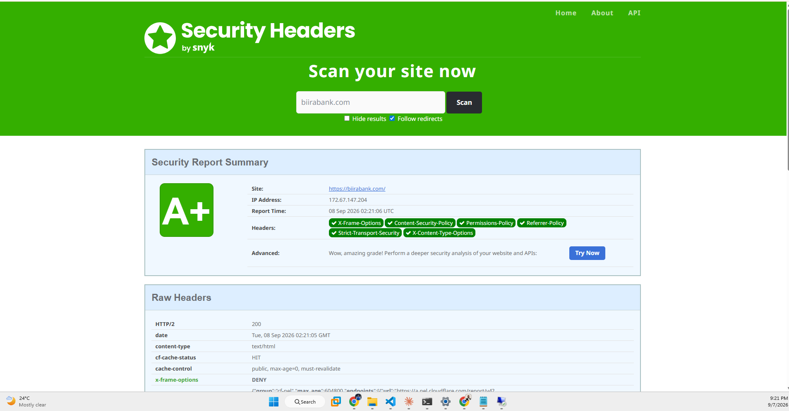

Everything else in this lab is an internal control: VLAN segmentation, internal firewall policy, an internal SIEM, an internal directory. That is one half of enterprise security. The other half is the part of the estate the internet can reach, and `biirabank.com` supplies it. A public site brings controls that have no internal equivalent, such as transport security graded by third parties and browser security headers.

The site is deliberately hardened and uninteresting. It collects nothing, authenticates nobody and runs no application logic, and it states in three places that Biira Bank is fictional and not a financial institution. Anything intentionally vulnerable stays internal, behind the firewall.

## Workers static assets, not Pages

Cloudflare offers two ways to host a static site. Pages is the older product, now labelled the legacy workflow in the dashboard, and Workers with static assets is the path Cloudflare recommends for new projects. I chose Workers. The site is a folder of static files today, but the roadmap adds server-side behaviour, and starting on Pages would have meant migrating at exactly that point.

## An exposure found by testing rather than reading

After the custom domains were attached, testing found the site still answering on its default `workers.dev` hostname, although the dashboard toggles for that hostname appeared to be off. That mattered because every control here is applied at the zone level, on `biirabank.com`. On the default hostname none of the zone-level controls applied: the same content, with no header rule and no TLS minimum.

I disabled the route for both production and preview. Requests kept succeeding for a short period, then began returning `404`. The lag was propagation across Cloudflare's edge, and the lesson matches the firewall work: a control is in place when a request proves it, not when the tool reports success.

## Transport and headers

Three transport settings, each verified from outside afterwards:

| Setting | Before | After |
|---|---|---|
| Encryption mode | Full | Full (Strict) |
| Plain HTTP | Served content with `200 OK` | `301` redirect to HTTPS |
| Minimum TLS version | TLS 1.0 | TLS 1.2 |

The TLS minimum was confirmed by attempting handshakes at each version: 1.0 and 1.1 are refused, 1.2 and 1.3 succeed.

Six response headers are applied by a single Transform Rule that matches every request: `Strict-Transport-Security`, `X-Content-Type-Options`, `X-Frame-Options`, `Referrer-Policy`, `Permissions-Policy` and `Content-Security-Policy`. The last is the one worth reading closely. It starts from `default-src 'none'` and permits only what is named afterwards: the site's own stylesheets and images, and Google Fonts. There is no `script-src` directive at all, so no JavaScript may execute on the page from any source.

That was only possible because I refactored the page first: the stylesheet moved into its own file, three inline `style` attributes became classes, and a small footer script was removed. Order matters. Applied to the original page, the policy would have rendered it unstyled, so the refactor was deployed and verified live before the rule was created.

## The policy blocked Cloudflare's own script

On first load under the new policy, the browser console reported one violation. Cloudflare Web Analytics was injecting `beacon.min.js` into every response at the edge, and the policy refused to run it. The policy had worked exactly as designed: it caught a third party modifying the page in transit.

The injection was invisible to command-line testing, because Cloudflare only adds the script for requests carrying browser-like headers. I found it by reading the console in a real browser. I disabled the injection rather than allowing the script, because allowing it would have made "no JavaScript runs on this page" untrue.

## A grade that moved

A score on its own proves nothing. A score that moves proves the work happened, and this scoreboard is public and not under my control. On 8 September 2026 at 01:19 UTC, securityheaders.com graded the site F, with five of the headers absent. Figure 5.1 is the same site at 02:21 UTC, about an hour later.

*Figure 5.1: The public tier after hardening, graded from outside rather than from the hosting platform's own dashboard. It started at F.*

What I took from it is that both surprises, the default hostname and the injected script, were found by testing the live service, not by reading configuration.

The full runbook, with every command, is [chapter 18 in the repository](https://github.com/noble-antwi/enterprise-security-homelab/blob/main/docs/18-public-web-presence-and-edge-hardening.md).
