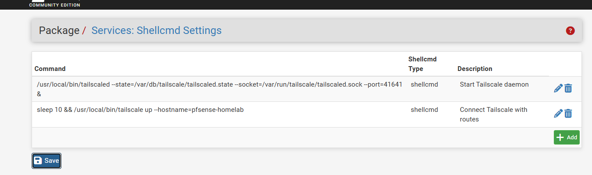
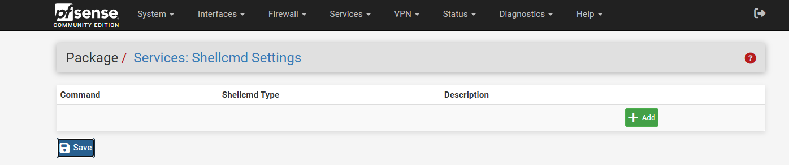
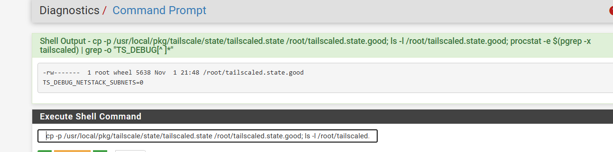
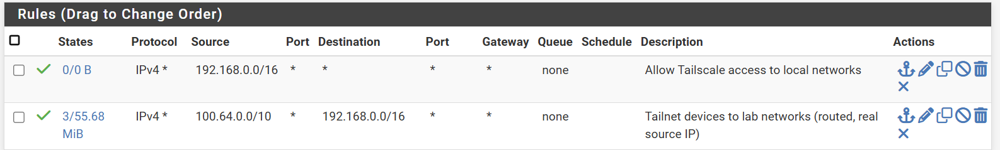
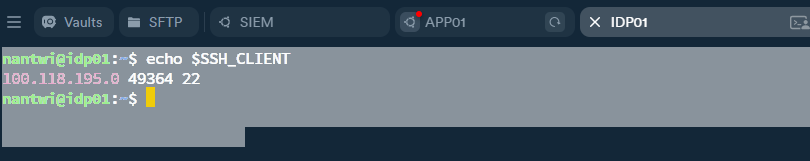
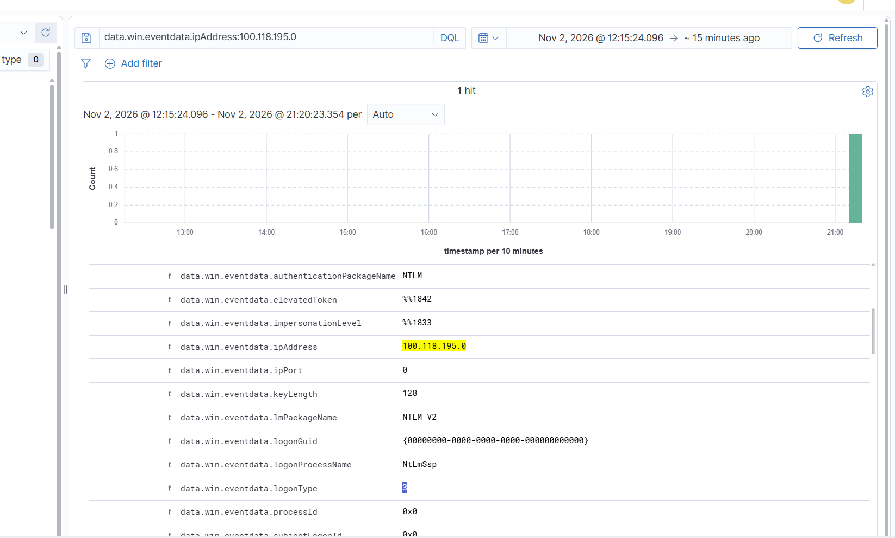
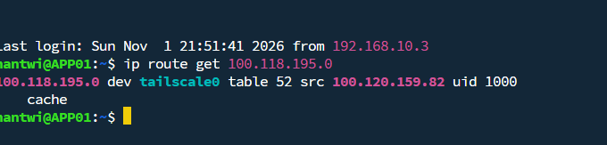

## In plain words

The lab sits behind a home router that I do not control, so nothing on the internet can open a connection into it. I reach it remotely through Tailscale, a service that builds tunnels between my signed-in devices, with both ends dialling out. I also made each remote connection arrive with the address of the real device, so logs and rules can name it.

## What I did, step by step

1. Chose Tailscale because it needs no inbound connection, and ran it on the firewall so firewall rules still decide what remote traffic reaches.
2. Traced a sign-out after a firewall upgrade on 1 November 2026 to two leftover start-up entries running a second copy (Figure 4.1).
3. Deleted both entries, signed the firewall in again and rebooted to confirm one copy ran with the same identity (Figure 4.2).
4. Changed one setting so the firewall routes remote traffic itself and the real source address is kept (Figure 4.3).
5. Allowed Tailscale's address range to reach the lab networks with one rule, and disabled the older rule on 2 November 2026 (Figure 4.4).
6. Confirmed in a remote login session that the server saw the laptop's own address, not the firewall's (Figure 4.5).
7. Proved it in the security logs: a remote desktop logon event carried the laptop's address as its source (Figure 4.6).

## The background

The lab sits behind a home router it does not administer. The pfSense WAN takes a private address from that router, so the lab is behind two layers of address translation and nothing on the internet can open a connection inward. Remote access had to work without any inbound port, and Tailscale does: it builds WireGuard tunnels between devices that each sign in to the same tailnet, and both ends dial out.

## Why pfSense is the subnet router

| Option | Needs inbound port forwarding | Decision |
|---|---|---|
| OpenVPN on pfSense | Yes | Not possible without control of the upstream router |
| ZeroTier | No | Not enough routes on the free tier |
| Tailscale | No | Chosen |

pfSense joins the tailnet as a subnet router and advertises the seven lab networks. I put the router on the firewall on purpose: remote traffic enters through pfSense, so pfSense rules still decide what it reaches. Key expiry is disabled for the router alone, because a silently expired key would cut off all remote access.

## Two copies of Tailscale

I first installed Tailscale on pfSense by hand in July 2025, with two Shellcmd entries to start it at every boot. When I later moved to the pfSense Tailscale package, I did not remove those entries. Nothing failed for over a year.

On 1 November 2026, after upgrading pfSense from 2.8.0 to 2.9.0, the firewall came back logged out of Tailscale, and the console showed Tailscale log lines instead of the pfSense menu. The old entries were starting a second `tailscaled` before the package's own. The package's start script saw a Tailscale already running and stepped aside, and its routine for migrating an old identity then copied the stray copy's empty state file over the real one. The upgrade did not cause the fault. It restarted everything and exposed it. Figure 4.1 shows the two entries, still in place from July 2025.

*Figure 4.1: The two startup entries left over from the manual install: start `tailscaled` by hand, then `tailscale up` ten seconds later.*

I deleted both entries, signed the firewall in once more, kept a copy of the working identity on the firewall, readable by root only, and rebooted to prove it: one `tailscaled`, started by the package, with the same identity as before the reboot. Figure 4.2 shows the Shellcmd list after the deletion.

*Figure 4.2: Both entries deleted. A search of the firewall's configuration file for the old daemon command then returned zero matches.*

## Seeing the real device

Until this change, every remote connection reached the lab from the firewall's own address. Keycloak events, SSH logins and Windows logon events all showed the same source, so an alert could say that a remote device signed in but never which one.

The cause is specific to FreeBSD. There, Tailscale handles subnet traffic in its own user-space network stack: it accepts the connection itself and opens a new one from the firewall's address. One environment setting, given to the service through `/etc/rc.conf.d/tailscaled`, turns that stack off for subnet traffic, so packets go to the pfSense kernel and are routed like any other traffic. After a restart through the package's own script, the running daemon carries the setting, as Figure 4.3 shows.

*Figure 4.3: `procstat -e` on the running `tailscaled` shows `TS_DEBUG_NETSTACK_SUBNETS=0`, so the setting is active and not only saved.*

Because the traffic is now routed rather than re-originated, the rules on the Tailscale interface see the real source. One rule allows Tailscale's address range, `100.64.0.0/10`, to the lab networks. The older rule written for relabelled traffic showed zero states afterwards and was disabled on 2 November 2026. Figure 4.4 shows both rules.

*Figure 4.4: The rule for `100.64.0.0/10`, Tailscale's address range, to the lab networks carries the traffic. The earlier `192.168.0.0/16` rule shows 0 states and was disabled on 2 November 2026.*

## The proof

Every remote connection now arrives with the real device's address instead of the firewall's, proven in two places:

- **In the SSH session itself.** On IDP01, over the tunnel, `echo $SSH_CLIENT` shows the laptop's Tailscale address. The same command showed `192.168.50.1` before the change.
- **In a Wazuh logon event.** A Remote Desktop session to DC01 over Tailscale produced a logon event carrying the laptop's Tailscale address and its computer name.

Figure 4.5 is the SSH session and Figure 4.6 is the Wazuh event.

*Figure 4.5: On IDP01, over the tunnel, `echo $SSH_CLIENT` shows `100.118.195.0`, the laptop's Tailscale address. The same command showed `192.168.50.1` before the change.*

*Figure 4.6: Wazuh, searching on the laptop's Tailscale address: one logon event from DC01, for a Remote Desktop session opened over Tailscale, with that address as its source.*

A Wazuh event gives a Tailscale address, and the Tailscale admin console maps that address to a device and its owner, so logs and rules can now name the device. I repeated the tests after a reboot with the same result.

## What surprised me

One server, APP01, runs Tailscale itself, and it stopped answering remote devices by its lab address. The request arrived through pfSense with a Tailscale source, APP01 replied through its own tunnel, and the laptop discarded an answer it expected from the subnet router. Figure 4.7 shows the reply path on APP01.

*Figure 4.7: On APP01, the route to the laptop's address goes through APP01's own Tailscale interface, `tailscale0`, not back through pfSense.*

The rule that follows: a server that runs Tailscale is reached by its Tailscale name, which is also a direct, end-to-end encrypted path.

The lesson from the outage: when a package takes over something that was set up by hand, retire the old start-up mechanism in the same change, and check that exactly one copy of the service is running.

The full runbook, with every command, is [chapter 05 in the repository](https://github.com/noble-antwi/enterprise-security-homelab/blob/main/docs/05-remote-access.md).
