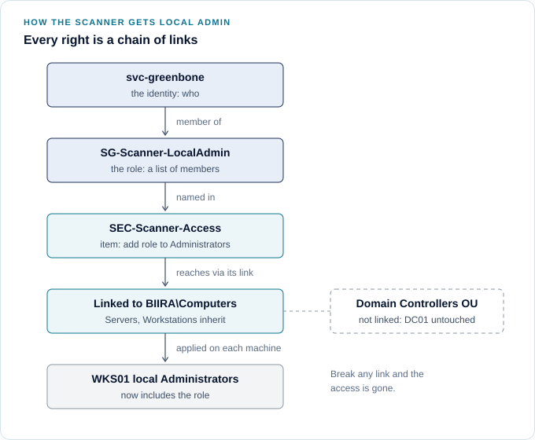
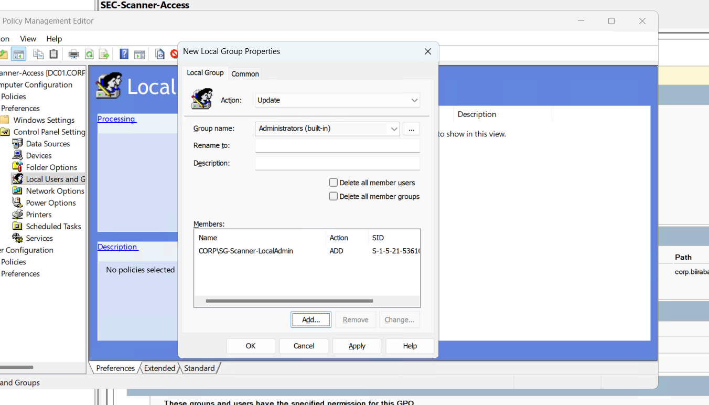
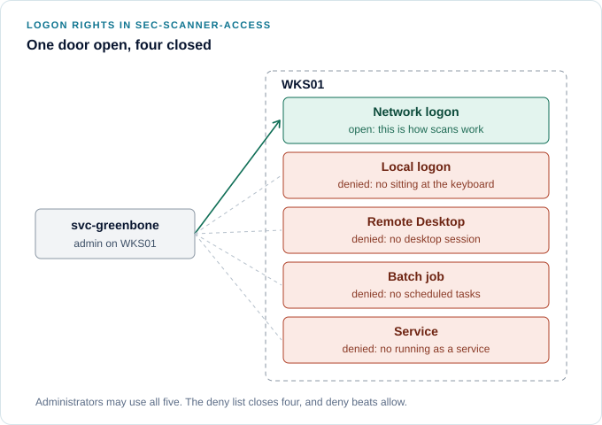
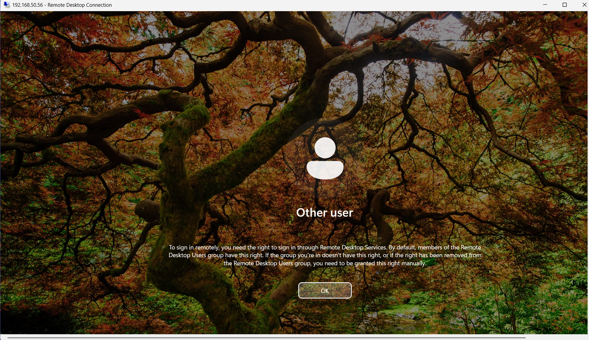
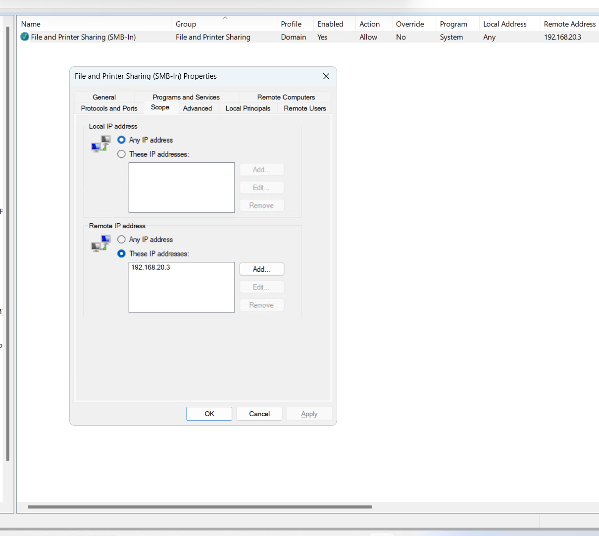

Greenbone can inspect a Windows machine from outside, or log in and inspect it from inside. Logging in is what turns "port 445 is open" into "this machine is missing a specific update", and it requires membership of the target's local Administrators group. So the design question is how to give a scanner administrative rights inside many machines without giving it any power over the domain. NIST SP 800-53 names it: RA-5(5), privileged access for vulnerability scanning.

## A chain of four links

Figure 18.1 shows the answer I built: four pieces, each doing one job and passing the right to the next.

*Figure 18.1: How the scanner becomes an administrator of member machines without gaining anything on the domain. Four links, each doing one job, and the Domain Controllers OU deliberately outside the chain.*

- **The account, `svc-greenbone`.** A domain service account with one purpose and a named owner, disabled or audited once for every machine. It is flagged as sensitive so Kerberos delegation can never reuse its ticket.
- **The group, `SG-Scanner-LocalAdmin`.** Rights go to groups, never directly to accounts. "Who can do this?" is answered by reading one list.
- **The policy, `SEC-Scanner-Access`.** Each Windows machine keeps its own local account database. A Group Policy is how one instruction, written centrally, is carried out by every machine on itself.
- **The scope.** The policy is linked to the member computers OU, which the Servers and Workstations OUs inherit. It is never linked at the domain root or to the Domain Controllers OU.

The scope is the control. A domain controller has no local account database: its Administrators group is the domain's built-in Administrators. The same instruction that makes the scanner an administrator of a member server would, on DC01, make a stored credential one of the most privileged objects in the directory. Linking to the member OUs excludes DC01 structurally rather than by luck.

## The grant itself

Figure 18.2 shows the single item that delivers the right, a Group Policy Preferences local group item.

*Figure 18.2: The grant itself. Action Update so existing administrators survive, the built-in Administrators group picked from the list so its well-known identifier is stored rather than a typed name, and the member added rather than the list replaced.*

Preferences are used rather than Restricted Groups because Preferences can add a member. Restricted Groups replaces the whole membership list, which removes administrators nobody meant to remove. Machines re-read the policy at startup and roughly every 90 minutes, so an entry removed by hand is restored.

## One door open, four closed

An administrator may sign in to Windows in every way it offers, and the scanner needs exactly one of them. Figure 18.3 shows the five logon types and what the same policy does to four of them.

*Figure 18.3: Five ways to sign in to Windows, four of them closed to the scanner. Its password is stored in a database and never expires, so the design assumes the credential leaks and narrows what a leak is worth.*

Four of the five are denied to the group: local, Remote Desktop, batch and service logon. Network logon alone is left. Two rules decided that. Deny beats allow, so the scanner keeps the administrator membership scanning requires while losing every door it does not use. And defining a right replaces it: a right set in a policy becomes the machine's entire list, so I read the workstation's existing deny rights first and carried its Guests entry over.

## Proving it on a real machine

A policy in a console shows intent. When I checked the directory, the target OU was empty, so the policy was linked correctly and applied to nothing. I pre-staged the first workstation, WKS01, in the right OU, joined it, and confirmed on the machine that the policy had arrived and the group was in its local Administrators.

Then I tried the closed door. Figure 18.4 shows a Remote Desktop sign-in to WKS01 as `CORP\svc-greenbone` with the correct password.

*Figure 18.4: The closed door, tried. The account is an administrator of this machine and the password is correct, and Windows still refuses, because deny overrides both. A configuration screen is not proof that a right is enforced.*

The same policy prepares the target for a scan. It sets Remote Registry to start automatically and enables the inbound SMB rule, narrowed as Figure 18.5 shows.

*Figure 18.5: The workstation's SMB rule, scoped to one remote address: SCAN01. A scan does not need a port opened to a segment, only to a host.*

## What I took from it

- **Every right should be explainable as a chain.** The access exists only while the account is in the group, the group is in Administrators and the machine is in scope. Break any link and it is gone.
- **A policy linked to an empty OU is not a control.** Prove it on a real machine.
- **Preferences leave their changes behind.** Unlinking the policy would not remove the grant, so the retirement order is written down with it: disable the account, switch the item to remove the member, and only then delete the policy and the group.
- **These rights narrow a stolen credential. They do not neutralise it.** So the SIEM keeps scanner sign-ins from SCAN01 out of the alert queue and alerts on the same account from anywhere else.

The full runbook, with every command, is [chapter 19 in the repository](https://github.com/noble-antwi/enterprise-security-homelab/blob/main/docs/19-vulnerability-scanning-scan01.md).
