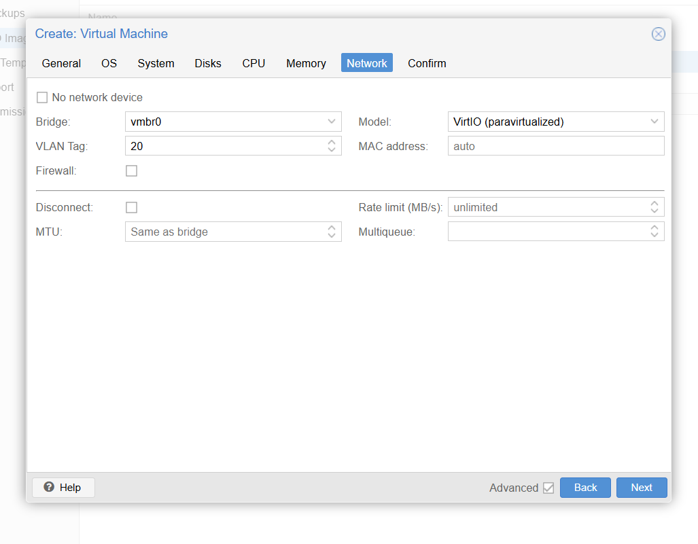
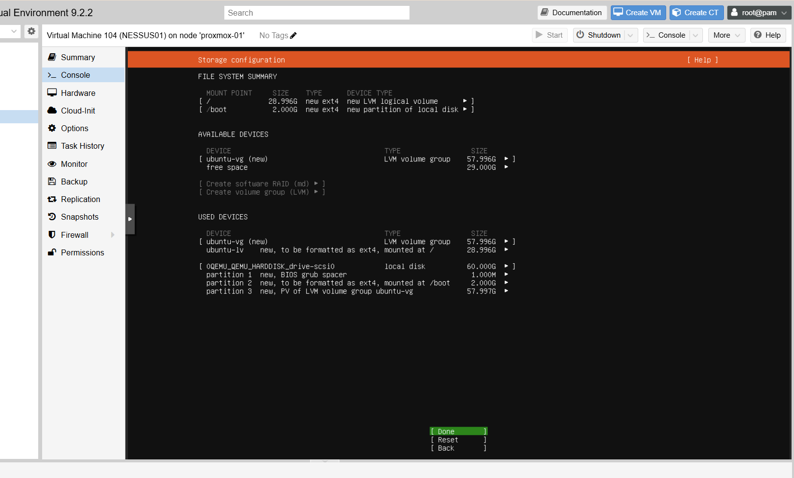
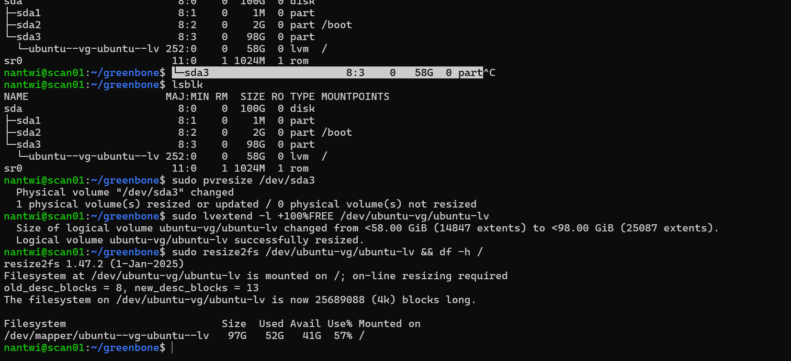
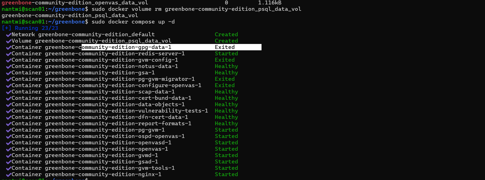
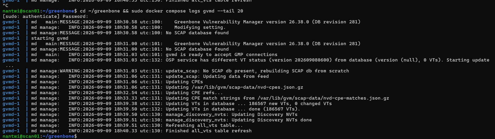
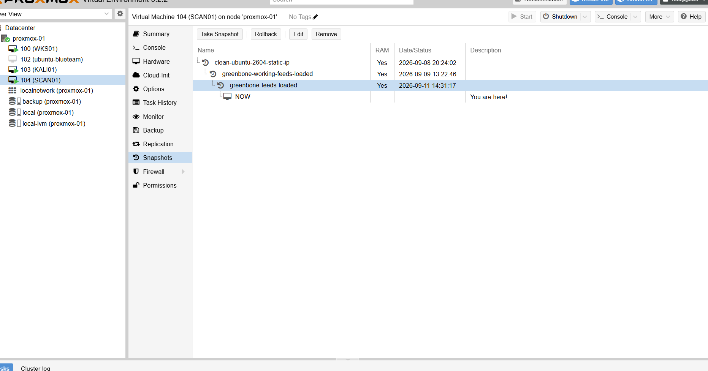
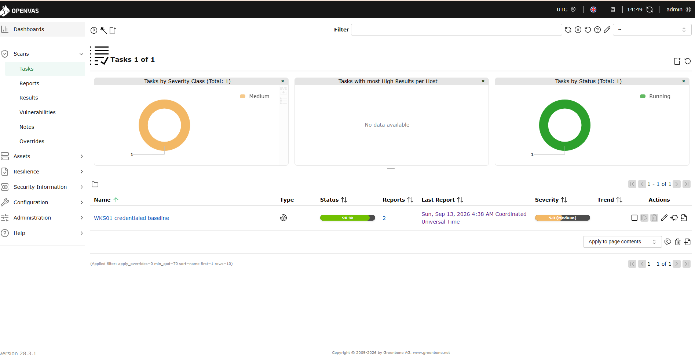

Wazuh already finds CVEs in this lab: each agent reports its installed packages and the manager matches them against CVE data. That is the view from inside a host. SCAN01 exists for the view from the network: which ports actually answer, which services are exposed across VLANs, whether TLS is weak, and, once the scanner is given credentials, the patch level inside the machine. An attacker meets the outside view first, so the lab needs both. CIS Controls v8 safeguard 7.5 asks for exactly this pairing of authenticated and unauthenticated internal scans.

## Why Greenbone, and why a virtual machine

Nessus Essentials was the first choice, for the familiarity of the Tenable interface in job descriptions. It was ruled out on its own current terms: five addresses on a thirty-day licence cannot cover nine hosts, or sustain a loop of scanning, fixing and scanning again. Older write-ups still quote more generous terms, so the decision rests on the vendor's own page. Greenbone Community Edition has no target limit and no expiry, and it is fully open source. Written up in [A Scanner That Is Not a Domain Admin](/lab-notes/2026/09/14/a-scanner-that-is-not-a-domain-admin.html).

The lab's placement rule runs Linux services as containers by default. SCAN01 is the exception, because a scanner stores administrative credentials for everything it scans. Compromise it and you hold the estate, which makes it a Tier 0 asset. A VM gives it a hardware isolation boundary rather than a kernel shared with other containers.

| Property | Value |
|---|---|
| Segment | VLAN 20 (BlueTeam), static address 192.168.20.3 |
| Operating system | Ubuntu 26.04 LTS |
| Resources | 2 vCPU, 8 GB RAM, 100 GB virtual disk |
| Deployment | Greenbone Community Containers under Docker Compose |
| Web interface | Ports 443 and 9392 bound to 192.168.20.3 only |

The web interface answers on that one address, not on every interface.

Figure 17.1 shows the VM's network interface at creation, where the hypervisor places the guest on VLAN 20.

*Figure 17.1: The VM's network interface at creation: bridge `vmbr0`, VLAN tag 20. The guest is placed on the BlueTeam segment by the hypervisor, not by anything the guest itself configures.*

## Three failures before the feeds loaded

The containers deployed cleanly. Getting the feeds loaded did not.

1. **The disk was only half allocated.** Ubuntu's installer built a 58 GB volume group but a logical volume of only 29 GB, and the feeds filled it. The first extend printed the new size, then rolled back because there was no room left to write LVM's own metadata backup.
2. **The database was half written.** Postgres had been part way through initialising when the disk filled, so the migrator failed on every start and everything that depended on it never started. I measured each volume, removed the one 82 MB database volume by name, and kept the 11 GB of downloaded feed data.
3. **The manager crashed when I used the interface.** Opening the web interface while a feed was still loading crashed the manager on a database constraint error. The rule since: stay out of the interface until the feeds report Current.

The first failure was visible at install time, as Figure 17.2 shows. When the disk reached 96% during the overnight feed load, I grew the virtual disk to 100 GB in Proxmox and carried the change up through every layer. Figure 17.3 shows each layer confirmed in turn.

*Figure 17.2: The root cause, visible at install time: the root filesystem on a 28.996 GB logical volume inside a 57.996 GB volume group, with 29 GB left free. Accepting the default produced the disk-full failure a day later.*

*Figure 17.3: Each layer confirmed in turn: the 100 GB disk and 98 GB partition, the physical volume resized, the logical volume extended from 58 GB to 98 GB, the filesystem grown online, and 97 GB reported with 41 GB free.*

Figure 17.4 shows the recovery from the second failure: the one database volume removed by name, then all 23 services running.

*Figure 17.4: The single named volume removed, then `Running 23/23`: a fresh database volume created, the migrator exiting cleanly, and every previously blocked service started.*

Figure 17.5 shows the manager finishing its load of the vulnerability tests, and Figure 17.6 shows where that ended: all four feeds loaded, 186,567 vulnerability tests in place, and scanning available.

*Figure 17.5: Greenbone Vulnerability Manager 26.38.0 ready for connections at 18:31 UTC, then 186,567 new vulnerability tests loaded and the refresh complete at 18:40. This is the moment the scanner became capable of scanning.*

*Figure 17.6: All four feeds loaded, after an initial load of about four hours and three separate failures. In this deployment the feeds never update themselves, so how often they are refreshed is a control rather than housekeeping.*

The initial load was bound by disk I/O rather than CPU, so I took a Proxmox snapshot once it finished and never have to repeat it. Figure 17.7 shows the snapshot chain.

*Figure 17.7: SCAN01's snapshot chain: the clean static-address install, the first working state on 9 September, and `greenbone-feeds-loaded` with all four feeds in place. A rollback point for every stage that took hours to reach.*

Each feed ships as a data container image, and newer data arrives only when those images are pulled and the containers restarted. A scanner running week-old tests misses what was published since, so the refresh procedure is defined as weekly, outside scan windows (NIST SP 800-53 RA-5(2)).

## The first credentialed scan

Figure 17.8 shows the scanner doing the job it was built for: a credentialed scan of WKS01, the first domain-joined workstation.

*Figure 17.8: The first credentialed scan, 19 September. The target is a name rather than an address, because the workstation holds a DHCP lease and a pinned address would eventually point at something else.*

The task is called a baseline on purpose. This run is the reference the next one is compared against, which is what makes a remediation loop possible rather than a one-off report.

## What I took from it

- **A success message describes intent. The system's own state is the truth.** The extend command said 58 GB while the volume listing still said 29 GB.
- **Measure before deleting.** Sizing every volume turned "delete the database volume" from a guess into a certainty.
- **Name machines for roles, not products.** The VM was first named after Nessus and was wrong within hours.

The full runbook, with every command, is [chapter 19 in the repository](https://github.com/noble-antwi/enterprise-security-homelab/blob/main/docs/19-vulnerability-scanning-scan01.md).
