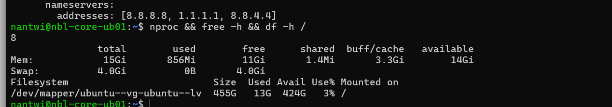
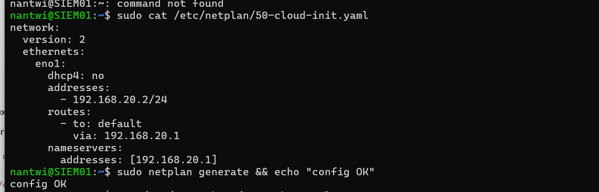
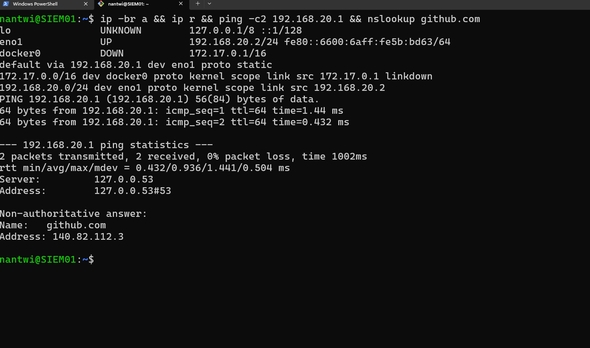
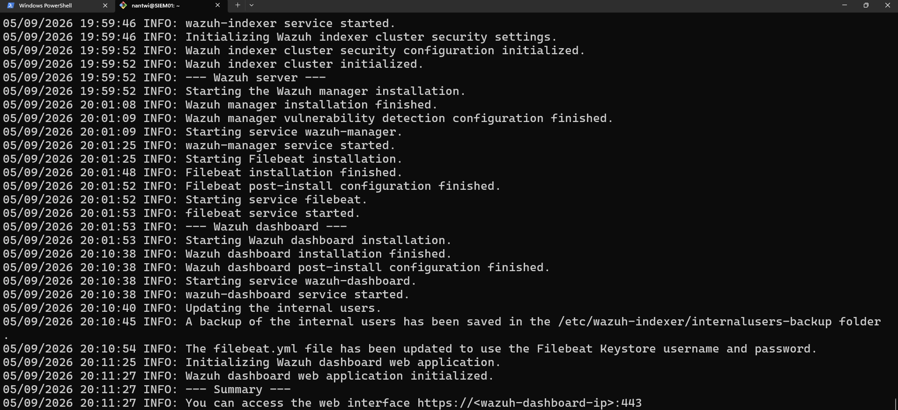
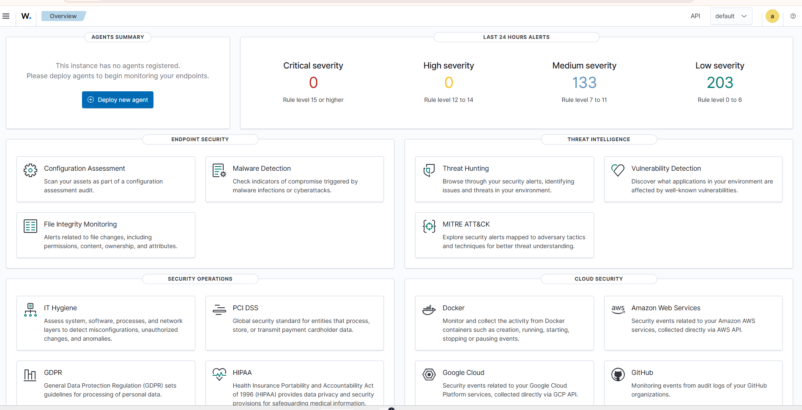
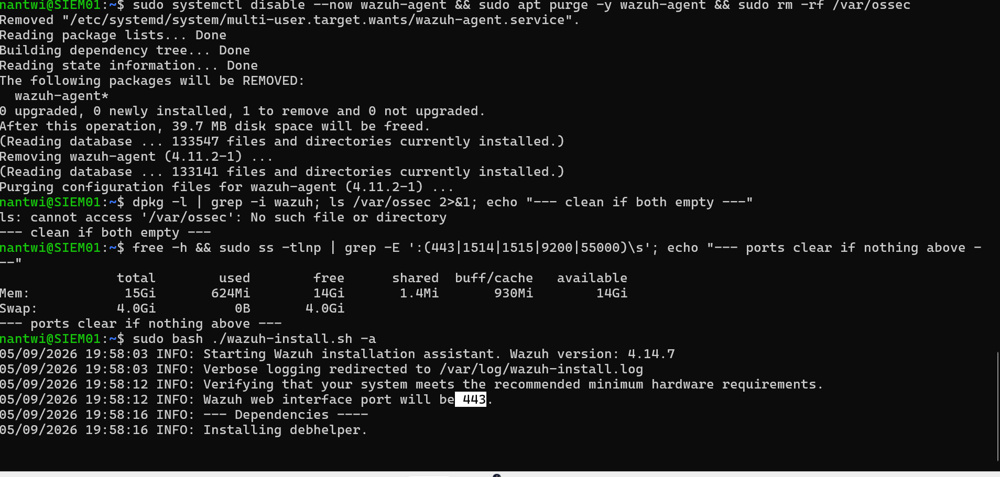
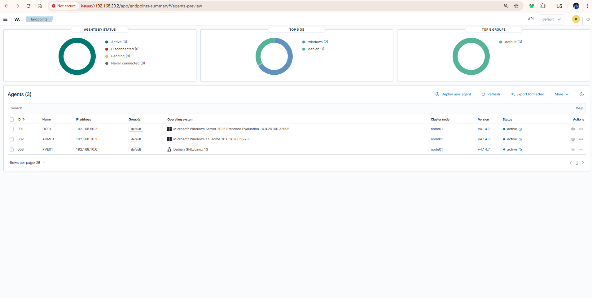
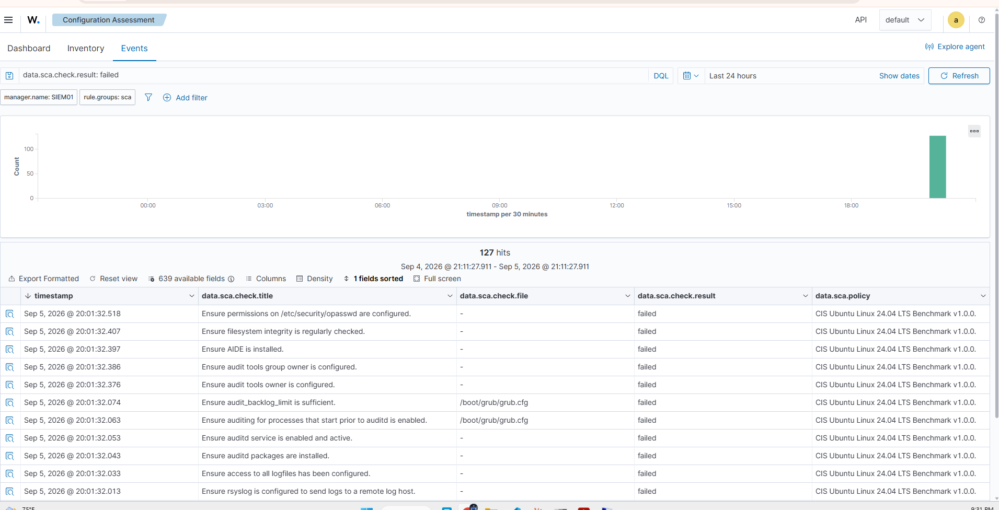

The lab's original SIEM was a physical machine running Rocky Linux 9.6 at `192.168.20.2`. It lost power on 29 August 2026 and did not return. That was the second hardware failure in this lab, after a server NIC. pfSense kept logging locally, but until the rebuild nothing was being shipped or correlated.

## A failure that became a role swap

The question was not how to rebuild it, but which machine should hold the role. The monitoring host was a Dell OptiPlex 9020 with 8 cores and 16 GB of RAM, running Grafana and Prometheus, a workload that fits comfortably in about 2 GB. Wazuh ships an Indexer, an OpenSearch instance, whose practical memory floor is around 8 GB and whose data has to survive. The roles were the wrong way round, and the failure was the chance to correct them. Figure 13.1 shows what the candidate host had to offer.

*Figure 13.1: The candidate host: 8 cores, 15 GiB of usable memory and 424 GB free of a 455 GB volume. The disk matters as much as the memory, because the Indexer is what eventually fills a SIEM's storage.*

| | Before | After |
|---|---|---|
| Dell OptiPlex 9020 (physical) | Grafana and Prometheus, VLAN 60 | SIEM01, Wazuh, VLAN 20 |
| Proxmox guest | none | MON01, Grafana and Prometheus, VLAN 60 |

The principle generalises: put the memory-hungry, data-bearing service on dedicated hardware, and the light, reproducible one on the hypervisor. Grafana and Prometheus can be rebuilt from a configuration file in minutes. A SIEM's value is its history. The story is written up in [Standing Up Wazuh Twice](/lab-notes/2026/09/08/standing-up-wazuh-twice.html).

## How it was built

I did not reinstall the machine. Ubuntu 24.04 carried over, so Wazuh moved from Rocky Linux to Ubuntu. The host was renamed SIEM01, readdressed from VLAN 60 to VLAN 20, and recabled to a VLAN 20 access port. The firewall rule that lets the management plane reach it on SSH and the dashboard port, `MGMT-11`, was built with logging on before the move rather than after.

One trap is worth knowing. The netplan file on Ubuntu Server is generated by cloud-init, and a file written by a program can be rewritten by that program. I disabled cloud-init's network management first, and the new address survived a reboot. Figure 13.2 shows the VLAN 20 configuration after that reboot, and Figure 13.3 the checks that followed.

*Figure 13.2: The VLAN 20 configuration after a reboot, with `netplan generate` confirming it parses. That it survived the reboot is the evidence that cloud-init no longer manages the interface.*

*Figure 13.3: Post-reboot verification in one command: the static address held, the default route is marked `proto static`, the gateway answers and name resolution works.*

Wazuh is three programs: the Indexer stores and searches events, the Server (the manager) accepts agents and applies detection rules, and the Dashboard is the web interface. The all-in-one installer puts all three on one host, which suits 16 GB and 8 cores. I downloaded the installer to a file rather than piping it straight into a root shell. Wazuh 4.14.7 has been live since 5 September 2026. Figure 13.4 shows the components installing and starting in sequence, and Figure 13.5 the dashboard on first login.

*Figure 13.4: The Indexer, manager, Filebeat and Dashboard each installing and starting in sequence. The capture is cropped on purpose, because the installer prints the generated admin credentials immediately below.*

*Figure 13.5: The dashboard on first login. "No agents registered" alongside 336 alerts is not a contradiction: the manager monitors its own host as agent `000`.*

## What went wrong

- **I applied the network change before moving the cable.** The host held an address its port could not serve. The right order is configuration, shutdown, cable, power.
- **SSH refused the connection.** The address had belonged to the failed host, so the recorded host key no longer matched. I read the fingerprint from the machine itself, confirmed it was the one SSH had presented, and only then removed the stale record.
- **The installer refused to run.** A `wazuh-agent` package was left over from the machine's previous role, and a manager and an agent cannot share a host because both own `/var/ossec`. I removed that one package explicitly rather than use the installer's overwrite flag.
- **A configuration edit took the dashboard down.** I appended session settings that were already in the file, and YAML rejects duplicate keys. A backup taken in the same breath as the edit made it a thirty-second recovery.

Figure 13.6 shows the third of those put right: the leftover agent purged and the installer running past the check that had refused it.

*Figure 13.6: The leftover agent purged, `/var/ossec` gone, Wazuh's ports confirmed free, and the installer proceeding past the check that had blocked it.*

## Proving it works

By 6 September three agents were reporting. Figure 13.7 shows them active in the dashboard.

*Figure 13.7: The first three agents, across two operating-system families: the domain controller, the administrative workstation and the hypervisor. WKS01 joined later as agent 004.*

Before any agent enrolled, the manager was already assessing its own host as agent `000`. Wazuh ships CIS Benchmark policies and evaluates the machine against them at startup. Figure 13.8 shows that first assessment against the CIS Ubuntu Linux 24.04 LTS Benchmark: 274 checks evaluated.

*Figure 13.8: The SIEM assessing itself on first boot: 147 passed, 127 failed against CIS Ubuntu 24.04. Captured before any change, because a baseline cannot be recreated later.*

Roughly half a benchmark failing is normal for a default installation. This is the "before" half of a before-and-after.

## What I took from it

- Copy a configuration file before editing it, and check whether a setting already exists before adding it.
- Verifying a host-key fingerprint out of band is what turns a dismissed warning into a cleared one.
- The moment an installer prints a generated credential is the moment people screenshot it. Every screenshot is now checked for passwords, keys and tokens before it is kept.

The full runbook, with every command, is [chapter 16 in the repository](https://github.com/noble-antwi/enterprise-security-homelab/blob/main/docs/16-siem01-build.md).
