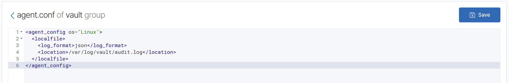
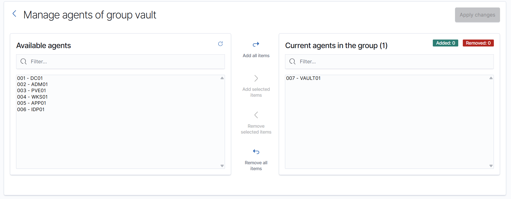
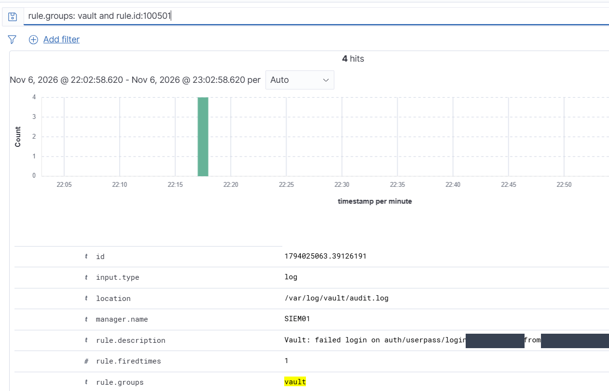
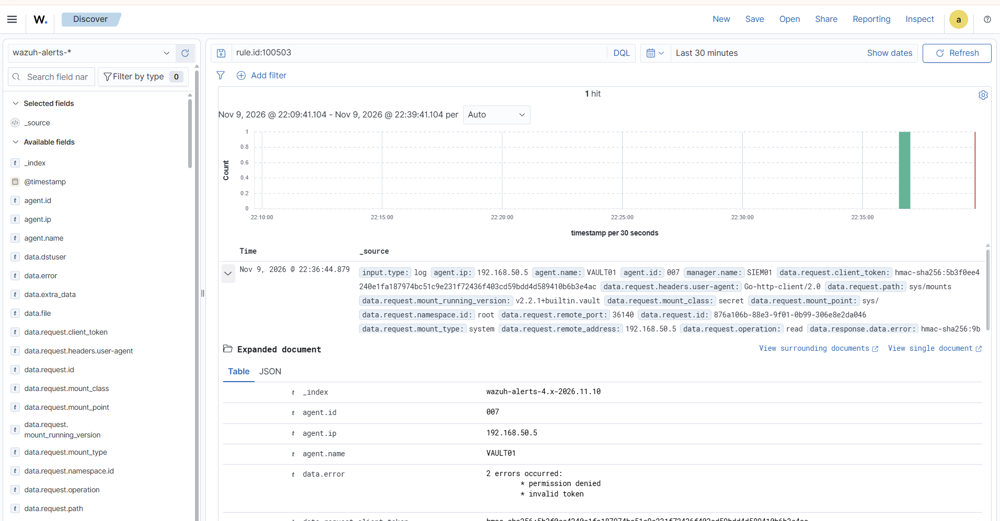
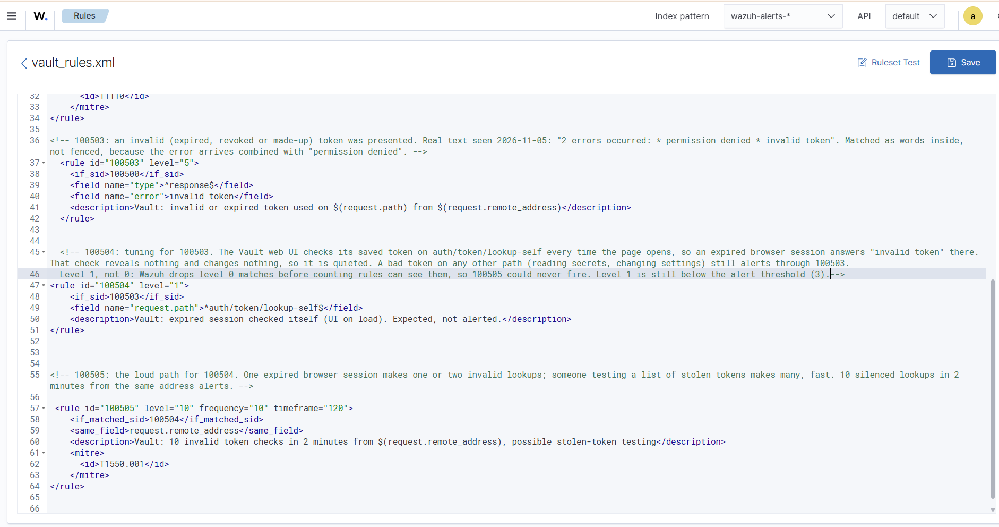
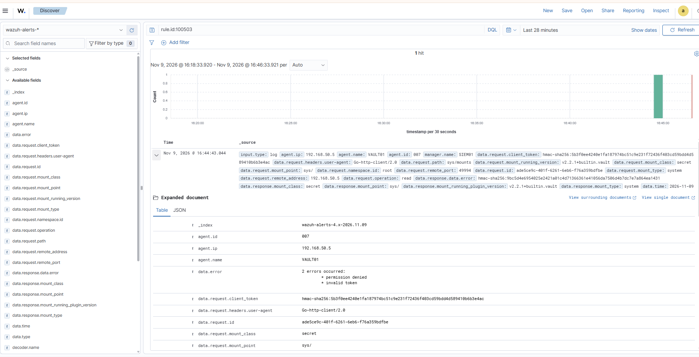

VAULT01 holds the secrets of the Biira Bank lab. It is HashiCorp Vault 2.2.1 on its own guest, with the other Tier 0 systems. It was initialised with five key shares, of which any three unseal it, it has a certificate from CA01, and its audit device was on from the start. It reports to the SIEM as Wazuh agent 007.

## What the audit log gives the SIEM

Vault records each call twice: once when the request arrives and once when the answer goes back. An error only appears on the answer, so every rule that reads an error checks that the line is a response.

Tokens and passwords never appear in the log in the clear. Vault replaces them with an HMAC, a one-way fingerprint, so one token can be followed across every event it touched without anyone seeing it.

Vault also refuses to act on anything it cannot write down, which is why the log is rotated daily or at 100 MB, with a reload that makes Vault reopen the file without resealing.

## Six rules, read as pairs

The Wazuh agent on VAULT01 follows the log as JSON through an agent group named `vault`. Six rules on SIEM01 read it.

| Rule | Level | Catches |
|---|---|---|
| 100500 | 0 | Every Vault line. Silent, and the parent of the rest |
| 100501 | 5 | A failed login |
| 100502 | 10 | Five failed logins in two minutes from one address (MITRE T1110) |
| 100503 | 5 | An invalid token used |
| 100504 | 1 | The web page checking its own expired session. Recorded, not alerted |
| 100505 | 10 | Ten of those in two minutes from one address (MITRE T1550.001) |

The collection setting lives once, in the group on the manager. Figure 12.1 is that setting, and Figure 12.2 shows VAULT01 as the group's first member.

*Figure 12.1: The agent group's whole configuration: read Vault's audit log as JSON. Any machine placed in the group inherits it.*

*Figure 12.2: VAULT01, agent 007, placed in the vault group.*

One event is a note. Many from the same place, fast, is an alarm. Rules 100501 and 100502 are that idea for passwords, and 100504 and 100505 for tokens.

## How it was proved

Every rule was tested by causing its event on VAULT01 and finding the result on SIEM01. Five wrong passwords gave four 100501 alerts and one 100502. A made-up token gave 100503, the same token on the session check stayed quiet, and ten in a row gave 100505. For rotation, I forced one, checked that Vault was writing into the new file, and watched the next alert arrive from it.

Figure 12.3 is a failed login raised by rule 100501, and Figure 12.4 is the made-up token raised by rule 100503. Figure 12.5 shows the rules as deployed, and Figure 12.6 is the alert that arrived after the rotation.

*Figure 12.3: Rule 100501 firing on a failed login, read from Vault's audit log. The account and the address are redacted.*

*Figure 12.4: Rule 100503: a made-up token refused by Vault and raised on SIEM01. The token appears only as its HMAC fingerprint.*

*Figure 12.5: The rules as deployed on the manager, each with a comment saying why it exists.*

*Figure 12.6: An alert from the new audit file, one minute after a forced log rotation. Nothing was lost in the handover.*

## What the build taught me

- **Write the rule from the log, not the screen.** The login page says "invalid username or password". The audit log says "invalid credentials". My first rule used the page's words and would never have fired.
- **A level 0 rule cannot be counted.** Wazuh drops a level 0 match before it reaches the memory that counting rules read, so the quiet rule is level 1: below the alert threshold, but remembered.

The full story is in the lab note [What Wazuh Hears When Vault Says No](/lab-notes/2026/11/09/what-wazuh-hears-when-vault-says-no.html). The first short-lived credentials follow.
